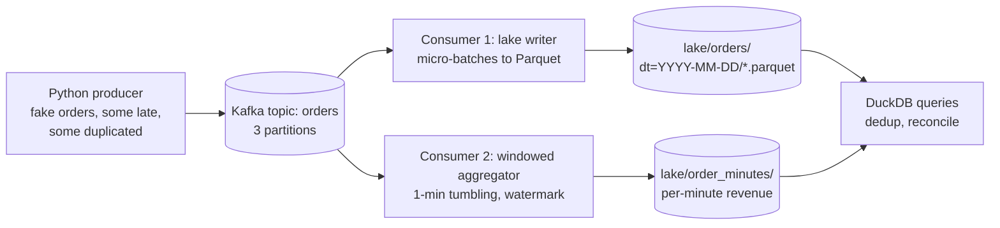

# Hands-On Project: Build a Streaming Pipeline

Stream events through Kafka into a partitioned Parquet lake, compute event-time windows with a watermark, handle late and duplicate events, and query the result with SQL. Then map the same design onto Amazon Kinesis and S3.

**Estimated Time:** 4-6 hours
**Difficulty:** Intermediate
**Prerequisites:** Python 3.11+, Docker, basic SQL. Read [Queues vs streams](../../learn/concepts/queues-vs-streams.md) and [Stream processing: windows and watermarks](../../learn/concepts/stream-processing-windows-and-watermarks.md) first.
**Cost:** Free for the local build. The optional AWS part costs a few dollars if you tear it down the same day.

---

## What you will build



The finished pipeline. One topic feeds two independent consumer groups: one lands every raw event in the lake, the other computes per-minute revenue by event time. DuckDB reads both to check that they agree.

By the end you can explain, with your own code as evidence:

- why two consumer groups can read the same stream independently, and replay it;
- why raw events are landed before anything is aggregated;
- how a watermark decides when a window is final, and what happens to late events;
- why duplicates appear under at-least-once delivery, and where you remove them.

---

## Step 1: Run Kafka locally

Kafka 4 runs without ZooKeeper (KRaft mode), so a single container is enough for development.

```bash
docker run -d --name kafka -p 9092:9092 apache/kafka:latest

# Create a topic with 3 partitions
docker exec kafka /opt/kafka/bin/kafka-topics.sh \
  --bootstrap-server localhost:9092 \
  --create --topic orders --partitions 3 --replication-factor 1

docker exec kafka /opt/kafka/bin/kafka-topics.sh \
  --bootstrap-server localhost:9092 --describe --topic orders
```

Set up a Python environment:

```bash
mkdir streaming-lab && cd streaming-lab
python3 -m venv .venv && source .venv/bin/activate
pip install confluent-kafka pyarrow duckdb
```

**Checkpoint:** `--describe` lists three partitions, each with a leader.

---

## Step 2: Produce realistic, messy events

Real streams are not tidy. This producer deliberately sends about 5% of events late (event time up to 3 minutes in the past) and about 2% twice, so the rest of the lab has something to handle.

```python
# producer.py
import json, random, time, uuid
from datetime import datetime, timedelta, timezone
from confluent_kafka import Producer

p = Producer({"bootstrap.servers": "localhost:9092", "enable.idempotence": True})
customers = [f"C-{i:04d}" for i in range(200)]

def make_event():
    now = datetime.now(timezone.utc)
    event_time = now
    if random.random() < 0.05:                      # late event
        event_time = now - timedelta(seconds=random.randint(30, 180))
    return {
        "event_id": str(uuid.uuid4()),
        "order_id": f"O-{random.randint(1, 10**9)}",
        "customer_id": random.choice(customers),
        "amount": round(random.uniform(5, 250), 2),
        "event_time": event_time.isoformat(),
    }

while True:
    e = make_event()
    payload = json.dumps(e).encode()
    # Key by customer: all of one customer's events go to one partition, in order
    p.produce("orders", key=e["customer_id"], value=payload)
    if random.random() < 0.02:                      # duplicate send
        p.produce("orders", key=e["customer_id"], value=payload)
    p.poll(0)
    time.sleep(0.05)                                # about 20 events per second
```

Run it in its own terminal: `python producer.py`.

Two choices to notice:

- **The key is `customer_id`.** Kafka hashes the key to pick a partition, so one customer's events stay in order. Ordering across customers is not guaranteed and not needed.
- **`event_id` is unique per event**, and a duplicate send repeats it. That id is what makes deduplication possible later. A stream without a unique event id cannot be deduplicated reliably.

**Checkpoint:** read a few messages back.

```bash
docker exec kafka /opt/kafka/bin/kafka-console-consumer.sh \
  --bootstrap-server localhost:9092 --topic orders --from-beginning --max-messages 5
```

---

## Step 3: Land raw events in the lake

The first consumer does no business logic at all. It writes every event, as received, to Parquet files partitioned by event date. This is the **bronze** layer: if any later step has a bug, you fix it and rebuild from here instead of asking the source to resend.

```python
# lake_writer.py
import json, os, time, uuid
import pyarrow as pa, pyarrow.parquet as pq
from confluent_kafka import Consumer

c = Consumer({
    "bootstrap.servers": "localhost:9092",
    "group.id": "lake-writer",
    "auto.offset.reset": "earliest",
    "enable.auto.commit": False,          # commit only after the file is written
})
c.subscribe(["orders"])

BATCH_SECONDS, BATCH_MAX = 30, 5000
buf, started = [], time.time()

def flush():
    global buf, started
    if not buf:
        return
    table = pa.Table.from_pylist(buf)
    by_day = {}
    for row in buf:
        by_day.setdefault(row["event_time"][:10], []).append(row)
    for day, rows in by_day.items():
        path = f"lake/orders/dt={day}"
        os.makedirs(path, exist_ok=True)
        pq.write_table(pa.Table.from_pylist(rows), f"{path}/{uuid.uuid4()}.parquet")
    c.commit(asynchronous=False)          # offsets advance only after data is safe
    print(f"flushed {table.num_rows} rows")
    buf, started = [], time.time()

try:
    while True:
        msg = c.poll(1.0)
        if msg is not None and not msg.error():
            row = json.loads(msg.value())
            row["_partition"], row["_offset"] = msg.partition(), msg.offset()
            buf.append(row)
        if len(buf) >= BATCH_MAX or time.time() - started >= BATCH_SECONDS:
            flush()
finally:
    flush()
    c.close()
```

Why it is built this way:

- **Commit after write.** If the process dies after writing a file but before committing, the batch is re-read and written again: duplicates, not loss. That is **at-least-once**, the safe default. Deduplication happens downstream, where it is easy.
- **Micro-batches, not one file per event.** Thousands of tiny files make every later query slow. Thirty seconds or 5,000 rows is a reasonable lab setting; production lakes compact files further. See [File formats and partitioning](../../learn/concepts/file-formats-and-partitioning.md).
- **Partition by event date** (`dt=`), so queries for one day read one folder.
- **Keep `_partition` and `_offset`.** They are the exact position in the stream, which is gold when debugging.

Run it: `python lake_writer.py`. After a minute you should see `flushed ...` lines and files under `lake/orders/`.

---

## Step 4: Compute event-time windows with a watermark

The second consumer, in a **different consumer group**, reads the same topic from the beginning without affecting the lake writer. It computes revenue per one-minute window by **event time**, using a watermark of "latest event time seen minus 60 seconds".

Real projects use Flink, Spark Structured Streaming or a managed service for this. Writing it once by hand shows you exactly what those engines do.

```python
# aggregator.py
import json, os, time
from collections import defaultdict
from datetime import datetime, timedelta
import pyarrow as pa, pyarrow.parquet as pq
from confluent_kafka import Consumer

ALLOWED_DELAY = timedelta(seconds=60)
c = Consumer({"bootstrap.servers": "localhost:9092", "group.id": "minute-agg",
              "auto.offset.reset": "earliest"})
c.subscribe(["orders"])

windows = defaultdict(lambda: {"revenue": 0.0, "orders": 0, "ids": set()})
max_event_time = None
late_count = 0
os.makedirs("lake/order_minutes", exist_ok=True)

def window_start(ts):
    return ts.replace(second=0, microsecond=0)

while True:
    msg = c.poll(1.0)
    if msg is None or msg.error():
        continue
    e = json.loads(msg.value())
    ts = datetime.fromisoformat(e["event_time"])
    max_event_time = ts if max_event_time is None else max(max_event_time, ts)
    watermark = max_event_time - ALLOWED_DELAY
    w = window_start(ts)

    if w + timedelta(minutes=1) <= watermark:     # this window already closed
        late_count += 1
        continue                                  # policy: drop, but count it

    win = windows[w]
    if e["event_id"] in win["ids"]:               # duplicate inside the window
        continue
    win["ids"].add(e["event_id"])
    win["revenue"] += e["amount"]
    win["orders"] += 1

    # Emit and forget every window whose end the watermark has passed
    for start in sorted(k for k in windows if k + timedelta(minutes=1) <= watermark):
        done = windows.pop(start)
        row = {"window_start": start.isoformat(), "orders": done["orders"],
               "revenue": round(done["revenue"], 2), "late_dropped_so_far": late_count}
        pq.write_table(pa.Table.from_pylist([row]),
                       f"lake/order_minutes/{start:%Y%m%dT%H%M}.parquet")
        print("closed", row)
```

Run it: `python aggregator.py`. Each line it prints is a window that the watermark has declared final.

Things to observe, and to be able to explain:

1. **A window closes about 60 seconds after it ends**, not at the end. That delay is the price of tolerating out-of-order events.
2. **Some late events are dropped** and `late_dropped_so_far` climbs. The producer sends some events up to 180 seconds late, and the watermark only waits 60. Change `ALLOWED_DELAY` to 200 seconds and the drops stop, while every result arrives later. That is the latency-versus-completeness trade from [the windows page](../../learn/concepts/stream-processing-windows-and-watermarks.md).
3. **The windows live in memory.** Kill the aggregator and restart it: its consumer group resumes from its committed offset, but the in-memory windows are lost. This is why real engines checkpoint state. A restart here can produce incomplete windows; write that down as a limitation of the hand-built version.
4. **Deduplication only works within one window's memory.** A duplicate whose twin landed in a window that already closed is not caught. Global dedup belongs in the lake, next step.

---

## Step 5: Query the lake, deduplicate, reconcile

DuckDB reads the Parquet folders directly. Start a shell with `python -c "import duckdb; duckdb.sql('...').show()"`, or install the DuckDB CLI.

```sql
-- How many raw events, and how many duplicates?
SELECT COUNT(*) AS events, COUNT(DISTINCT event_id) AS unique_events
FROM read_parquet('lake/orders/*/*.parquet', hive_partitioning = true);

-- A clean silver view: one row per event_id
CREATE OR REPLACE VIEW orders_clean AS
SELECT * EXCLUDE (rn) FROM (
  SELECT *, ROW_NUMBER() OVER (PARTITION BY event_id ORDER BY _partition, _offset) AS rn
  FROM read_parquet('lake/orders/*/*.parquet', hive_partitioning = true)
) WHERE rn = 1;

-- Recompute per-minute revenue in batch, from complete data
CREATE OR REPLACE VIEW minutes_batch AS
SELECT date_trunc('minute', CAST(event_time AS TIMESTAMPTZ)) AS window_start,
       COUNT(*) AS orders, ROUND(SUM(amount), 2) AS revenue
FROM orders_clean GROUP BY 1;

-- Compare the streaming result with the batch truth
SELECT b.window_start, b.revenue AS batch_revenue, s.revenue AS stream_revenue,
       ROUND(b.revenue - COALESCE(s.revenue, 0), 2) AS missing_in_stream
FROM minutes_batch b
LEFT JOIN read_parquet('lake/order_minutes/*.parquet') s
  ON CAST(s.window_start AS TIMESTAMPTZ) = b.window_start
ORDER BY b.window_start DESC
LIMIT 20;
```

The last query is the most important thing in this lab. The streaming numbers are **fast and slightly low** (late events were dropped). The batch numbers from the lake are **slow and complete**. Many production systems publish the first for dashboards and overwrite them with the second once a day. That is the [streaming analytics pattern](../architecture-patterns/streaming-analytics.md) in miniature.

**Checkpoint:** `unique_events` is about 2% lower than `events` (the duplicate sends). `missing_in_stream` is a small share of each minute's revenue, a few percent at most, from late events the watermark dropped. The newest minutes have no streaming result yet, because their windows are still open. (In the test run for this page: 2,856 events, 2,791 unique, and under 10% of each closed minute's revenue missing from the stream, except the first minute or two after start-up.)

---

## Step 6: Replay

Because Kafka keeps the log, you can reprocess history with new logic. Stop the aggregator, change `ALLOWED_DELAY` to 200 seconds, and start it in a **new** consumer group so it reads from the beginning:

```python
c = Consumer({"bootstrap.servers": "localhost:9092", "group.id": "minute-agg-v2",
              "auto.offset.reset": "earliest"})
```

Write its output to `lake/order_minutes_v2/` and rerun the reconciliation query against it. The gap shrinks. You just did a Kappa-style reprocess: new code, same log. A queue that deleted messages on read could not do this.

To reset an existing group instead:

```bash
docker exec kafka /opt/kafka/bin/kafka-consumer-groups.sh --bootstrap-server localhost:9092 \
  --group minute-agg --reset-offsets --to-earliest --topic orders --execute
```

(The group must have no running consumers when you reset it.)

---

## Step 7 (optional): The same design on AWS

The managed version swaps each piece for a service. Use the `--region` your account uses and delete everything afterwards.

| Local | AWS |
|---|---|
| Kafka topic | Kinesis Data Streams (or Amazon MSK for real Kafka) |
| Lake writer consumer | Amazon Data Firehose: buffers, converts JSON to Parquet, writes to S3 by date |
| `lake/` folder | S3 bucket, with a Glue Data Catalog table over it |
| Aggregator | Amazon Managed Service for Apache Flink (Flink SQL as in the concept page) |
| DuckDB | Amazon Athena |

```bash
aws kinesis create-stream --stream-name orders --shard-count 1 --region us-east-1
aws s3 mb s3://YOUR-BUCKET-streaming-lab --region us-east-1
```

Then, in the console (the CLI form needs a long JSON document):

1. Create a **Glue database** and a **table** describing the order fields; Firehose uses it as the Parquet schema.
2. Create a **Firehose stream**: source = the Kinesis stream, destination = the S3 bucket, enable **record format conversion** to Parquet using the Glue table, buffer 60 seconds, S3 prefix `orders/dt=!{timestamp:yyyy-MM-dd}/`.
3. Change the producer to `boto3.client("kinesis").put_record(StreamName="orders", Data=payload, PartitionKey=e["customer_id"])`.
4. Query in **Athena** with the same SQL as step 5 (`FROM` the Glue table instead of `read_parquet`).

Note that Firehose partitions by **arrival** time unless you configure dynamic partitioning on the event's own timestamp. Arrival-time partitions are a common source of "the late events are in tomorrow's folder" confusion.

**Tear down:** delete the Firehose stream, the Kinesis stream, and empty and delete the bucket. Kinesis shards and Flink applications bill by the hour while they exist.

---

## Extensions

- Replace the hand-written aggregator with **Flink SQL** (the `TUMBLE` example in [the windows page](../../learn/concepts/stream-processing-windows-and-watermarks.md)) or **Spark Structured Streaming**, and compare results.
- Write the lake as an **Iceberg or Delta table** instead of loose Parquet, so the dedup can be a `MERGE` and readers get atomic commits.
- Add a **schema registry** and an Avro schema, then try a breaking change. See [Data contracts](../../learn/concepts/data-contracts.md).
- Add a **data quality check** that fails when `late_dropped_so_far` exceeds 1% of events in an hour.
- Feed the stream from a real database with **Debezium** instead of a fake producer. See [Change data capture](../../learn/concepts/change-data-capture.md).

## What to put in your README

Explain the two consumer groups, the commit-after-write choice, your watermark setting and its measured cost in dropped events, and the reconciliation result. "Streaming revenue was within 0.4% of batch with a 60-second watermark; 200 seconds closed the gap and delayed every window by 3 minutes" is the kind of sentence that gets attention in an interview.

## Related

- [Batch vs streaming](../../learn/concepts/batch-vs-streaming.md) - whether this pipeline should be streaming at all
- [Messaging and queue services across clouds](../service-comparison-messaging-queues.md) - Kafka, Kinesis, Event Hubs and Pub/Sub compared
- [Build a data pipeline](./build-data-pipeline.md) - the batch counterpart
- [Confluent Certified Developer](../../exams/confluent/certified-developer/) - the Kafka developer exam this lab supports

## Official docs

- **[📖 Apache Kafka quickstart](https://kafka.apache.org/quickstart)** - running a broker, topics, console producer and consumer
- **[📖 confluent-kafka Python client](https://docs.confluent.io/kafka-clients/python/current/overview.html)** - producer and consumer configuration used here
- **[📖 Amazon Data Firehose: Convert input data format](https://docs.aws.amazon.com/firehose/latest/dev/record-format-conversion.html)** - JSON to Parquet on delivery to S3
- **[📖 DuckDB: Reading Parquet files](https://duckdb.org/docs/stable/data/parquet/overview)** - `read_parquet` and hive partitioning
