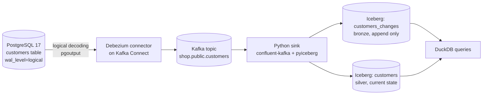

# Hands-On Project: Change Data Capture with Debezium into a Lakehouse

Capture every insert, update and delete from a PostgreSQL table with Debezium, carry the events through Kafka, and land them in two Iceberg tables: an append-only history of every change and a current-state table kept in step with the source. You will watch an update, a delete and a replay happen, and see exactly where the traps are.

**Estimated Time:** 3-4 hours
**Difficulty:** Advanced
**Prerequisites:** Docker with Compose, Python 3.10+ and `uv` (or `venv`), basic SQL. Read [Change data capture](../../learn/concepts/change-data-capture.md) first, and do [Build an Iceberg lakehouse locally](./iceberg-lakehouse-local.md) so the table format is familiar. The design this implements is [CDC into a lakehouse](../architecture-patterns/cdc-to-lakehouse.md).
**Cost:** Free. Everything runs in local containers and a local folder.
**Tested:** 2026-11-07 end to end: PostgreSQL 17.11, Debezium Connect 3.6.3.Final (`quay.io/debezium/connect:3.6`, which reported Kafka Connect 4.3.0), Apache Kafka 4.3.1 (`apache/kafka:latest` on the test day, so pin a tag when you repeat this), pyiceberg 0.12.0, confluent-kafka 2.16.1, DuckDB 2.0.0. Every command and every output block below comes from that run.

---

## What you will build



A change in PostgreSQL is read from its write-ahead log by Debezium, published to Kafka as an event with a `before` and `after` image, and applied by a small Python sink to two Iceberg tables. The sink commits its Kafka offset only after both tables are written.

---

## Step 1: Start the stack

Save as `compose.yaml`. Kafka has two listeners: `kafka:9092` for containers (Debezium), and `localhost:29092` for the Python sink on your machine.

```yaml
services:
  postgres:
    image: postgres:17
    environment:
      POSTGRES_PASSWORD: pw
      POSTGRES_DB: shop
    command: ["postgres", "-c", "wal_level=logical"]
  kafka:
    image: apache/kafka:latest
    ports: ["29092:29092"]
    environment:
      KAFKA_NODE_ID: 1
      KAFKA_PROCESS_ROLES: broker,controller
      KAFKA_LISTENERS: INTERNAL://:9092,EXTERNAL://:29092,CONTROLLER://:9093
      KAFKA_ADVERTISED_LISTENERS: INTERNAL://kafka:9092,EXTERNAL://localhost:29092
      KAFKA_LISTENER_SECURITY_PROTOCOL_MAP: INTERNAL:PLAINTEXT,EXTERNAL:PLAINTEXT,CONTROLLER:PLAINTEXT
      KAFKA_INTER_BROKER_LISTENER_NAME: INTERNAL
      KAFKA_CONTROLLER_LISTENER_NAMES: CONTROLLER
      KAFKA_CONTROLLER_QUORUM_VOTERS: 1@kafka:9093
      KAFKA_OFFSETS_TOPIC_REPLICATION_FACTOR: 1
      KAFKA_TRANSACTION_STATE_LOG_REPLICATION_FACTOR: 1
      KAFKA_TRANSACTION_STATE_LOG_MIN_ISR: 1
  connect:
    image: quay.io/debezium/connect:3.6
    ports: ["8083:8083"]
    depends_on: [kafka, postgres]
    environment:
      BOOTSTRAP_SERVERS: kafka:9092
      GROUP_ID: "1"
      CONFIG_STORAGE_TOPIC: connect_configs
      OFFSET_STORAGE_TOPIC: connect_offsets
      STATUS_STORAGE_TOPIC: connect_statuses
```

```bash
docker compose -p cdclab up -d
# Wait about 40 seconds, then:
curl -s localhost:8083/
```

```text
{"version":"4.3.0","commit":"a9ce3221537b8653","kafka_cluster_id":"5L6g3nShT-eMCtK--X86sw"}
```

That is the Kafka Connect REST API answering. `wal_level=logical` on PostgreSQL is what lets Debezium read changes; without it the connector fails at start.

## Step 2: Create the source table (and choose its replica identity)

```bash
docker compose -p cdclab exec -T postgres psql -U postgres -d shop <<'SQL'
create table customers(
  id int primary key, name text not null, plan text not null,
  updated_at timestamptz not null default now());
alter table customers replica identity full;
insert into customers(id,name,plan) values (1,'Ada','free'),(2,'Grace','pro'),(3,'Linus','free');
SQL
```

The `replica identity full` line matters, and you will see why in Step 6. By default PostgreSQL writes only the primary key of the old row into the log for updates and deletes.

## Step 3: Register the connector

Save as `connector.json`:

```json
{
  "name": "shop-connector",
  "config": {
    "connector.class": "io.debezium.connector.postgresql.PostgresConnector",
    "database.hostname": "postgres",
    "database.port": "5432",
    "database.user": "postgres",
    "database.password": "pw",
    "database.dbname": "shop",
    "topic.prefix": "shop",
    "table.include.list": "public.customers",
    "plugin.name": "pgoutput",
    "key.converter": "org.apache.kafka.connect.json.JsonConverter",
    "key.converter.schemas.enable": "false",
    "value.converter": "org.apache.kafka.connect.json.JsonConverter",
    "value.converter.schemas.enable": "false"
  }
}
```

```bash
curl -s -X POST -H "Content-Type: application/json" localhost:8083/connectors -d @connector.json
sleep 10
curl -s localhost:8083/connectors/shop-connector/status
```

```text
{"name":"shop-connector","connector":{"state":"RUNNING","worker_id":"172.28.0.4:8083","version":"3.6.3.Final"},"tasks":[{"id":0,"state":"RUNNING","worker_id":"172.28.0.4:8083","version":"3.6.3.Final"}],"type":"source"}
```

`topic.prefix` plus schema and table gives the topic name, `shop.public.customers`. The JSON converter with `schemas.enable=false` keeps events small and readable; production setups usually use a schema registry with Avro or Protobuf instead.

## Step 4: Set up the Python sink

```bash
mkdir cdc-lab && cd cdc-lab
uv venv --python 3.12 .venv && source .venv/bin/activate
uv pip install "pyiceberg[sql-sqlite,pyarrow,pyiceberg-core]" confluent-kafka duckdb
mkdir lake
```

Save as `sink.py`. It reads events until the topic is idle, writes the batch to the bronze table, collapses the batch to the latest event per key for silver, and only then commits the Kafka offset.

```python
"""Debezium events on Kafka -> two Iceberg tables.

customers_changes  bronze: every change event, append-only (the history)
customers          silver: current state, upsert and delete by id
"""
import json
import os
import sys
from datetime import datetime

import pyarrow as pa
from confluent_kafka import Consumer
from pyiceberg.catalog.sql import SqlCatalog
from pyiceberg.expressions import In
from pyiceberg.schema import Schema
from pyiceberg.types import LongType, NestedField, StringType, TimestamptzType

TOPIC = "shop.public.customers"
IDLE_SECONDS = float(sys.argv[1]) if len(sys.argv) > 1 else 8.0

catalog = SqlCatalog(
    "local",
    uri="sqlite:///lake/catalog.db",
    warehouse="file://" + os.path.abspath("lake/warehouse"),
)
catalog.create_namespace_if_not_exists("shop")

ARROW_CUSTOMERS = pa.schema([
    pa.field("id", pa.int64(), nullable=False),
    pa.field("name", pa.string()),
    pa.field("plan", pa.string()),
    pa.field("updated_at", pa.timestamp("us", tz="UTC")),
])
ARROW_CHANGES = pa.schema([
    pa.field("lsn", pa.int64(), nullable=False),
    pa.field("op", pa.string()),
    pa.field("id", pa.int64()),
    pa.field("name", pa.string()),
    pa.field("plan", pa.string()),
    pa.field("updated_at", pa.timestamp("us", tz="UTC")),
])

def get_or_create(name, fields):
    if catalog.table_exists(name):
        return catalog.load_table(name)
    return catalog.create_table(name, schema=Schema(*fields))

silver = get_or_create("shop.customers", [
    NestedField(1, "id", LongType(), required=True),
    NestedField(2, "name", StringType()),
    NestedField(3, "plan", StringType()),
    NestedField(4, "updated_at", TimestamptzType()),
])
bronze = get_or_create("shop.customers_changes", [
    NestedField(1, "lsn", LongType(), required=True),
    NestedField(2, "op", StringType()),
    NestedField(3, "id", LongType()),
    NestedField(4, "name", StringType()),
    NestedField(5, "plan", StringType()),
    NestedField(6, "updated_at", TimestamptzType()),
])

def ts(v):
    return datetime.fromisoformat(v.replace("Z", "+00:00")) if v else None

consumer = Consumer({
    "bootstrap.servers": "localhost:29092",
    "group.id": "iceberg-sink",
    "auto.offset.reset": "earliest",
    "enable.auto.commit": False,
})
consumer.subscribe([TOPIC])

events, idle_since = [], datetime.now()
while True:
    msg = consumer.poll(1.0)
    if msg is None:
        if events or (datetime.now() - idle_since).total_seconds() > IDLE_SECONDS:
            if not events:
                break
            # flush a batch
            events.sort(key=lambda e: e["source"]["lsn"])
            rows = []
            for e in events:
                row = e["after"] or e["before"]
                rows.append({"lsn": e["source"]["lsn"], "op": e["op"], "id": row["id"],
                             "name": row["name"], "plan": row["plan"], "updated_at": ts(row["updated_at"])})
            bronze.append(pa.Table.from_pylist(rows, schema=ARROW_CHANGES))

            latest = {}
            for e in events:                      # sorted by lsn, so the last one wins
                latest[(e["after"] or e["before"])["id"]] = e
            deletes = [k for k, e in latest.items() if e["op"] == "d"]
            upserts = [e["after"] for e in latest.values() if e["op"] != "d"]
            if deletes:
                silver.delete(In("id", deletes))
            if upserts:
                silver.upsert(pa.Table.from_pylist(
                    [{**u, "updated_at": ts(u["updated_at"])} for u in upserts], schema=ARROW_CUSTOMERS),
                    join_cols=["id"])
            consumer.commit(asynchronous=False)    # commit only after both tables are written
            print(f"applied {len(events)} events: {len(upserts)} upserts, {len(deletes)} deletes")
            events, idle_since = [], datetime.now()
        continue
    if msg.error():
        print("consumer error:", msg.error()); continue
    if msg.value() is None:                       # tombstone after a delete: skip
        continue
    events.append(json.loads(msg.value()))
    idle_since = datetime.now()
consumer.close()
```

Save this helper as `show.py`:

```python
import os, duckdb, glob
con = duckdb.connect(); con.sql("INSTALL iceberg; LOAD iceberg;")
def latest(t): return os.path.abspath(sorted(glob.glob(f"lake/warehouse/shop/{t}/metadata/*.metadata.json"))[-1])
print(con.sql(f"select id, name, plan from iceberg_scan('{latest('customers')}') order by id"))
print(con.sql(f"select lsn, op, id, plan from iceberg_scan('{latest('customers_changes')}') order by lsn"))
```

## Step 5: Run the snapshot

The first run reads the three existing rows. Debezium took an initial **snapshot** and emitted them as `op = "r"` (read) events.

```bash
python sink.py 6
python show.py
```

```text
applied 3 events: 3 upserts, 0 deletes
┌───────┬─────────┬─────────┐
│  id   │  name   │  plan   │
│ int64 │ varchar │ varchar │
├───────┼─────────┼─────────┤
│     1 │ Ada     │ free    │
│     2 │ Grace   │ pro     │
│     3 │ Linus   │ free    │
└───────┴─────────┴─────────┘

┌──────────┬─────────┬───────┬─────────┐
│   lsn    │   op    │  id   │  plan   │
│  int64   │ varchar │ int64 │ varchar │
├──────────┼─────────┼───────┼─────────┤
│ 26822384 │ r       │     1 │ free    │
│ 26822384 │ r       │     2 │ pro     │
│ 26822384 │ r       │     3 │ free    │
└──────────┴─────────┴───────┴─────────┘
```

## Step 6: Make changes and watch them arrive

```bash
docker compose -p cdclab exec -T postgres psql -U postgres -d shop <<'SQL'
update customers set plan='pro',  updated_at=now() where id=1;
update customers set plan='team', updated_at=now() where id=1;
delete from customers where id=3;
insert into customers(id,name,plan) values (4,'Barbara','free');
SQL
python sink.py 6
python show.py
```

```text
applied 4 events: 2 upserts, 1 deletes
┌───────┬─────────┬─────────┐
│  id   │  name   │  plan   │
│ int64 │ varchar │ varchar │
├───────┼─────────┼─────────┤
│     1 │ Ada     │ team    │
│     2 │ Grace   │ pro     │
│     4 │ Barbara │ free    │
└───────┴─────────┴─────────┘

┌──────────┬─────────┬───────┬─────────┐
│   lsn    │   op    │  id   │  plan   │
│  int64   │ varchar │ int64 │ varchar │
├──────────┼─────────┼───────┼─────────┤
│ 26822384 │ r       │     1 │ free    │
│ 26822384 │ r       │     2 │ pro     │
│ 26822384 │ r       │     3 │ free    │
│ 26822480 │ u       │     1 │ pro     │
│ 26822648 │ u       │     1 │ team    │
│ 26822816 │ d       │     3 │ free    │
│ 26822952 │ c       │     4 │ free    │
└──────────┴─────────┴───────┴─────────┘
```

Read the two tables side by side:

- **Silver** (`customers`) matches the source: Ada is on `team`, Linus is gone, Barbara is new. The two updates to Ada were collapsed to the last one inside the batch.
- **Bronze** (`customers_changes`) kept all seven events. Ada's whole history is there, and Linus's delete is a row with `op = d` instead of a missing row. This is the history you would lose if you only mirrored current state.

### The replica identity trap

Before this project's final run we tried the default replica identity. With the default, the `before` image of an update was `null`, and the delete event's `before` held only the key. The non-key columns came through as placeholders (`''` for text, and `1970-01-01` for the timestamp), which would be wrong data if you stored them. Using `replica identity full` gives complete `before` images, at the price of a larger log. The alternative is to key everything off the primary key, as the sink above does for deletes, and ignore the other `before` columns.

Also expect a **tombstone** after every delete: a message with the same key and a null value, there so Kafka log compaction can drop the key. The sink skips null values.

## Step 7: Prove replays are safe (and see what is not)

A sink that crashes after writing but before committing its offset will read the same events again. Simulate that by resetting the consumer group to the start and rerunning:

```bash
docker compose -p cdclab exec -T kafka /opt/kafka/bin/kafka-consumer-groups.sh \
  --bootstrap-server kafka:9092 --group iceberg-sink --topic shop.public.customers \
  --reset-offsets --to-earliest --execute
python sink.py 6
python show.py
```

```text
applied 7 events: 3 upserts, 1 deletes
```

pyiceberg also printed `UserWarning: Delete operation did not match any records`, because Linus was already gone. The silver table printed the same three rows as before: Ada on `team`, Grace, Barbara. **Silver is idempotent**, because upserts and deletes by key give the same end state however many times you apply them. **Bronze is not**: every event now appears twice (14 rows). Fix it by deduplicating on `(lsn, id)`, either when reading (`select distinct`), or by merging into bronze on that key instead of appending. This delivery guarantee is at-least-once; the table design turns it into effectively-once. See [Idempotency explained](https://cloud.noblerworks.com/learn/concepts/idempotency-explained/).

---

## What to measure and what to watch in production

- **Connector lag and state.** The REST status endpoint shows `RUNNING` or `FAILED`; alert on anything else. Lag between PostgreSQL and the sink is the Kafka consumer lag of the sink's group, see [Kafka consumer lag](../troubleshooting/kafka-consumer-lag.md).
- **Replication slot growth.** Debezium holds a replication slot on PostgreSQL. If the connector stops, the slot makes the database keep WAL, and its disk fills. See [Replication lag](../troubleshooting/replication-lag.md#cause-1-replica-disconnected-primary-keeps-wal-for-it).
- **Schema changes.** Adding a column on the source changes the event shape; decide how the sink reacts before it happens. See [Data contracts](../../learn/concepts/data-contracts.md).
- **Small files.** One Iceberg commit per batch makes many small files; compact them. See [Build an Iceberg lakehouse locally](./iceberg-lakehouse-local.md).

## Clean up

```bash
docker compose -p cdclab down -v
deactivate; cd .. && rm -rf cdc-lab
```

## Where this runs in the cloud

| This lab | Managed alternatives |
|---|---|
| Debezium on Kafka Connect | AWS DMS, Google Datastream, Azure Data Factory change data capture, Databricks Lakeflow Connect, Fabric mirroring; see [Change data capture](../../learn/concepts/change-data-capture.md#the-managed-options) |
| Kafka | Amazon MSK, Confluent Cloud, Azure Event Hubs (Kafka endpoint), see [Messaging services compared](../service-comparison-messaging-queues.md) |
| Python sink to Iceberg | Kafka Connect Iceberg sink, Spark Structured Streaming, Flink, or the vendor's CDC apply (for example Delta `MERGE INTO`) |

These are pointers to categories, not tested equivalents.

## Extensions

- Add `op = "d"` handling as a **soft delete** (an `is_deleted` flag and `deleted_at`) instead of removing the row.
- Run Debezium's **incremental snapshot** to re-read one table while streaming continues. Not run here; see the Debezium docs.
- Replace the single-threaded sink with Spark Structured Streaming `foreachBatch` and a `MERGE`.

## Related

- [Change data capture](../../learn/concepts/change-data-capture.md) - the concepts behind every step
- [CDC into a lakehouse](../architecture-patterns/cdc-to-lakehouse.md) - the reference pattern
- [Build a streaming pipeline](./build-streaming-pipeline.md) - Kafka basics, windows and watermarks
- [Replication lag](../troubleshooting/replication-lag.md) and [Kafka consumer lag](../troubleshooting/kafka-consumer-lag.md)

## Official docs

- **[📖 Debezium: PostgreSQL connector](https://debezium.io/documentation/reference/stable/connectors/postgresql.html)** - configuration, snapshots, replica identity and event format
- **[📖 Debezium: Tutorial](https://debezium.io/documentation/reference/stable/tutorial.html)** - the container-based quickstart this lab adapts
- **[📖 PostgreSQL: Logical Decoding](https://www.postgresql.org/docs/current/logicaldecoding.html)** - what Debezium reads from
- **[📖 PostgreSQL: REPLICA IDENTITY (ALTER TABLE)](https://www.postgresql.org/docs/current/sql-altertable.html)** - what the log records for old rows
- **[📖 Apache Kafka: Documentation](https://kafka.apache.org/documentation/)** - broker, listeners and consumer groups
- **[📖 PyIceberg: Getting started](https://py.iceberg.apache.org/)** - the catalog and table API used by the sink
