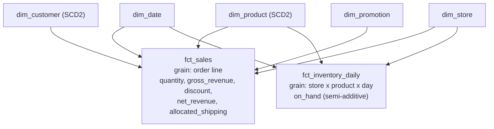

# Hands-On Project: Design a Star Schema

Take a small business from a list of questions to a working dimensional model: a bus matrix, declared grains, two kinds of fact table, a Type 2 dimension, and SQL that proves the design answers the questions without double-counting.

**Estimated Time:** 2-3 hours
**Difficulty:** Intermediate
**Prerequisites:** Comfortable SQL including joins. Read [Data modeling for analytics](../../learn/concepts/data-modeling-for-analytics.md) and [Slowly changing dimensions](../../learn/concepts/slowly-changing-dimensions.md) first.
**Tools:** Pen and paper, then [DuckDB](https://duckdb.org/) (a single binary, or `pip install duckdb`). No cloud account.

This project is about **design decisions**. The follow-up, [Build a dbt project](./build-dbt-project.md), implements a model like this one as tested, version-controlled code.

---

## The business

**Spokes & Sprockets** sells bicycle parts online and from two physical shops. Its operational database has these tables (simplified):

```text
customers(customer_id, name, email, city, country, segment, updated_at)
products(product_id, sku, name, category, brand, list_price, updated_at)
stores(store_id, name, channel)              -- 'web', 'shop-london', 'shop-leeds'
orders(order_id, customer_id, store_id, ordered_at, shipping_fee, promo_code)
order_lines(order_id, line_no, product_id, quantity, unit_price, discount)
inventory_counts(store_id, product_id, counted_on, on_hand)   -- one row per day
```

The managing director's questions:

1. Revenue and units by product category, by month, by channel.
2. Average order value by customer segment, **as the segment was at the time of the order**.
3. Which promotions drive revenue, and which just give away margin?
4. Stock on hand at the end of each month, by store and category.
5. How many products had zero sales in a month?

---

## Step 1: Start from business processes, not tables

Kimball's method begins by naming **business processes** - events the business measures - because each one usually becomes one fact table.

Read the questions again and list the processes:

- **Selling** (questions 1, 2, 3, 5): an order line being sold.
- **Inventory** (question 4): stock being counted.

Shipping fees and promotions are not separate processes here; they are properties of selling. Resist making a fact table per source table.

---

## Step 2: Draw the bus matrix

A **bus matrix** lists processes as rows and the dimensions they share as columns. Shared columns are **conformed dimensions**: one `dim_product` used by both facts, so "sales vs stock by category" lines up exactly.

| Process | Date | Customer | Product | Store | Promotion |
|---|---|---|---|---|---|
| Sales (order lines) | X | X | X | X | X |
| Inventory (daily count) | X | | X | X | |

Two facts, five dimensions, three of them conformed. On a real project this one table is the most useful planning document you will produce: it shows every team which dimensions must be shared and agreed.

---

## Step 3: Declare the grain of each fact

Write the grain as a sentence before naming any column.

- **`fct_sales`**: one row per **order line**. (Not per order: question 1 needs product, and an order has many products.)
- **`fct_inventory_daily`**: one row per **store, product and day**.

These are two of the three classic fact types:

| Type | Grain | Example here | Additive? |
|---|---|---|---|
| **Transaction** | One row per event | `fct_sales` | Fully: sum across any dimension |
| **Periodic snapshot** | One row per thing per period | `fct_inventory_daily` | **Semi-additive**: sum across stores and products, never across days |
| **Accumulating snapshot** | One row per process instance, updated as it moves through milestones | An order with ordered, paid, shipped, delivered dates | Duration measures |

The semi-additive point matters. Summing `on_hand` across 31 days of October gives a meaningless number 31 times too big. For a month you take the **last** day's value (or an average).

---

## Step 4: Handle the measure that does not fit the grain

`shipping_fee` lives on the **order**, but `fct_sales` is at the **order line**. This is the most common star-schema bug in the wild.

If you copy the order's fee onto every line, an order with 4 lines counts its fee 4 times. The options:

1. **Allocate** the fee across lines, for example in proportion to line revenue, so the lines sum back to the order's fee exactly.
2. **Keep a separate order-grain fact** (`fct_orders`) for order-level measures.
3. Leave the fee out of the line fact and say so.

For this project, allocate. Write down the allocation rule; finance will ask.

```sql
-- allocated_shipping = shipping_fee * line_revenue / order_revenue
```

---

## Step 5: Design the dimensions

For each dimension, decide the attributes and the change policy for each one.

**`dim_customer`** - a Type 2 dimension, because question 2 needs the segment **as it was**.

| Column | Notes |
|---|---|
| `customer_key` | Surrogate key, one per version |
| `customer_id` | Natural key from the source |
| `name`, `email` | Type 1: corrections overwrite. `email` is PII; mark it |
| `city`, `country`, `segment` | **Type 2**: a change creates a new version |
| `valid_from`, `valid_to`, `is_current` | Version bookkeeping, half-open interval |

**`dim_product`** - Type 2 on `category` and `brand` (recategorizations must not rewrite last year's category report), Type 1 on `name`. `list_price` is better treated as a fact-side measure (`unit_price` on the line) than a dimension attribute.

**`dim_store`** - small and stable: `store_key`, `store_id`, `name`, `channel`. Type 1.

**`dim_promotion`** - one row per promo code, plus one row for "no promotion". Never leave the foreign key `NULL`; a real "none" member keeps inner joins from silently dropping un-promoted sales.

**`dim_date`** - one row per calendar day, generated, not extracted: `date_key`, `date_day`, `month`, `quarter`, `year`, `day_of_week`, `is_weekend`, `fiscal_period`. A date dimension lets every report group by fiscal period or weekend without date arithmetic.

---

## Step 6: Draw the schema



Two fact tables sharing three conformed dimensions (date, product, store). The sales fact also uses customer and promotion; the inventory fact does not, exactly as the bus matrix said.

---

## Step 7: Build it in DuckDB

Create the tables and some sample data. Run `duckdb spokes.duckdb` and paste:

```sql
CREATE TABLE dim_date AS
SELECT CAST(strftime(d, '%Y%m%d') AS INTEGER) AS date_key,
       CAST(d AS DATE) AS date_day,
       year(d) AS year, quarter(d) AS quarter, month(d) AS month,
       strftime(d, '%Y-%m') AS year_month,
       dayofweek(d) IN (0, 6) AS is_weekend
FROM generate_series(DATE '2025-01-01', DATE '2026-12-31', INTERVAL 1 DAY) AS t(d);

CREATE TABLE dim_customer (
  customer_key INTEGER PRIMARY KEY, customer_id VARCHAR, name VARCHAR,
  country VARCHAR, segment VARCHAR,
  valid_from DATE, valid_to DATE, is_current BOOLEAN);

INSERT INTO dim_customer VALUES
 (1, 'C-1', 'Ana',  'DE', 'hobbyist', '2024-01-01', '2026-06-30', false),
 (2, 'C-1', 'Ana',  'FR', 'pro',      '2026-06-30', '9999-12-31', true),
 (3, 'C-2', 'Ben',  'GB', 'pro',      '2024-01-01', '9999-12-31', true);

CREATE TABLE dim_product (product_key INTEGER PRIMARY KEY, product_id VARCHAR,
  name VARCHAR, category VARCHAR, brand VARCHAR);
INSERT INTO dim_product VALUES
 (10, 'P-1', 'Chain 11s', 'drivetrain', 'Shimano'),
 (11, 'P-2', 'Brake pads', 'brakes', 'SRAM');

CREATE TABLE dim_store (store_key INTEGER PRIMARY KEY, store_id VARCHAR, channel VARCHAR);
INSERT INTO dim_store VALUES (100, 'web', 'online'), (101, 'shop-london', 'retail');

CREATE TABLE dim_promotion (promotion_key INTEGER PRIMARY KEY, promo_code VARCHAR);
INSERT INTO dim_promotion VALUES (0, 'NONE'), (1, 'SPRING10');

CREATE TABLE fct_sales (
  order_id VARCHAR, line_no INTEGER,
  date_key INTEGER, customer_key INTEGER, product_key INTEGER,
  store_key INTEGER, promotion_key INTEGER,
  quantity INTEGER, gross_revenue DECIMAL(10,2), discount DECIMAL(10,2),
  net_revenue DECIMAL(10,2), allocated_shipping DECIMAL(10,2));

INSERT INTO fct_sales VALUES
 ('O-1', 1, 20260315, 1, 10, 100, 1, 2, 60.00, 6.00, 54.00, 3.60),
 ('O-1', 2, 20260315, 1, 11, 100, 1, 1, 30.00, 3.00, 27.00, 1.40),
 ('O-2', 1, 20260901, 2, 10, 101, 0, 1, 30.00, 0.00, 30.00, 0.00),
 ('O-3', 1, 20260902, 3, 11, 100, 0, 4, 120.00, 0.00, 120.00, 5.00);

CREATE TABLE fct_inventory_daily (date_key INTEGER, product_key INTEGER,
  store_key INTEGER, on_hand INTEGER);
INSERT INTO fct_inventory_daily VALUES
 (20260930, 10, 100, 40), (20260930, 11, 100, 25),
 (20261030, 10, 100, 35), (20261031, 10, 100, 32), (20261031, 11, 100, 20);
```

Note that order O-1 (March) points at customer version 1 (Germany, hobbyist), and O-2 (September) at version 2 (France, pro). That is the Type 2 lookup done at load time.

---

## Step 8: Prove the design answers the questions

**Question 1 - revenue by category, month and channel:**

```sql
SELECT d.year_month, p.category, s.channel, SUM(f.net_revenue) AS revenue
FROM fct_sales f
JOIN dim_date d    USING (date_key)
JOIN dim_product p USING (product_key)
JOIN dim_store s   USING (store_key)
GROUP BY ALL ORDER BY ALL;
```

**Question 2 - average order value by segment at the time.** The grain is order line, so aggregate to orders first, then average:

```sql
WITH orders AS (
  SELECT f.order_id, c.segment, SUM(f.net_revenue) AS order_value
  FROM fct_sales f JOIN dim_customer c USING (customer_key)
  GROUP BY ALL
)
SELECT segment, AVG(order_value) AS aov FROM orders GROUP BY segment;
```

Averaging `net_revenue` directly would give average **line** value, a different and smaller number. Grain again.

To answer "by **current** segment" instead, join through the natural key to the current row:

```sql
SELECT cur.segment, SUM(f.net_revenue)
FROM fct_sales f
JOIN dim_customer v   ON v.customer_key = f.customer_key
JOIN dim_customer cur ON cur.customer_id = v.customer_id AND cur.is_current
GROUP BY ALL;
```

**Question 4 - month-end stock (semi-additive):**

```sql
SELECT d.year_month, p.category, SUM(i.on_hand) AS month_end_on_hand
FROM fct_inventory_daily i
JOIN dim_date d USING (date_key)
JOIN dim_product p USING (product_key)
WHERE d.date_day = last_day(d.date_day)
GROUP BY ALL;
```

**Question 5 - products with zero sales in a month.** The sales fact has no rows for things that did not happen, so build the full set of product-months and anti-join:

```sql
SELECT m.year_month, p.name
FROM (SELECT DISTINCT year_month FROM dim_date WHERE year = 2026) m
CROSS JOIN dim_product p
WHERE NOT EXISTS (
  SELECT 1 FROM fct_sales f JOIN dim_date d USING (date_key)
  WHERE f.product_key = p.product_key AND d.year_month = m.year_month);
```

---

## Step 9: Write the tests your design implies

Every design decision above implies a check. Write each as a query that should return zero rows:

```sql
-- Dimension keys are unique (no fan-out on join)
SELECT customer_key FROM dim_customer GROUP BY 1 HAVING COUNT(*) > 1;

-- Exactly one current version per customer
SELECT customer_id FROM dim_customer GROUP BY 1
HAVING SUM(CASE WHEN is_current THEN 1 ELSE 0 END) <> 1;

-- Type 2 versions do not overlap
SELECT a.customer_id FROM dim_customer a JOIN dim_customer b
  ON a.customer_id = b.customer_id AND a.customer_key < b.customer_key
 AND a.valid_from < b.valid_to AND b.valid_from < a.valid_to;

-- Every fact row finds its dimensions (no orphan keys)
SELECT * FROM fct_sales f
WHERE NOT EXISTS (SELECT 1 FROM dim_product p WHERE p.product_key = f.product_key)
   OR NOT EXISTS (SELECT 1 FROM dim_promotion x WHERE x.promotion_key = f.promotion_key);

-- Grain holds: one row per order line
SELECT order_id, line_no FROM fct_sales GROUP BY 1, 2 HAVING COUNT(*) > 1;
```

In the dbt project these become declarative tests that run on every build.

---

## Deliverables

1. The bus matrix (step 2).
2. A one-paragraph **design note** per fact: grain, measures, additivity, and the shipping allocation rule.
3. A table of every dimension attribute with its SCD type and a one-line reason.
4. The DDL and the answer queries.
5. The zero-row tests.

## Extensions

- Add an **accumulating snapshot** `fct_order_fulfilment` with `ordered_date_key`, `paid_date_key`, `shipped_date_key`, `delivered_date_key` and lag measures. Several date keys on one fact are called **role-playing** uses of `dim_date`.
- Add a **returns** process to the bus matrix. Does it share every dimension with sales? What is its grain?
- Rewrite the model as **One Big Table** for one dashboard, and list what you lose.

## Related

- [Build a dbt project](./build-dbt-project.md) - implement a tested model like this in code
- [Data modeling for analytics](../../learn/concepts/data-modeling-for-analytics.md) - the concepts behind every step
- [SQL joins explained](../../learn/concepts/sql-joins-explained.md) - the fan-out the uniqueness test prevents
- [Window functions explained](../../learn/concepts/window-functions-explained.md) - building `valid_to` with `LEAD`

## Official docs

- **[📖 Kimball Group: Dimensional modeling techniques](https://www.kimballgroup.com/data-warehouse-business-intelligence-resources/kimball-techniques/dimensional-modeling-techniques/)** - grain, fact table types, conformed dimensions and the bus matrix
- **[📖 Microsoft: Understand star schema for Power BI](https://learn.microsoft.com/en-us/power-bi/guidance/star-schema)** - the same design from the BI tool's point of view
- **[📖 DuckDB documentation](https://duckdb.org/docs/)** - the SQL dialect used in this lab
