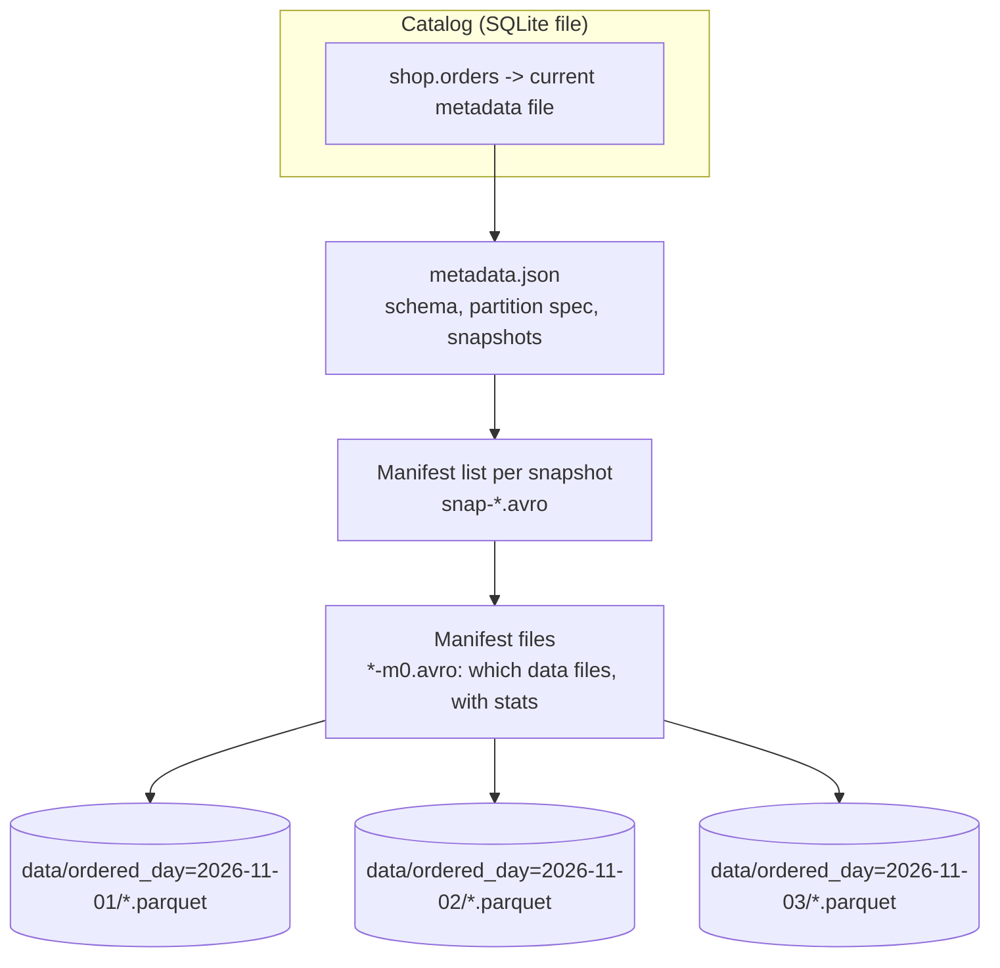

# Hands-On Project: Build an Apache Iceberg Lakehouse Locally

Create an Iceberg table on your laptop with PyIceberg, then look at what a table format actually is: a folder of Parquet files plus a tree of metadata. You will append data, evolve the schema, delete rows, time travel to an old snapshot, read the table from DuckDB, and expire a snapshot. Nothing needs a cloud account.

**Estimated Time:** 2-3 hours
**Difficulty:** Intermediate
**Prerequisites:** Python 3.10+, comfort with a terminal. Read [Warehouses, lakes and lakehouses](../../learn/concepts/warehouses-lakes-lakehouses.md) and [File formats and partitioning](../../learn/concepts/file-formats-and-partitioning.md) first.
**Cost:** Free. Local folder and a local SQLite file as the catalog.
**Tested:** 2026-11-07 on Python 3.12 with PyIceberg 0.12.0 (with the `sql-sqlite`, `pyarrow` and `pyiceberg-core` extras), PyArrow 26.0.1 and DuckDB 2.0.0 with its `iceberg` extension. Every output below is pasted from that run. **Not covered:** Spark, Trino, REST catalogs and object storage; this lab does not run any of them.

---

## What you will build



The catalog stores one pointer per table. The pointer leads to a metadata file, which lists snapshots; each snapshot leads through a manifest list and manifests to the Parquet data files. A commit writes new metadata and swaps the pointer. Readers never see a half-written table.

---

## Step 1: Install

```bash
mkdir iceberg-lab && cd iceberg-lab
uv venv --python 3.12 .venv && source .venv/bin/activate     # or: python3 -m venv .venv
uv pip install "pyiceberg[sql-sqlite,pyarrow,pyiceberg-core]" duckdb
python -c "import pyiceberg, duckdb; print(pyiceberg.__version__, duckdb.__version__)"
```

```text
0.12.0 2.0.0
```

**Do not skip the `pyiceberg-core` extra.** On the first attempt we installed only `sql-sqlite` and `pyarrow`. Creating the table worked, but the first `append` to a table partitioned by day failed with:

```text
pyiceberg.exceptions.NotInstalledError: pyiceberg_core needs to be installed. pip install "pyiceberg[pyiceberg-core]"
```

The partition transforms (day, month, bucket) are computed by that package. An unpartitioned table does not need it.

## Step 2: Create, append, evolve, delete

Save as `lab.py`. It uses a SQLite file as the catalog and a folder as the warehouse.

```python
import pyarrow as pa
from pyiceberg.catalog.sql import SqlCatalog
from pyiceberg.partitioning import PartitionSpec, PartitionField
from pyiceberg.transforms import DayTransform
from pyiceberg.schema import Schema
from pyiceberg.types import NestedField, LongType, StringType, DoubleType, TimestampType
from datetime import datetime

catalog = SqlCatalog("local", uri="sqlite:///lake/catalog.db", warehouse="file://" + __import__("os").path.abspath("lake/warehouse"))
catalog.create_namespace_if_not_exists("shop")

schema = Schema(
    NestedField(1, "order_id", LongType(), required=True),
    NestedField(2, "customer", StringType()),
    NestedField(3, "amount", DoubleType()),
    NestedField(4, "ordered_at", TimestampType()),
)
spec = PartitionSpec(PartitionField(source_id=4, field_id=1000, transform=DayTransform(), name="ordered_day"))
tbl = catalog.create_table("shop.orders", schema=schema, partition_spec=spec)

def batch(start, n, day):
    return pa.table({
        "order_id": pa.array(range(start, start + n), pa.int64()),
        "customer": [f"c{i%5}" for i in range(n)],
        "amount": [float(i) for i in range(n)],
        "ordered_at": pa.array([datetime(2026, 11, day, 10, 0)] * n, pa.timestamp("us")),
    }, schema=pa.schema([pa.field("order_id", pa.int64(), nullable=False), pa.field("customer", pa.string()), pa.field("amount", pa.float64()), pa.field("ordered_at", pa.timestamp("us"))]))

tbl.append(batch(1, 100, 1))
tbl.append(batch(101, 100, 2))
print("snapshots:", [(s.snapshot_id, s.summary.operation.value) for s in tbl.snapshots()])
first = tbl.snapshots()[0].snapshot_id

with tbl.update_schema() as u:
    u.add_column("channel", StringType())
tbl.append(batch(201, 50, 3).append_column("channel", pa.array(["web"] * 50)))

tbl.delete("order_id <= 10")
print("rows now:", tbl.scan().to_arrow().num_rows)
print("rows at first snapshot:", tbl.scan(snapshot_id=first).to_arrow().num_rows)
print("snapshots:", [(s.snapshot_id, s.summary.operation.value) for s in tbl.snapshots()])
print("current schema:", tbl.schema())
print("metadata:", tbl.metadata_location)
```

```bash
mkdir lake
python lab.py
```

```text
snapshots: [(2041855516367472240, 'append'), (7049715629187474470, 'append')]
rows now: 240
rows at first snapshot: 100
snapshots: [(2041855516367472240, 'append'), (7049715629187474470, 'append'), (716194981592425407, 'append'), (8706804375328270430, 'overwrite')]
current schema: table {
  1: order_id: required long
  2: customer: optional string
  3: amount: optional double
  4: ordered_at: optional timestamp
  5: channel: optional string
}
metadata: file:///.../iceberg-lab/lake/warehouse/shop/orders/metadata/00005-6e1682d4-e857-4ac2-8ac2-7aa9d965dc54.metadata.json
```

(Snapshot ids and file names are random; yours will differ.) What this shows:

- **Each write is a snapshot.** Three appends and one delete made four. The delete shows as `overwrite` because PyIceberg rewrote a data file rather than marking rows deleted.
- **Time travel works.** Reading the first snapshot returns 100 rows; the current table has 240 (250 appended, minus 10 deleted; the arithmetic is below).
- **Schema evolution is a metadata change.** `channel` was added as field id 5 with no data rewritten. Older files simply read as `null` for that column. Columns are tracked by id, not name, which is why renames and reorders are safe.

The row arithmetic: 100 + 100 + 50 appended = 250 rows, minus the 10 rows with `order_id <= 10` = 240.

## Step 3: Look at the files

```bash
find lake -type f | sort
```

On the test run the warehouse held one `.metadata.json` per commit (six of them, numbered `00000` to `00005`), one `snap-*.avro` manifest list per snapshot, several manifest `.avro` files, and four Parquet files:

```text
data/ordered_day=2026-11-01/00000-0-8e5865aa-....parquet   (90 rows after the delete)
data/ordered_day=2026-11-01/00000-0-19a10019-....parquet   (the original 100 rows, now unreferenced by the current snapshot)
data/ordered_day=2026-11-02/00000-0-b3b4349b-....parquet   (100 rows)
data/ordered_day=2026-11-03/00000-0-c95838ba-....parquet   (50 rows)
```

(Names shortened.) Two points worth stopping on:

1. The delete did not edit the Parquet file. Iceberg files are **immutable**. It wrote a new file with 90 rows for that day and committed a snapshot that points at the new one. The old file is still on disk because snapshot 1 still references it for time travel.
2. The folders `ordered_day=...` came from the **partition spec** (`DayTransform` on `ordered_at`). Readers filter on `ordered_at`, and the metadata, not the folder name, tells the engine which files to skip. This is hidden partitioning: no extra `day` column to remember in queries.

List the table's files and snapshots through the API:

```python
from pyiceberg.catalog.sql import SqlCatalog
import os
c = SqlCatalog("local", uri="sqlite:///lake/catalog.db", warehouse="file://" + os.path.abspath("lake/warehouse"))
t = c.load_table("shop.orders")
for r in t.inspect.snapshots().select(["snapshot_id", "operation"]).to_pylist(): print(r)
for r in t.inspect.files().select(["file_path", "record_count"]).to_pylist():
    print(r["file_path"].split("/data/")[1], r["record_count"])
```

```text
{'snapshot_id': 2041855516367472240, 'operation': 'append'}
{'snapshot_id': 7049715629187474470, 'operation': 'append'}
{'snapshot_id': 716194981592425407, 'operation': 'append'}
{'snapshot_id': 8706804375328270430, 'operation': 'overwrite'}
ordered_day=2026-11-01/00000-0-8e5865aa-797e-4175-b4f3-1a44039fd742.parquet 90
ordered_day=2026-11-03/00000-0-c95838ba-abdf-4eb6-86b1-edf07cfb48dd.parquet 50
ordered_day=2026-11-02/00000-0-b3b4349b-e9ee-4e35-8dec-d72cc9944859.parquet 100
```

`inspect.files()` lists only the three files the **current** snapshot references.

## Step 4: Read it from a different engine

A table format exists so more than one engine can read the same table. DuckDB reads Iceberg through its extension (it downloads the extension on first use, so it needs internet once). Save as `duck.py`:

```python
import duckdb, glob, os
con = duckdb.connect()
con.sql("INSTALL iceberg; LOAD iceberg;")
meta = sorted(glob.glob("lake/warehouse/shop/orders/metadata/*.metadata.json"))[-1]
print(meta)
print(con.sql(f"select count(*) n, min(order_id) lo, max(order_id) hi from iceberg_scan('{os.path.abspath(meta)}')").fetchall())
print(con.sql(f"select cast(ordered_at as date) d, count(*) from iceberg_scan('{os.path.abspath(meta)}') group by 1 order by 1").fetchall())
```

```bash
python duck.py
```

```text
lake/warehouse/shop/orders/metadata/00005-6e1682d4-e857-4ac2-8ac2-7aa9d965dc54.metadata.json
[(240, 11, 250)]
[(datetime.date(2026, 11, 1), 90), (datetime.date(2026, 11, 2), 100), (datetime.date(2026, 11, 3), 50)]
```

DuckDB agrees with PyIceberg: 240 rows, ids 11 to 250, and the per-day counts match the file counts above. Here we pointed it at the newest metadata file. A real deployment points every engine at a **catalog**, so all of them see the latest pointer; see [Warehouses, lakes and lakehouses](../../learn/concepts/warehouses-lakes-lakehouses.md).

## Step 5: Expire a snapshot

Old snapshots keep old files alive. Expiring one removes it from the table history:

```python
first = t.snapshots()[0].snapshot_id
t.maintenance.expire_snapshots().by_id(first).commit()
t = c.load_table("shop.orders")
print("after expire:", [s.snapshot_id for s in t.snapshots()])
try:
    t.scan(snapshot_id=first).to_arrow()
except Exception as e:
    print("time travel to expired:", type(e).__name__, e)
```

```text
after expire: [7049715629187474470, 716194981592425407, 8706804375328270430]
time travel to expired: ValueError Snapshot not found: 2041855516367472240
```

Time travel to that snapshot is gone, as intended. **But on this PyIceberg version the Parquet file it referenced was still on disk afterwards** (a count of `*.parquet` under `data/` still returned 4). Treat PyIceberg's expire as a metadata operation here. Physical cleanup of orphaned files is done by engine procedures such as Spark's `expire_snapshots` and `remove_orphan_files`; we did **not** run those in this lab, so check the Iceberg docs for your engine.

---

## Why the metadata tree exists (the part for interviews)

| Problem on a plain Parquet folder | What Iceberg's metadata does |
|---|---|
| Two writers, a reader sees half a write | Commit is an atomic pointer swap in the catalog |
| "Which files make up this table?" needs a directory listing | The manifest lists them, with per-file column stats, so engines skip files without opening them |
| Renaming a column breaks old files | Columns are tracked by id |
| Changing the partitioning means rewriting everything | The partition spec is versioned in metadata; old files keep the old layout |
| No history | Every commit is a snapshot you can read |

Delta Lake and Apache Hudi solve the same problems with different metadata layouts. Compare them in [Warehouses, lakes and lakehouses](../../learn/concepts/warehouses-lakes-lakehouses.md).

## Clean up

```bash
deactivate; cd .. && rm -rf iceberg-lab
```

## Extensions

- Add `tbl.upsert(...)` and compare the files it writes with `append`.
- Partition by `bucket` on `customer` instead of by day and watch how the folders change.
- Read the table from Spark or Trino with a REST catalog. Not run here.
- Put the warehouse on S3 and the catalog in AWS Glue or a REST catalog. Not run here.
- Feed this table from a CDC stream: [Change data capture with Debezium into a lakehouse](./debezium-cdc-to-lakehouse.md).

## Related

- [Warehouses, lakes and lakehouses](../../learn/concepts/warehouses-lakes-lakehouses.md) - table formats in context
- [File formats and partitioning](../../learn/concepts/file-formats-and-partitioning.md) - Parquet, pruning and small files
- [Architecture pattern: lakehouse](../architecture-patterns/lakehouse-architecture.md)
- [Debezium CDC into a lakehouse](./debezium-cdc-to-lakehouse.md) - the next build, which fills Iceberg tables from a database log

## Official docs

- **[📖 Apache Iceberg: Table spec](https://iceberg.apache.org/spec/)** - metadata files, snapshots, manifests and partition transforms
- **[📖 Apache Iceberg: Documentation](https://iceberg.apache.org/docs/latest/)** - engine procedures such as snapshot expiration and orphan file removal
- **[📖 PyIceberg](https://py.iceberg.apache.org/)** - catalog configuration, writes, schema evolution and inspection
- **[📖 DuckDB documentation](https://duckdb.org/docs/)** - the `iceberg` extension is listed under core extensions
