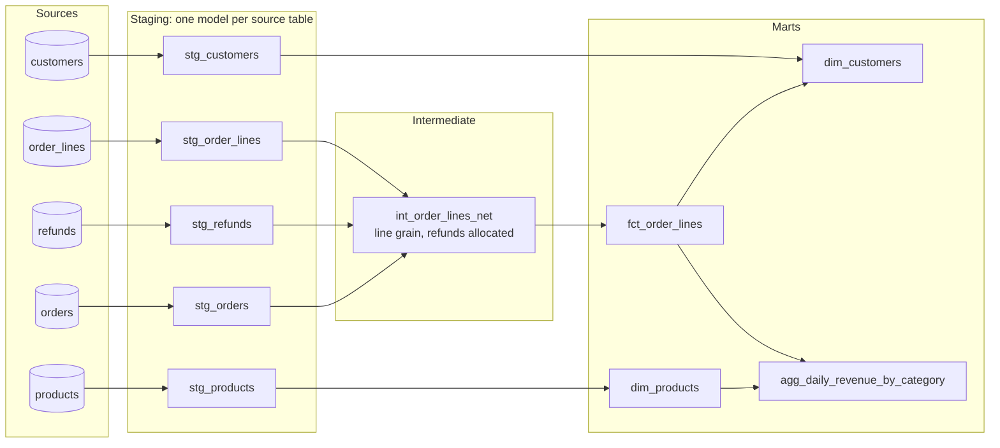

# Analytics Engineer Interview Guide: What Gets Tested and Worked Answers

Analytics engineering sits between data engineering and analysis: you own the transformed, tested, documented models that dashboards, analysts and finance trust. Interviews for the role look different from data engineer interviews. There is less about Spark clusters and streaming, and much more about **modelling judgement, SQL fluency, dbt-style workflow, testing, metric definitions and working with stakeholders**. This guide explains what each round is really testing, works through example answers the way a strong candidate would give them, and lists the traps that catch people.

For the SQL round itself, use the [SQL interview guide](./sql-interview-guide.md); for whiteboard modelling, the [data modeling and pipeline design guide](./data-modeling-system-design-interview.md). This page covers the rest, and how the pieces fit together for this specific role. The concepts underneath are in [Analytics engineering and dbt](../../learn/concepts/analytics-engineering-and-dbt.md).

---

## What the role is, and why interviewers care about it

An analytics engineer turns raw, replicated source data into models people can query without knowing the quirks of the source: one row per order, revenue that matches finance, customers deduplicated, dates in the right time zone. The work applies software engineering habits (version control, code review, tests, CI, documentation) to SQL transformations.

So interviewers are asking three questions throughout:

1. **Can you model data so that numbers are right and stay right?** Grain, keys, history, tests.
2. **Can you write and organise SQL that other people can maintain?** Layering, naming, modularity, performance.
3. **Can you work with the people who use the data?** Turning vague requests into definitions, pushing back, explaining trade-offs.

A candidate who writes clever SQL but cannot explain the grain of their model, or who builds whatever a stakeholder asks without questioning the definition, will struggle.

---

## The typical loop

| Round | What it looks like | What it is really testing |
|---|---|---|
| Recruiter or hiring manager screen | Background, a project you are proud of | Can you explain a data project in business terms, including what changed because of it? |
| SQL round | Live coding, 2 to 4 problems | Joins, aggregation at the right grain, window functions, nulls, deduplication. See the [SQL guide](./sql-interview-guide.md) |
| Modelling round | "Model this business process" on a whiteboard | Grain, facts and dimensions, history, how you would layer it in dbt |
| Take-home or live dbt exercise | A small project: stage sources, build marts, add tests | Project structure, naming, tests, documentation, judgement about materialisation |
| Metrics and stakeholder round | "Marketing and finance disagree on revenue" | Defining metrics precisely, resolving conflicts, communicating |
| Behavioural | Past situations | Ownership, dealing with a broken dashboard, prioritising requests |

---

## Round 1: modelling with dbt-style layers

### What they are testing

Whether you can take messy sources and produce models with a clear grain, a clean layering and sensible materialisations, and explain why.

### Worked example

**Prompt:** "We have a Shopify-like source: `orders`, `order_lines`, `customers`, `refunds` and `products`, replicated into the warehouse. Finance wants daily net revenue by product category, and marketing wants customer lifetime value. Walk me through the models you would build."

**A strong answer, talked through:**

*"First I'd confirm definitions. Net revenue: gross line amounts minus discounts minus refunds, excluding tax and shipping? Recognised on order date or on fulfilment date? In which time zone? And for lifetime value, is it net revenue to date, or a predicted figure? I'll assume net revenue by order date in the store's time zone, and LTV as net revenue to date."*

*"Then the layers. I'd follow the common staging, intermediate and marts structure."*



*The diagram shows the layered project. Each source table gets one staging model that renames, casts and lightly cleans. An intermediate model joins order lines to orders and allocates refunds down to line level. The marts layer holds a fact table at order-line grain, customer and product dimensions (with lifetime value computed on the customer dimension from the fact table), and a daily revenue aggregate by category built from the fact and the product dimension.*

*"**Staging** models are one-to-one with source tables: rename columns to a consistent convention, cast types, convert timestamps to UTC, and nothing else. No joins. That way every downstream model reads clean names, and if the source changes I fix it in one place."*

*"The **grain** of the fact table is the important decision. Finance wants revenue by product category, and categories live on products, so the fact has to be at **order-line grain**, not order grain. If I built an order-level fact I couldn't split an order's revenue across categories."*

*"Refunds are the awkward part. If refunds are recorded at order level, I need to allocate them to lines, typically in proportion to line amount, in an intermediate model. If they are at line level, I join directly. I'd ask which, and I'd make the allocation rule explicit and documented, because finance will ask."*

*"**Materialisations**: staging as views (cheap, always fresh), the fact table as an incremental model because order lines grow forever, dimensions as tables, and the daily aggregate as a table. I'd add `unique` and `not_null` tests on every primary key, `relationships` tests from the fact's foreign keys to the dimensions, and a reconciliation test that daily net revenue matches finance's source of truth within a tolerance."*

*"For LTV, I'd put `lifetime_net_revenue`, `first_order_date` and `order_count` on `dim_customers`, computed from the fact. If marketing wants LTV as of a past date, that's a different model: a customer-by-month snapshot."*

### Traps

- **Joining in staging.** It mixes cleaning with business logic and makes staging models no longer one-to-one with sources.
- **Building the fact at order grain** and then trying to split revenue by category later.
- **Forgetting refunds, discounts, tax or currency.** Interviewers often leave one out on purpose to see whether you ask.
- **Not stating a grain.** Every model you name should have a one-sentence grain.
- **Making everything a table** (or everything a view) without reasoning about cost and freshness.

**[📖 dbt: How we structure our dbt projects](https://docs.getdbt.com/best-practices/how-we-structure/1-guide-overview)** - the staging, intermediate and marts conventions most teams follow
**[📖 dbt: Materializations](https://docs.getdbt.com/docs/build/materializations)** - view, table, incremental, ephemeral and materialized view, and when to use each

---

## Round 2: incremental models and late data

### What they are testing

Whether you understand the trade-off between cost and correctness in incremental builds, and the specific ways they go wrong.

### Worked example

**Question:** "Your `fct_events` table has 3 billion rows and takes two hours to rebuild. How would you make it incremental, and what could go wrong?"

**A strong answer:**

*"An incremental model only processes new or changed rows on each run and merges them into the existing table. In dbt, I'd configure it as incremental with a `unique_key` of `event_id`, and filter the source to rows newer than what's already in the table."*

```sql
{{ config(materialized='incremental', unique_key='event_id') }}

select
  event_id,
  user_id,
  event_name,
  event_ts,
  loaded_at
from {{ ref('stg_events') }}


  -- Look back 3 days to pick up late-arriving events
  where loaded_at > (select dateadd('day', -3, max(loaded_at)) from {{ this }})

```

*"Three things can go wrong, and I'd design for each:"*

1. *"**Late-arriving data.** If I filter on `event_ts > max(event_ts)`, an event that happened yesterday but arrived today is skipped forever. So I filter on the **load timestamp**, not the event timestamp, and add a lookback window. The `unique_key` makes the overlap safe, because re-processed rows are merged, not duplicated."*
2. *"**Duplicates in the batch.** If the same `event_id` appears twice in one batch, a merge can fail or produce duplicates depending on the warehouse. I deduplicate in the model, keeping the latest version with `row_number()`."*
3. *"**Logic changes.** When I change the model's logic, existing rows still have the old logic. I'd run a full refresh, or a targeted backfill, and that should be planned and announced, not discovered."*

*"I'd also consider the incremental strategy: `merge` is the most flexible but costs more on large tables; `delete+insert` or `insert_overwrite` by date partition can be cheaper when late data is confined to recent partitions."*

### Traps

- **Filtering on event time** and silently losing late data.
- **No `unique_key`**, so the lookback window creates duplicates.
- **Assuming incremental is always better.** A 2-million-row table should probably just be a table; incremental logic adds complexity and failure modes.
- **Forgetting that schema changes** (a new column) need handling (`on_schema_change`) or a full refresh.

**[📖 dbt: Incremental models](https://docs.getdbt.com/docs/build/incremental-models)** - configuration, `is_incremental()`, unique keys and strategies

---

## Round 3: testing and data quality

### What they are testing

Whether you treat models like software: tests that encode assumptions, run in CI, and fail loudly.

### Worked example

**Question:** "A VP says the revenue dashboard showed a 40% drop yesterday and it was wrong. How do you make sure that doesn't happen again?"

**A strong answer, in two parts: fix it, then prevent it.**

*"First, find the cause: compare the model's output with the source system for the affected day, look at the run logs, and check whether a source load was late or partial, a join started dropping rows, or a definition changed. Communicate early: tell the VP what you know, what you don't, and when you'll update them. Then fix the data and annotate the dashboard."*

*"Then prevention, in layers:"*

| Layer | Test | What it catches |
|---|---|---|
| Sources | Freshness checks on each source (warn after 6 hours, error after 24) | A source that stopped loading |
| Primary keys | `unique` and `not_null` on every model's key | Fan-out from a bad join, duplicates |
| Relationships | Foreign keys exist in the dimension | Orphan rows, dropped joins |
| Accepted values | `status` in a known list | A new source value nobody mapped |
| Volume | Row count within an expected range of the trailing average | Partial loads, silent filters |
| Reconciliation | Daily revenue matches the billing system within 0.5% | Logic errors that pass every structural test |
| Contracts | Enforced column names and types on public models | Upstream changes breaking consumers |

*"The reconciliation test is the one that would have caught this. Structural tests can all pass while a number is wrong. I'd run tests in CI on every pull request against a sample of production data, and in production after every run, with failures blocking the dashboard refresh rather than letting bad numbers through."*

### Traps

- **Only structural tests.** `unique` and `not_null` everywhere, but nothing that checks whether the number is right.
- **Tests that warn and nobody reads.** A test that never fails a build is a log line.
- **Blaming the source** without adding a freshness or volume check that would have caught it.
- **Not communicating** while investigating. Interviewers listen for this.

**[📖 dbt: Data tests](https://docs.getdbt.com/docs/build/data-tests)** - generic and singular tests, severity and thresholds
**[📖 dbt: Model contracts](https://docs.getdbt.com/docs/collaborate/govern/model-contracts)** - enforcing the shape of public models

See also [Data quality and lineage](../../learn/concepts/data-quality-and-lineage.md) and [Data contracts](../../learn/concepts/data-contracts.md).

---

## Round 4: history and slowly changing dimensions

### What they are testing

Whether you understand "as it is now" versus "as it was then", and choose deliberately.

### Worked example

**Question:** "Sales reps get reassigned to new regions. Leadership wants revenue by region. Which region does a sale count for: the rep's region when the sale happened, or now?"

**A strong answer:**

*"That's a business question, so I'd ask, but I'd explain the options. Usually finance wants **as it was then**: a sale made in the West counts for the West even after the rep moves East. Sales operations sometimes wants **as it is now**, to see a current team's book of business."*

*"To support 'as it was then' I need history of the rep's region. In dbt I'd use a **snapshot** on the reps table, which records each version with `dbt_valid_from` and `dbt_valid_to`. That gives me a [type 2 slowly changing dimension](../../learn/concepts/slowly-changing-dimensions.md). The fact table then joins to the version valid at the sale's timestamp:"*

```sql
select
  f.order_id,
  f.amount,
  r.region
from {{ ref('fct_orders') }} f
join {{ ref('dim_sales_reps') }} r
  on  r.rep_id = f.rep_id
  and f.ordered_at >= r.valid_from
  and f.ordered_at <  coalesce(r.valid_to, '9999-12-31')
```

*"I'd also keep a current-region column for the 'as it is now' view, so both questions are one join away. And I'd note that snapshots only capture history from when you start running them; if history matters, start snapshotting before anyone asks."*

### Traps

- **Joining to the current dimension** and silently restating history.
- **Overlapping validity windows** (using `<=` on both ends), which double-counts rows at boundaries.
- **Not mentioning** that snapshots cannot recover history that was never captured.

**[📖 dbt: Snapshots](https://docs.getdbt.com/docs/build/snapshots)** - capturing type 2 history from mutable source tables

---

## Round 5: metric definitions and the semantic layer

### What they are testing

Whether you can make a metric mean one thing everywhere, and handle disagreement between teams.

### Worked example

**Question:** "Marketing says we had 12,000 active users last month; product says 9,500. Both are pulling from your models. What do you do?"

**A strong answer:**

*"First, don't pick a winner. Find out how each number is defined. Typical differences: what counts as 'active' (any event, or a meaningful action?), the time window (calendar month or trailing 30 days?), time zone, whether test and internal accounts are excluded, and whether logged-out visitors are counted. I'd reproduce both numbers from the models and list exactly where they diverge."*

*"Then get the owners in a room with that list, agree a definition (or agree that there are two metrics with two names, like 'monthly visitors' and 'monthly active users'), and write it down. The definition then lives in **one place**: a governed metric in a semantic layer, or at minimum one documented mart model, so every dashboard reads the same logic. I'd deprecate the old calculations rather than leaving them around."*

*"The technical lesson underneath is that metrics like distinct users are **non-additive**: you can't sum daily active users to get monthly active users. A semantic layer helps because it computes the metric correctly at whatever grain is requested."*

### Traps

- **Choosing one team's number** without understanding the other.
- **Fixing it in the dashboard** instead of in the model or metric definition.
- **Summing distinct counts** or averaging averages.

**[📖 dbt: Semantic models](https://docs.getdbt.com/docs/build/semantic-models)** - defining entities, dimensions and measures for governed metrics

See the [semantic layer pattern](../architecture-patterns/semantic-layer.md).

---

## Round 6: performance and cost

### What they are testing

Whether you know what makes warehouse models slow or expensive, without needing to be a database internals expert.

**Good things to say when asked "this model takes 40 minutes and costs too much":**

- **Look at the query profile first.** Find the step that dominates: a huge scan, a spill to disk, an exploding join.
- **Exploding joins** are the most common cause: a join on a non-unique key multiplies rows. Check the row count before and after each join.
- **Filter and prune early.** Make sure filters hit the partition or clustering column so the warehouse skips data.
- **Make it incremental** if it reprocesses years of unchanged history every run.
- **Do not `SELECT *`** in models; columnar warehouses charge for columns read.
- **Move repeated logic upstream** into a model computed once, rather than recomputing it in five marts.
- **Right-size the schedule.** A model refreshed every 15 minutes that is read once a day is waste.

See [Slow SQL query diagnosis](../troubleshooting/slow-sql-query-diagnosis.md) and [File formats and partitioning](../../learn/concepts/file-formats-and-partitioning.md).

---

## Round 7: stakeholders and behaviour

These questions decide many analytics engineering offers, because the role is a translation job.

**"Tell me about a time a stakeholder asked for something you thought was wrong."** A strong answer has a specific situation, shows that you understood the underlying need, explains the alternative you proposed and why, and ends with the outcome, including what you would do differently. Avoid answers where you simply refused, or simply complied.

**"How do you prioritise when five teams want models this week?"** Talk about impact (which request affects a decision or revenue), effort, and making the trade-off visible: a shared backlog, agreed priorities with a manager, and saying no or not yet with a reason.

**"A dashboard you own broke on a Monday morning. Walk me through the first hour."** Acknowledge quickly to the users, assess impact, find the cause (source freshness, last run, last merged change), fix or roll back, communicate the fix, then write a short postmortem and add the test that would have caught it.

---

## The take-home: what reviewers look for

If you get a take-home dbt project, reviewers usually look for:

- **A clear structure**: staging, intermediate and marts, with consistent naming (`stg_`, `int_`, `fct_`, `dim_`).
- **Sources declared** with freshness checks.
- **A stated grain** for each mart, in the model's description.
- **Tests on every primary key**, relationships, and at least one business-logic test.
- **Documentation**: model and column descriptions, and a short README explaining decisions and assumptions.
- **Restraint**: solving the problem asked, cleanly, rather than building everything you know.
- **Assumptions written down**, especially where the prompt was ambiguous.

The README matters more than people expect. A paragraph explaining "I assumed refunds are allocated to lines in proportion to amount; with more time I would confirm this with finance and add a reconciliation test" shows exactly the judgement the role needs.

---

## Questions to expect and strong short answers

**"What's the difference between a data engineer and an analytics engineer?"** Data engineers typically own getting data in and the platform it runs on; analytics engineers own the modelled, tested, documented layer that people query. The boundary varies by company; say how you would work with the other side.

**"ETL or ELT?"** ELT is the norm in cloud warehouses: load raw data, transform with SQL inside the warehouse, where compute scales and the raw data stays available for reprocessing. See [ETL vs ELT](../../learn/concepts/etl-vs-elt.md).

**"View, table or incremental?"** Views for light, frequently changing logic and small data; tables for heavy logic read often; incremental for large, append-heavy data where full rebuilds are too slow or expensive.

**"How do you handle PII in models?"** Keep it out of marts unless needed, mask or hash it where possible, use warehouse access policies on sensitive columns, and document which models contain it.

**"What does CI look like for a dbt project?"** On every pull request, build and test only the modified models and their downstream dependencies against a CI schema, using production state to decide what changed, and block merging on failures.

**"How do you know your models are used?"** Warehouse query history and BI usage logs. Unused models are cost and maintenance; deprecate them.

---

## Practise like this

1. Build a small dbt project on a public dataset (the [build a dbt project](../hands-on-projects/build-dbt-project.md) guide walks through one), with staging, a fact at a stated grain, a type 2 snapshot, tests and a README.
2. For each worked example on this page, write your own answer out loud in under five minutes, then compare.
3. Practise the SQL patterns in the [SQL interview guide](./sql-interview-guide.md) until joins at the right grain, deduplication and window functions are automatic.
4. Prepare three stories: a metric you defined or fixed, a time data was wrong and what you changed, and a stakeholder disagreement you resolved.

- **[📖 Kimball dimensional modeling techniques](https://www.kimballgroup.com/data-warehouse-business-intelligence-resources/kimball-techniques/dimensional-modeling-techniques/)** - grain, fact table types and SCDs, the vocabulary interviewers use

---

## Related

- [SQL interview guide](./sql-interview-guide.md) - the SQL round, with worked problems
- [Data modeling and pipeline design interviews](./data-modeling-system-design-interview.md) - the design round
- [Data engineer interview prep](./data-engineer-interview.md) - the broader data engineering interview
- [DBA interview guide](./dba-interview.md) - the database administration interview
- [Analytics engineering and dbt](../../learn/concepts/analytics-engineering-and-dbt.md)
- [Data modeling for analytics](../../learn/concepts/data-modeling-for-analytics.md)
- [Semantic layer](../architecture-patterns/semantic-layer.md)
