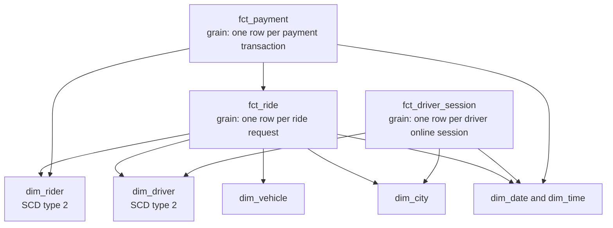
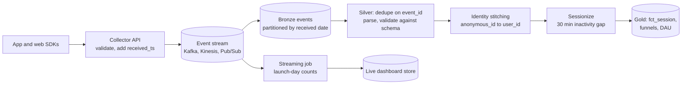

# Data Modeling and Pipeline Design Interviews: Worked Designs

The design round is where senior data engineering and analytics engineering interviews are won or lost. You get a vague prompt ("design the data model for a ride-sharing app", "build a pipeline for our clickstream") and 45 to 60 minutes. This guide gives you a repeatable structure, then works through four full designs the way a strong candidate would talk through them.

The [data engineer interview guide](./data-engineer-interview.md) already covers a real-time analytics pipeline; the designs here are different and go deeper on modelling decisions.

---

## What the interviewer is scoring

Design rounds are not about reaching a single right answer. Interviewers typically score:

- **Requirements gathering.** Did you ask who uses the data, how fresh it must be, how big it is, and what questions it must answer before drawing anything?
- **Modelling judgement.** Did you pick a sensible grain, separate facts from dimensions, and handle change over time?
- **Pipeline reasoning.** Batch or streaming, and why. How data gets in, how it is made correct, how it is served.
- **Failure thinking.** Late data, duplicates, schema changes, backfills, bad source data.
- **Trade-off communication.** Naming the alternative you did not pick and why.

A strong answer spends the first 5 to 10 minutes on requirements, which feels slow but is what separates senior candidates.

---

## A repeatable structure

Use the same five steps every time, and say them out loud so the interviewer can follow.

**1. Clarify (5 to 10 minutes).** Who are the consumers (analysts, dashboards, ML, an external API)? What are the top five questions they need answered? Freshness: daily, hourly, seconds? Volume: events per day, rows in the biggest table, growth rate? History: do they need "as it was then" or only "as it is now"? Any compliance constraints (personal data, retention, regional storage)?

**2. Model (15 minutes).** Name the business processes (orders placed, rides completed, sessions). For each, state the **grain** in one sentence ("one row per completed ride"). Then list the dimensions (who, what, where, when) and the measures. Draw the star schema. See [Data modeling for analytics](../../learn/concepts/data-modeling-for-analytics.md).

**3. Pipeline (10 to 15 minutes).** Sources, ingestion, layers ([bronze, silver, gold](../architecture-patterns/medallion-architecture.md)), orchestration, serving.

**4. Correctness and operations (5 to 10 minutes).** Idempotency, late data, deduplication, data quality tests, backfills, monitoring.

**5. Scale and trade-offs (remaining time).** What breaks at 10 or 100 times the volume, and what you would change.

---

## Design 1: Ride-sharing analytics model

**Prompt:** "Design the analytics data model for a ride-sharing company. The business wants to analyse rides, revenue, driver performance and rider behaviour."

### Clarify

Good questions and plausible answers:

- *Top questions?* Rides and gross bookings by city by day; driver utilization (time on trip versus time online); cancellation rates by who cancelled; rider retention; surge pricing impact.
- *Volume?* 20 million rides per day globally; driver location pings every 4 seconds.
- *Freshness?* Daily for finance, under 15 minutes for city operations dashboards.
- *History?* Driver and rider attributes change (rating, vehicle, city); finance wants reports as of the time of the ride.

### Model

Several business processes, so several fact tables, sharing conformed dimensions.

The ride-sharing model as a constellation of three fact tables sharing conformed dimensions. Rides, driver sessions and payments are separate business processes with separate grains; they connect through shared driver, rider, city and date dimensions, and payments link to rides by ride key.

**`fct_ride`**, grain: one row per ride *request*, not per completed ride. This is a deliberate choice: if the grain were "completed ride", cancellations would need a separate table and the cancellation rate would require a join across facts. With one row per request, a `status` column (completed, cancelled by rider, cancelled by driver, no driver found) and timestamps for each milestone (requested, accepted, picked up, dropped off) make every funnel question a single-table query. This is an **accumulating snapshot** fact: the row is updated as the ride progresses.

Measures: `distance_km`, `duration_s`, `fare_amount`, `surge_multiplier`, `wait_time_s` (requested to pickup), `driver_payout`, `platform_fee`.

**`fct_driver_session`**, grain: one row per continuous period a driver is online. Measures: `online_seconds`, `on_trip_seconds`, `idle_seconds`. Utilization is `on_trip_seconds / online_seconds`, computed at query time over sums, never by averaging per-session ratios (that would weight a 2-minute session the same as an 8-hour one).

**`fct_payment`**, grain: one row per payment transaction (charge, refund, tip, adjustment). Finance needs this separately because one ride can have several transactions over days (a tip added later, a refund after a complaint).

**Dimensions:** `dim_driver` and `dim_rider` as [SCD type 2](../../learn/concepts/slowly-changing-dimensions.md) with `valid_from`, `valid_to` and `is_current`, so a ride joins to the driver's attributes at ride time. The fact stores the surrogate key of the version that was current. `dim_city` carries time zone, country and currency, which matter because "rides per day" must use the city's local day, not UTC.

**What about location pings?** Billions of rows per day, used mainly for ETA models and heatmaps. Keep them out of the star schema: land them in a partitioned table (by date and city, or a geospatial cell such as an H3 index) and aggregate into a `fct_supply_demand_cell_5min` table for heatmaps. Say this explicitly; recognizing that not everything belongs in the dimensional model is a senior signal.

### Pipeline

Ride and payment services publish events to Kafka; the trip database is also replicated by [CDC](../architecture-patterns/cdc-to-lakehouse.md). Bronze holds raw events. Silver builds the ride state by applying events per `ride_id`, ordered by event time with a sequence number. Gold builds facts and dimensions. City operations dashboards read a streaming aggregate refreshed every few minutes; finance reads the daily batch, which is the system of record.

### Correctness

- Late events (a phone offline in a tunnel) update the ride row; the accumulating snapshot design absorbs them.
- Daily finance numbers are restated if late payments arrive: partition the fact by ride date, and re-process the last N days on each run (a "lookback window").
- Reconciliation test: sum of `fct_payment` per day matches the payment provider's settlement file within tolerance.

### Trade-offs to mention

One wide denormalized ride table would be simpler for analysts and fast in columnar engines; the star schema keeps driver and rider history correct and avoids repeating attributes. Many teams build both: the star schema as the core, plus a wide "one big table" view in gold for ad-hoc use.

---

## Design 2: Clickstream and sessionization pipeline

**Prompt:** "Our web and mobile apps emit events. Design a pipeline that gives product analysts sessions, funnels and daily active users."

### Clarify

- *Volume?* 2 billion events per day, peaks at 5 times average.
- *Freshness?* Daily is fine for most analysis; product wants a near-real-time view of a launch day.
- *Identity?* Users browse logged-out (anonymous ID) and later log in; analysts want the whole journey attributed to the user.
- *Session definition?* 30 minutes of inactivity ends a session.

### Model

- **`fct_event`**, grain: one row per event, partitioned by event date. Columns: `event_id`, `anonymous_id`, `user_id` (nullable), `event_name`, `event_ts`, `received_ts`, device, page or screen, properties as a semi-structured column.
- **`fct_session`**, grain: one row per session. `session_id`, `user_key`, `start_ts`, `end_ts`, `event_count`, `landing_page`, `converted` flag, attribution (UTM source).
- **`dim_user`** and an **identity map** table (`anonymous_id` to `user_id`, with first-seen time).
- **`agg_daily_active_users`** per day, platform and country.

### Pipeline

The clickstream pipeline. Client SDKs send events to a collector that stamps receive time and publishes to a stream. A streaming job serves launch-day counts directly, while every event lands in bronze. The batch path deduplicates, stitches anonymous and logged-in identities, sessionizes on a 30-minute gap and builds gold tables.

### The interesting decisions

**Event time versus receive time.** Mobile events can arrive hours or days late (offline phones batch-send). Partition bronze by *received* date so ingestion is append-only and simple. Sessionization uses *event* time. Each daily run reprocesses event dates within a lookback window (say 3 days) to pick up late arrivals; events later than that are kept but only fixed in a weekly restatement. Mention that client clocks can be wrong: clamp event times that are in the future or before the app was installed.

**Deduplication.** SDKs retry, so the same `event_id` can arrive twice. Deduplicate in silver on `event_id` within a time bound (you cannot afford a global dedup across all history at 2 billion per day; a few days is enough because retries happen within minutes).

**Sessionization.** The gaps-and-islands pattern from the [SQL interview guide](./sql-interview-guide.md#7-gaps-and-islands): flag an event as a session start if the gap to the previous event for that user exceeds 30 minutes, then a running sum assigns session numbers. At this volume it runs in Spark or the warehouse, partitioned by user, which makes skew a risk: bots and test accounts produce millions of events. Filter known bots early.

**Identity stitching.** When a user logs in, emit an identify event linking `anonymous_id` to `user_id`. Silver maintains the mapping; gold resolves every event to a `user_key` (the user ID if known, else the anonymous ID). Retroactively re-attributing pre-login events is a business choice; say you would ask.

**DAU must be a distinct count at the requested grain.** Never sum daily DAU into a monthly figure.

### Scale and cost

At this volume, storage format and file sizes matter: Parquet with a table format, partitioned by date, clustered by user or event name; compact small files written by the streaming landing. Keep the raw properties column but extract the 20 most-queried properties into real columns so queries do not parse JSON on every row.

---

## Design 3: Subscription business metrics (MRR and churn)

**Prompt:** "We are a SaaS company. Finance and leadership want monthly recurring revenue, churn and expansion, by plan and segment, and they want the numbers to match the billing system."

### Clarify

- *Source?* Stripe (or a similar billing system) and the product database.
- *Definitions?* Ask. MRR from active subscriptions, normalized to monthly (annual plans divided by 12). Churned MRR when a subscription ends; contraction on downgrade; expansion on upgrade.
- *History?* Leadership wants to see MRR as of any past date, and month-by-month movements.

### Model

The core insight: MRR is a **state over time**, and movements are **differences between states**. The cleanest model is a periodic snapshot.

- **`fct_subscription_event`**, grain: one row per subscription change (created, upgraded, downgraded, cancelled, reactivated), with old and new MRR.
- **`fct_mrr_daily_snapshot`**, grain: one row per subscription per day it was active, with that day's MRR. Built from the events by generating a row for each day between changes (a date spine join).
- **`fct_mrr_movement_monthly`**, grain: one row per customer per month, with `starting_mrr`, `new`, `expansion`, `contraction`, `churn`, `reactivation`, `ending_mrr`. The categories are computed by comparing each customer's MRR at the start and end of the month.
- **`dim_customer`** (SCD type 2 for segment and region), **`dim_plan`**.

A daily snapshot table looks big (every active subscription every day), but at, say, 200,000 subscriptions it is 73 million rows a year, trivial for a columnar warehouse, and it makes "MRR on any date" a simple filter and sum. Mention that MRR is a semi-additive measure: you can sum it across customers on one day, but never across days.

### Correctness

- **Reconcile with billing.** A daily test compares total MRR from the snapshot with the billing system's own report, within a small tolerance, and alerts on drift. Finance trust depends on this.
- **Movement categories must add up:** `starting + new + expansion - contraction - churn + reactivation = ending`, tested for every month.
- **Restatements.** Billing systems backdate changes (a refund, a cancellation effective last month). Rebuild the snapshot from events rather than updating it incrementally, or reprocess a lookback window; freeze closed months once finance signs them off, and report later corrections as adjustments.
- **Definitions in one place.** MRR and churn are perfect candidates for a [semantic layer](../architecture-patterns/semantic-layer.md), so the board deck and the dashboard agree.

---

## Design 4: Inventory feed for an operational dashboard

**Prompt:** "Stores need a dashboard showing current stock per product, updated within five minutes, and analysts need daily stock history."

This is a good test of choosing the right fact table type.

- **Transaction fact** `fct_inventory_movement`: one row per stock movement (sale, delivery, transfer, adjustment, shrinkage), with signed quantity. This is the source of truth and is append-only.
- **Periodic snapshot fact** `fct_inventory_daily`: one row per product per store per day, with closing quantity. Built nightly by adding the day's movements to the previous day's closing balance. Analysts use this for history; it is semi-additive (sum across stores, not across days).
- **Current state** for the dashboard: a small table or key-value store keyed by store and product, updated by a streaming job from point-of-sale and warehouse events, or by CDC from the inventory system. It must handle out-of-order events with a sequence number per store, exactly like the merge guard in [CDC into a lakehouse](../architecture-patterns/cdc-to-lakehouse.md#the-apply-job-step-by-step).

Explain why you do not compute current stock by summing all movements on every dashboard refresh (cost and latency grow forever), and why you still keep the movements (auditability, and the ability to rebuild the snapshot when a bug is found). Add a nightly reconciliation of the streaming current state against the batch snapshot; a difference is a bug in one of them.

---

## Questions to expect and strong short answers

**"Star schema or one big table?"** Star schema as the governed core (reusable dimensions, history handled once, smaller storage); wide tables in gold for specific consumers where join cost or analyst simplicity matters. Columnar engines make wide tables cheap, so it is no longer either/or.

**"How do you handle a late-arriving dimension?"** A fact arrives for a customer not yet in `dim_customer`. Insert a placeholder dimension row (an "inferred member") with the natural key and unknown attributes, link the fact to it, and update it when the real record arrives. Never drop the fact.

**"How do you make the pipeline idempotent?"** Each run writes a whole partition (overwrite by date) or merges on a key, so re-running produces the same result. Never append blindly. See [Failing and late pipelines](../troubleshooting/failing-and-late-pipelines.md).

**"How do you backfill two years of data after a logic change?"** Parameterize jobs by date range, run in chunks, write to a new table version or a shadow table, compare to the old output, then swap. Watch warehouse cost and API limits.

**"Data vault?"** Good when many source systems change often and auditability of raw history is paramount (banks, insurers); it adds a lot of tables and needs a presentation layer on top. For most product companies, a medallion layout plus a star schema is enough.

**"Batch or streaming?"** Ask what decision changes if data is fresher. Default to batch or micro-batch; use streaming where minutes matter and someone acts on it. See [Batch vs streaming](../../learn/concepts/batch-vs-streaming.md).

---

## Practise like this

Take each prompt above, set a 45-minute timer, and talk out loud while drawing on paper. Then compare with the worked design and note what you skipped. Common gaps on a first attempt: not stating the grain, forgetting history (SCD), ignoring late data, and not mentioning a reconciliation test. Try new prompts too: a food-delivery marketplace, a streaming music service, an ad-click attribution pipeline, a hospital bed-occupancy dashboard.

- **[📖 Kimball dimensional modeling techniques](https://www.kimballgroup.com/data-warehouse-business-intelligence-resources/kimball-techniques/dimensional-modeling-techniques/)** - the canonical list: grain, fact table types, SCDs, late-arriving dimensions
- **[📖 dbt guide: how we structure our dbt projects](https://docs.getdbt.com/best-practices/how-we-structure/1-guide-overview)** - staging, intermediate and marts layering in practice

---

## Related

- [SQL interview guide](./sql-interview-guide.md) - the SQL round, with worked problems
- [Data engineer interview prep](./data-engineer-interview.md) - concepts, tools and a real-time pipeline design
- [Analytics engineer interview guide](./analytics-engineer-interview.md) - dbt layering, tests and metric definitions
- [Design a star schema](../hands-on-projects/design-star-schema.md) - hands-on modelling practice
- [Slowly changing dimensions](../../learn/concepts/slowly-changing-dimensions.md)
- [Medallion architecture](../architecture-patterns/medallion-architecture.md)
