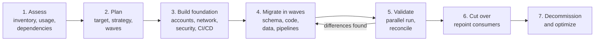

# Migrating a Legacy Data Warehouse to a Cloud Warehouse or Lakehouse

A practical guide to moving an on-premises or legacy data warehouse (Teradata, Netezza, Oracle Exadata, SQL Server, Greenplum, Vertica, Hadoop and Hive, or an older cloud warehouse) to Snowflake, BigQuery, Redshift, Microsoft Fabric or a Databricks lakehouse. It covers assessment, choosing a strategy, converting code, moving data, running old and new in parallel, cutover, and the mistakes that sink these projects.

The [database migration guide](./database-migration.md) covers moving an operational (OLTP) database. Warehouse migrations are a different problem: the data is bigger, the code is the hard part, and the risk is not downtime but numbers that silently change.

---

## Why warehouse migrations are hard

Moving the data is the easy bit. A legacy warehouse that has run for fifteen years is mostly made of **logic**: thousands of stored procedures, ETL jobs in Informatica, DataStage or SSIS, BTEQ scripts, views on views, scheduled jobs in a mainframe scheduler, and reports in tools that send SQL straight to the warehouse. Much of it is undocumented. Some of it is unused. Some of it is load-bearing in ways nobody remembers, such as a view that quietly excludes test accounts and has done since 2013.

The measure of success is not "the data is in the new platform". It is **"every report that matters produces the same numbers as before, the old system is switched off, and the new one costs what we said it would"**. Projects that measure progress by terabytes moved tend to reach 90% and stay there for a year, running two warehouses at once.

---

## The phases

The warehouse migration lifecycle. Assessment and planning come first. A foundation of accounts, networking and security is built once. Workloads then move in waves, each converted, loaded and validated in a parallel run against the old system before consumers are repointed. The legacy platform is switched off only when the last wave has cut over.

---

## Phase 1: Assess

Assessment decides the size of the project, so do it with data, not interviews alone.

**Inventory everything.** Databases, schemas, tables (with sizes and row counts), views, stored procedures, macros, user-defined functions, ETL jobs, scheduler definitions, and the reports and extracts that read from the warehouse. Every major migration tool includes an assessment component that scans code and produces this inventory with complexity scores (see the tools section).

**Find out what is actually used.** Query logs are the most valuable input you have. Legacy warehouses keep detailed query history (Teradata DBQL, Oracle AWR and audit trails, SQL Server Query Store and extended events). Analyse a few months of it:

- Which tables were read in the last 90 days, and by whom?
- Which reports and users generate the most load?
- Which stored procedures and jobs actually ran?

It is common to find that 30 to 50% of objects have not been touched in a year. Every object you do not migrate is code you do not convert, test or maintain. Agree with owners to archive them (a cheap export to object storage) rather than migrate them.

**Map dependencies.** Which jobs load which tables, which views read which tables, which reports read which views. This lineage drives the wave plan: you cannot move a report until everything it reads has moved.

**Catalogue the awkward parts.** Things that convert badly and need human attention: procedural code with cursors and loops, dynamic SQL built in strings, proprietary functions and syntax (Teradata `QUALIFY` is now widely supported, but `PERIOD` types, macros, `SET` tables with implicit deduplication and case-insensitive default collation are not), vendor-specific date arithmetic, and any logic that depends on sort order without an `ORDER BY`.

**Estimate.** Size the effort by converted objects weighted by complexity, not by data volume. Include testing, which is usually as large as conversion.

---

## Phase 2: Choose the target and the strategy

### Target platform

| If you mostly... | Strong candidates | Why |
|---|---|---|
| Run SQL analytics and BI, want minimal operations | Snowflake, BigQuery | Fully managed, separate storage and compute, little tuning |
| Are standardized on AWS with heavy existing Redshift skills | Amazon Redshift (Serverless or RA3), or Iceberg on S3 with Redshift and Athena | Integration with the rest of AWS, zero-ETL feeds |
| Are a Microsoft shop with Power BI and SQL Server skills | Microsoft Fabric (Warehouse and Lakehouse on OneLake) | T-SQL familiarity, Power BI Direct Lake, one capacity bill |
| Mix SQL, data engineering in Python, ML and streaming | Databricks lakehouse | Open formats (Delta, Iceberg), Spark and SQL in one platform |
| Need open table formats to avoid lock-in | Iceberg or Delta, with any engine that reads them | Data stays in your storage; engines are swappable |

Most of these now read and write open table formats, so the choice is less permanent than it used to be. See [Warehouses, lakes and lakehouses](../../learn/concepts/warehouses-lakes-lakehouses.md) and the [lakehouse architecture](../architecture-patterns/lakehouse-architecture.md) pattern.

### Migration strategy

**Lift and shift.** Convert schemas and code as directly as possible, keeping the same data model and job structure. Fastest route to switching off the old system, lowest risk of changed numbers, and the easiest to validate (old and new should match exactly). The downside: you carry old design debt into the new platform, and some patterns that were efficient on the old engine are expensive on the new one (row-by-row procedural logic, for example).

**Re-architect.** Redesign the data model and pipelines for the new platform: ELT with dbt instead of stored procedures, a [medallion layout](../architecture-patterns/medallion-architecture.md), modern ingestion. Better long-term result, but validation is harder (numbers may legitimately change), and the project is much longer.

**The hybrid most successful teams use:** lift and shift the data model and the bulk of the logic, so you can validate against the old system and switch it off, then modernize workload by workload once you are on the new platform. Re-architect up front only the pieces that genuinely cannot work as they are (for example, a nightly batch that has to become streaming), or the ones so broken that converting them is pointless.

### Wave planning

Do not migrate everything at once ("big bang"). Group workloads into waves along dependency lines: a subject area (finance, sales, supply chain) with its source loads, transformations and reports. Pick a first wave that is important enough to matter but not the most critical or complex; its job is to prove the tooling, the validation process and the team's estimates.

---

## Phase 3: Build the foundation

Before any wave, set up once:

- **Accounts, environments and networking**: dev, test and prod; private connectivity from on-premises (VPN or dedicated links) sized for bulk transfer.
- **Identity and access**: single sign-on, role design, mapping of legacy roles and grants. Do not copy legacy grants blindly; they have usually accumulated over years. See [Data governance and catalogs](../../learn/concepts/data-governance-and-catalogs.md).
- **Security and compliance**: encryption, key management, data residency, masking for sensitive columns, audit logging.
- **CI/CD** for converted code (dbt projects, SQL scripts, pipeline definitions) so every change is reviewed and deployable.
- **Cost controls**: budgets, warehouse auto-suspend, resource monitors or reservations. The first surprise bill usually arrives during the parallel run, when both systems are busy.

---

## Phase 4: Migrate each wave

### Schema conversion

Convert DDL with a tool, then review. Things to watch:

- **Data types.** Precision and scale of decimals, timestamp time zone semantics, string lengths, and character sets. Teradata and SQL Server default to case-insensitive comparison; Snowflake and BigQuery are case-sensitive by default. A `WHERE country = 'usa'` that matched 'USA' before will match nothing after. Decide on collation explicitly.
- **Physical design does not translate.** Teradata primary indexes, Netezza distribution keys and Oracle partitions and indexes have no direct equivalent in Snowflake or BigQuery. Drop them, and design clustering or partitioning for the new platform from the query logs.
- **Constraints.** Most cloud warehouses do not enforce primary and foreign keys (they record them for optimizers and tools). If the old system relied on enforced uniqueness, add data tests.

### Code conversion

This is the largest piece of work. Automated converters handle most standard SQL and a good share of procedural code; the remainder needs engineers who know both dialects. Plan for:

- **Stored procedures**: convert to the target's procedural language (Snowflake Scripting, BigQuery scripting, T-SQL in Fabric) for lift and shift, or rewrite as set-based dbt models when re-architecting. Cursor loops that processed one row at a time should become set-based SQL; on a distributed engine they are painfully slow.
- **ETL tool jobs** (Informatica, DataStage, SSIS, Ab Initio): some converters translate them to SQL, dbt or Spark; otherwise rebuild them, or run the existing ETL tool against the new target as an interim step.
- **Scheduling**: move from the legacy scheduler to Airflow, Dagster, or the platform's own orchestration, keeping dependencies explicit. See [Data pipelines and orchestration](../../learn/concepts/data-pipelines-and-orchestration.md).
- **Reports and extracts**: BI tools that send SQL to the warehouse need their connections and any custom SQL converted. Reports are often the most numerous objects and the most visible if they break.

### Data movement

**Historical load.** Export from the legacy system to files (Parquet where the export tool supports it, otherwise compressed delimited files), transfer, and bulk load. For large volumes over a slow link, physical transfer appliances (AWS Snowball, Azure Data Box, Google Transfer Appliance) beat the network. Rough arithmetic helps: 500 TB over a dedicated 1 Gbps link at 80% utilization takes around two months.

**Keeping current until cutover.** During the parallel run, the new platform needs the same daily data as the old one. Two approaches:

1. **Dual-feed**: run the converted ingestion pipelines against the same sources, so both systems load independently. This also tests the new pipelines.
2. **Replicate**: copy changes from the legacy warehouse to the new one ([CDC](../architecture-patterns/cdc-to-lakehouse.md) or incremental exports). Simpler early on, but it does not test the new pipelines, so you still need a dual-feed period before cutover.

---

## Phase 5: Validate

Validation is where migrations earn trust. Plan it from day one, automate it, and expect it to find real differences.

**Levels of validation, in order:**

1. **Row counts** per table and per partition (day, month).
2. **Aggregate checksums**: sums of numeric columns, counts of distinct keys, min and max of dates, per table and partition. Cheap to compute on both sides and catch most problems.
3. **Row-level comparison** for important tables: hash each row on both sides (after normalizing types, trimming strings, aligning time zones) and compare hash sets. Mismatches give you the exact rows to investigate. Several tools automate this.
4. **Report-level comparison**: the outputs of key reports and dashboards, compared number by number for the same parameters.

**Run old and new in parallel** for at least one full business cycle that matters (a month-end close for finance; a quarter if quarterly reports are critical). Compare every day, and track differences in a log with an owner and a resolution for each.

**Expect legitimate differences** and decide how to handle them: floating-point rounding, different `NULL` sorting, case sensitivity, time zone conversion, and bugs in the old system that the new one does not reproduce. When the old system was wrong, document the change and get the report owner to sign it off. Do not "fix" the new system to reproduce an old bug without a decision.

---

## Phase 6: Cut over

Cut over per wave, not all at once:

1. Freeze changes to the wave's legacy objects.
2. Run final validation for the latest data.
3. Repoint consumers: BI connections, extracts, downstream systems. Using a DNS alias or a connection abstraction for the warehouse endpoint early in the project makes this a configuration change.
4. Keep the legacy objects read-only for an agreed period, so you can compare or fall back.
5. Communicate clearly to users which system is now the source of truth.

Have a written rollback plan for each wave. It is rarely used, but writing it forces you to think about what would have to be true to go back.

---

## Phase 7: Decommission and optimize

Switching off the old system is what pays for the project, so schedule it as a milestone with a date, not as a hope. Archive what must be retained for legal reasons to cheap object storage in an open format. Cancel licences and support contracts, and reclaim hardware.

Then optimize the new platform: right-size compute, add clustering based on real query patterns, remove migration-era scaffolding, and begin the modernization you deferred.

---

## Migration tools

Each vendor offers assessment and conversion tooling, much of it free:

- **[📖 BigQuery Migration Service](https://docs.cloud.google.com/bigquery/docs/migration-intro)** - assessment, batch and interactive SQL translation, and data transfer for migrations to BigQuery
- **[📖 Snowflake SnowConvert AI](https://docs.snowflake.com/en/migrations/snowconvert-docs/overview)** - code conversion from Teradata, Oracle, SQL Server, Redshift and others to Snowflake
- **[📖 Databricks Lakebridge](https://databrickslabs.github.io/lakebridge/)** - open-source assessment, code conversion and reconciliation for migrations to Databricks (from the BladeBridge acquisition, 2025)
- **[📖 AWS Schema Conversion Tool](https://docs.aws.amazon.com/SchemaConversionTool/latest/userguide/CHAP_Welcome.html)** - converting data warehouse schemas and code to Amazon Redshift, with data extraction agents
- **[📖 AWS DMS Schema Conversion](https://docs.aws.amazon.com/dms/latest/userguide/CHAP_SchemaConversion.html)** - managed schema conversion inside AWS DMS
- **[📖 Fabric Migration Assistant for Data Warehouse](https://learn.microsoft.com/en-us/fabric/data-warehouse/migration-assistant)** - migrating Synapse dedicated SQL pools and SQL Server analytics databases to Fabric Warehouse
- **[📖 Migrating Synapse dedicated SQL pools to Fabric](https://learn.microsoft.com/en-us/fabric/data-warehouse/migration-synapse-dedicated-sql-pool-methods)** - methods and planning for Synapse-to-Fabric moves

Third-party tools and partners (for example Datafold for cross-database diffing, and system integrators with converters for specific ETL tools) fill gaps, especially for ETL tool conversion and row-level reconciliation.

---

## Anti-patterns that sink migrations

- **Migrating everything.** Moving unused objects multiplies conversion and testing effort. Use query logs to cut scope first.
- **Measuring progress in terabytes.** Data is the easy part. Track converted and validated objects, and reports cut over.
- **Big bang cutover.** One weekend to switch everything leaves no room for the differences you will find. Use waves.
- **No parallel run, or one that is too short.** Month-end and quarter-end logic only runs at month-end and quarter-end.
- **Re-architecting everything during the migration.** You can no longer compare old and new numbers, and the timeline doubles. Lift, validate, switch off, then improve.
- **Copying legacy physical design.** Indexes and distribution choices from the old engine are meaningless or harmful on the new one.
- **Ignoring cost until the first bill.** Converted row-by-row procedures and unclustered scans can make the new platform more expensive than the old. Watch query cost during the parallel run.
- **No owner for each report.** Someone must sign off that each important report is right on the new platform. Without owners, validation never finishes.
- **Leaving the legacy system on "just in case".** It will stay on for years. Set the decommission date at the start.

---

## Checklist

- [ ] Inventory built from code scans and query logs; unused objects agreed for archive.
- [ ] Dependencies mapped and workloads grouped into waves.
- [ ] Target platform and strategy chosen and written down, with reasons.
- [ ] Foundation in place: environments, network, identity, security, CI/CD, cost controls.
- [ ] Collation, time zone and type-mapping decisions documented.
- [ ] Automated validation at count, checksum, row and report level.
- [ ] Parallel run covers at least one full critical business cycle per wave.
- [ ] Every important report has an owner who signs off.
- [ ] Rollback plan written per wave.
- [ ] Decommission date set and tracked.

---

## Related

- [Database migration guide](./database-migration.md) - moving operational databases, CDC and cutover strategies
- [Lakehouse architecture](../architecture-patterns/lakehouse-architecture.md)
- [Medallion architecture](../architecture-patterns/medallion-architecture.md) - a common target layout after re-architecting
- [Data pipeline / ETL](../architecture-patterns/data-pipeline-etl.md)
- [ETL vs ELT](../../learn/concepts/etl-vs-elt.md) - the shift most migrations make along the way
- [Slow SQL query diagnosis](../troubleshooting/slow-sql-query-diagnosis.md) - tuning converted queries on the new platform
