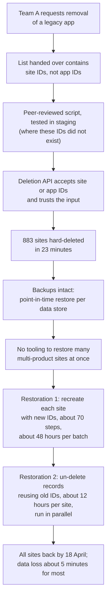

# Postmortem study guide - Atlassian cloud site deletion, 2022-04-05

> On 5 April 2022 a maintenance script meant to remove one legacy app from Atlassian Cloud customer sites was given the wrong kind of ID and deleted **883 entire sites belonging to 775 customers** in 23 minutes. Atlassian had good backups: it met its one-hour recovery point objective and limited data loss to about five minutes before deletion for most customers. But it had never built a way to restore hundreds of multi-product sites at once, so some customers waited up to **14 days** to get their Jira and Confluence back. It is the textbook example of the gap between being able to **recover data** and being able to **recover service**.

Atlassian published a detailed post-incident review (PIR) on 29 April 2022. Everything below comes from that review unless stated otherwise.

---

## Why data engineers and DBAs study this one

The [GitLab 2017 postmortem](./postmortem-gitlab-database-2017.md) is about backups that did not exist. Atlassian is the opposite case: backups existed, were immutable, were tested and met their objective. The outage still lasted two weeks. That makes it the better lesson for mature teams, because the failures were in places that mature teams also overlook:

- a destructive API that accepted two kinds of identifier and trusted the caller,
- a change that was reviewed and tested, but in ways that could not catch the actual mistake,
- hard deletes with no soft-delete stage,
- restore tooling designed for one tenant at a time, in a multi-tenant system,
- identifiers that were embedded everywhere, so recreating an object with a new ID broke references,
- and the deletion of the very contact data needed to talk to affected customers.

---

## The setup

Atlassian Cloud runs on AWS as a multi-tenant microservice architecture. A customer's **site** is the container for their products (Jira, Confluence and others), identified by a cloud ID and URL. The data for one site is spread across many services and data stores, each of which stores data for many tenants in shared shards, with each tenant's data isolated from the others.

Atlassian's data protection, as described in the PIR:

- Replication across AWS Availability Zones, with automated failover typically in 60 to 120 seconds.
- **Immutable backups** with full and incremental backups that allow point-in-time recovery of any data store, retained for **30 days**, tested and audited.
- A disaster recovery programme focused on infrastructure failures, data corruption, single-service events and **single-site** deletions.

That last point is the crux. Restoring one site, or restoring one data store to a point in time, was a known and practised operation. Restoring hundreds of sites, each spanning several products and dozens of services, was not.

---

## Timeline (UTC, 2022)

- **2021.** Atlassian acquired and integrated a standalone app, "Insight - Asset Management", into Jira Service Management. The standalone app needed to be removed from customer sites that still had it.
- **Before 5 April.** One team requested the deletion and another ran it, using an existing script and process. The first production run, against 30 sites, worked correctly; its IDs had been gathered before a miscommunication and were genuine app IDs.
- **5 April, 07:38 to 08:01.** The next run used a list that contained **site IDs instead of app IDs**. The deletion API accepted either kind of ID. It deleted 883 sites, representing 775 customers. Jira products, Confluence, Atlassian Access, Opsgenie and Statuspage became unavailable for those customers.
- **07:46.** The first support ticket from an affected customer.
- **08:17.** Incident confirmed; major incident process triggered.
- **08:53.** Cause identified: the Insight script had deleted whole sites.
- **5 to 9 April.** Early recovery used the existing site restoration process ("Restoration 1"), with automation built to run it in batches.
- **8 April.** First customers restored.
- **9 April.** Atlassian estimated Restoration 1 would take three weeks to finish everyone, and proposed a faster approach ("Restoration 2").
- **14 to 17 April.** Restoration 2 used for the remaining sites.
- **18 April.** All sites restored.
- **29 April.** PIR published.

*The diagram follows the incident from cause to recovery. A handover produced a list of site IDs instead of app IDs; the script passed review and staging tests that could not detect this; and the deletion API accepted the IDs without question, deleting 883 sites in 23 minutes. The backups were intact, but there was no tooling to restore many multi-product sites at once. The first approach recreated each site with new identifiers and was slow and sequential; the second un-deleted records using the original identifiers and ran in parallel, finishing all restores by 18 April.*

---

## Root cause analysis

Atlassian named two direct causes. Both are worth understanding as patterns, not as one-off mistakes.

### 1. A communication gap at a handover

The requesting team supplied site IDs where the executing team expected app IDs. Nothing about an ID string tells you what kind of object it identifies. Handovers of identifier lists (in a ticket, a spreadsheet, a chat message) are a classic place for this to go wrong: the receiving team trusts that the list means what the request says.

### 2. A destructive API with no guard rails

In Atlassian's words, the API "accepts both site and app identifiers and assumes the input is correct", and there was "no warning signal to confirm the type of deletion (site or app) being requested". One endpoint could delete something small or something enormous, depending on what was passed, and it did not ask.

### Why review and testing did not catch it

This is the subtle part. The process was followed:

- **Peer review** focused on which endpoint was called and how. It did not check that the IDs in the input referred to apps rather than sites. Reviewing code is not the same as reviewing the **data** the code will act on.
- **Staging tests** passed, but the production IDs did not exist in staging, so the test could not reveal that they were the wrong kind.
- **A first production run** on 30 sites succeeded, which built confidence, but its input list predated the miscommunication.

Each check validated something real, and none validated the thing that was wrong.

### Why recovery took up to 14 days

The data was safe; the problem was putting it back together:

- **Restore tooling was built for single-site events.** Atlassian had runbooks for restoring one site, not for hundreds simultaneously across several products.
- **Restoration 1 created new sites.** Each new site got a new cloud ID. Because identifiers like the cloud ID are treated as immutable and embedded in records across many systems (and in third-party apps), every restored data store had to be remapped from old IDs to new. The process had about 70 mostly sequential steps and took about 48 hours per batch. It restored 112 sites, covering about 53% of affected users.
- **Restoration 2 un-deleted instead.** It re-created the original records, starting with the site's catalogue record, and **reused the old identifiers**. That removed more than half the steps, including coordinating with every third-party app vendor for each site. It took about 12 hours per site with far more parallelism, and restored the remaining 771 sites, covering about 47% of users.
- **Consistency across stores needed a common restore point.** Each site's data lived in several stores. Atlassian restored primary stores to a fixed point in time just before deletion and brought the other stores to the same point, so the restored site was consistent. For 57 customers restored early on, inconsistent manual handling restored some Confluence and Insight databases to a point more than five minutes before deletion; Atlassian later recovered the remaining data with those customers.

### Why communication was slow

The same script deleted the customer identifiers and contact details (cloud URL, site system admin contacts) that Atlassian's support, licensing and billing systems relied on. Customers could not file a high-priority ticket because the support form required a valid cloud URL, which no longer existed. Atlassian acknowledged it was slow to confirm the incident publicly and did not give customers even rough restoration estimates early enough.

---

## RPO met, RTO missed

Atlassian's own summary is the best one-line lesson from this incident: **"we missed our RTO but met our RPO."**

- **Recovery point objective (RPO)**: how much data you lose. Atlassian's target was one hour; actual loss was about five minutes before deletion for most customers. Excellent.
- **Recovery time objective (RTO)**: how long until service is back. Up to 14 days for some customers. Far outside any reasonable target.

Backup design mostly determines RPO. Restore design (tooling, automation, parallelism, practice at scale) determines RTO. Teams that only test "can we restore this database?" are testing RPO and assuming RTO.

---

## What Atlassian changed

The PIR lists four learnings, each with commitments:

1. **Universal soft deletes.** Deleting customer data or metadata must go through a soft-delete process first, and in Atlassian's words a deletion of this type "should be prohibited or have multiple layers of protections to avoid errors, including staged rollout and tested rollback plan".
2. **Automate multi-site, multi-product restoration** as part of the disaster recovery programme, to meet the RTO for an event of this size, and regularly run DR exercises that restore all products for a large set of sites.
3. **Improve incident management for large-scale events**, with playbooks for incidents involving hundreds of people working in parallel.
4. **Improve communications**: back up customer contact data separately, let support tooling accept incidents from customers without a valid URL, and provide earlier, clearer estimates.

---

## What this teaches

### Soft delete first, hard delete later

A soft delete marks data as deleted (a flag, a tombstone, a move to a holding area) and makes it invisible to normal reads, while keeping it recoverable. A separate, delayed job purges it after a retention window. Had sites been soft-deleted, recovery would have been an "un-delete" measured in minutes per site, not a restore from backup.

In data platforms, the same idea shows up as:

- `deleted_at` columns and views that filter them out,
- table formats and warehouses with time travel (Delta Lake, Iceberg, Snowflake Time Travel) that keep old versions for a period,
- object storage versioning and delayed lifecycle expiry,
- retention locks and recycle bins on managed databases.

### Destructive operations should be narrow, explicit and confirmed

- **One endpoint, one kind of object.** An API that deletes an app should not be able to delete a site.
- **Typed or prefixed identifiers** (for example `site_...` and `app_...`) make the wrong kind of ID fail validation instead of silently succeeding.
- **Dry runs** that print exactly what would be deleted, in human terms ("883 sites, 775 customers"), before anything is deleted.
- **Blast-radius limits**: a maximum number of objects per run, and a staged rollout (one internal site, then a handful, then the rest) with a pause to check results.

The [AWS S3 2017 postmortem](https://cloud.noblerworks.com/resources/postmortem-aws-s3-2017/) on the cloud site makes the same point about operator commands with no upper bound.

### Review the data, not just the code

Bulk changes driven by an input list (IDs to delete, rows to update, a backfill date range) need the list itself reviewed and validated: query each ID to confirm it is the expected type and belongs to the expected object, compare counts with expectations, and sample a few by hand. For SQL, the equivalent is running the `SELECT` with the same `WHERE` clause first and checking the row count before running the `DELETE` or `UPDATE`, ideally inside a transaction you can roll back.

### Test what your test environment can actually catch

A staging environment without production identifiers cannot catch identifier mistakes. Know what each test layer validates, and add a check for the risk that remains (here: validating IDs against production metadata in a read-only pre-flight step).

### Design restore for the failure you fear, at the scale you fear

Restoring one tenant is not the same exercise as restoring a thousand. Practise restores at realistic scale and measure the time. In multi-tenant systems, build tooling that can select a set of tenants and restore all their data, across every store, to one consistent point in time.

### Keep identifiers stable

Atlassian's faster restore worked because it reused original identifiers. A recovery that issues new primary keys or new surrogate IDs forces you to remap every reference, inside and outside your system. Prefer restore processes that bring back the original keys, and design data so that recovery does not require rewriting references.

### Back up the metadata you need to respond

Contact lists, ownership records, the catalogue of what exists and who owns it: if your incident can delete them, your response depends on them, so store a copy outside the blast radius.

---

## Cert mapping

| Cert | What this incident tests |
|---|---|
| [Azure DP-300](../exams/azure/dp-300/) | Point-in-time restore, long-term retention, RPO and RTO, testing recovery |
| [GCP Professional Cloud Database Engineer](../exams/gcp/cloud-database-engineer/) | Backup and recovery design, multi-tenant considerations |
| [SnowPro Advanced: Administrator](../exams/snowflake/snowpro-advanced-administrator/) | Time Travel, `UNDROP`, Fail-safe and their retention windows as soft-delete safety nets |
| [Databricks Data Engineer Professional](../exams/databricks/data-engineer-professional/) | Delta Lake time travel and `RESTORE`, safe bulk operations |
| [AWS Database Specialty (retired, reference)](../exams/aws/specialty/database-dbs-c01/) | Snapshots, PITR and restoring to new instances |

---

## Discussion questions (use as study prompts)

1. Which operations in your platform hard-delete data immediately? For each, what would a soft-delete stage look like, and how long should it hold data?
2. Your restore tooling can bring back one database to any point in the last 30 days. How long would it take to bring back 500 tenants across four products to one consistent point? Has anyone measured it?
3. A colleague hands you a spreadsheet of 2,000 IDs to delete. List the checks you would run before executing.
4. If your restore process gives restored rows new primary keys, which downstream systems would break?
5. What information would you need in the first hour of an incident like this to contact affected customers, and where would it come from if the incident deleted it?

---

## Sources

- **[📖 Atlassian: Post-incident review on the Atlassian April 2022 outage (29 April 2022)](https://www.atlassian.com/engineering/post-incident-review-april-2022-outage)** - the official PIR: architecture, timeline, causes, Restoration 1 and 2, RPO and RTO, communications and the four learnings. All figures on this page come from it.
- **[📖 Google SRE book: Postmortem culture](https://sre.google/sre-book/postmortem-culture/)** - the blameless review practice behind write-ups like this one.

---

## Related

- [Postmortem: GitLab.com database deletion, 2017](./postmortem-gitlab-database-2017.md) - backups that did not exist, as opposed to restores that did not scale
- [Change data capture](../learn/concepts/change-data-capture.md) - how deletes propagate downstream, and why soft deletes are easier to capture
- [Transactions and ACID](../learn/concepts/transactions-and-acid.md) - consistency across a restore
- [Data contracts](../learn/concepts/data-contracts.md) - making identifiers and their meaning explicit between teams
- [Failing and late pipelines](./troubleshooting/failing-and-late-pipelines.md) - idempotent reruns and safe backfills
- [DBA interview guide](./interview-prep/dba-interview.md) - backup, restore and RPO/RTO questions with worked answers
- Cloud postmortems on the sibling site: [AWS S3 2017](https://cloud.noblerworks.com/resources/postmortem-aws-s3-2017/), [Cloudflare regex 2019](https://cloud.noblerworks.com/resources/postmortem-cloudflare-regex-2019/), [GCP networking 2019](https://cloud.noblerworks.com/resources/postmortem-gcp-networking-2019/)
