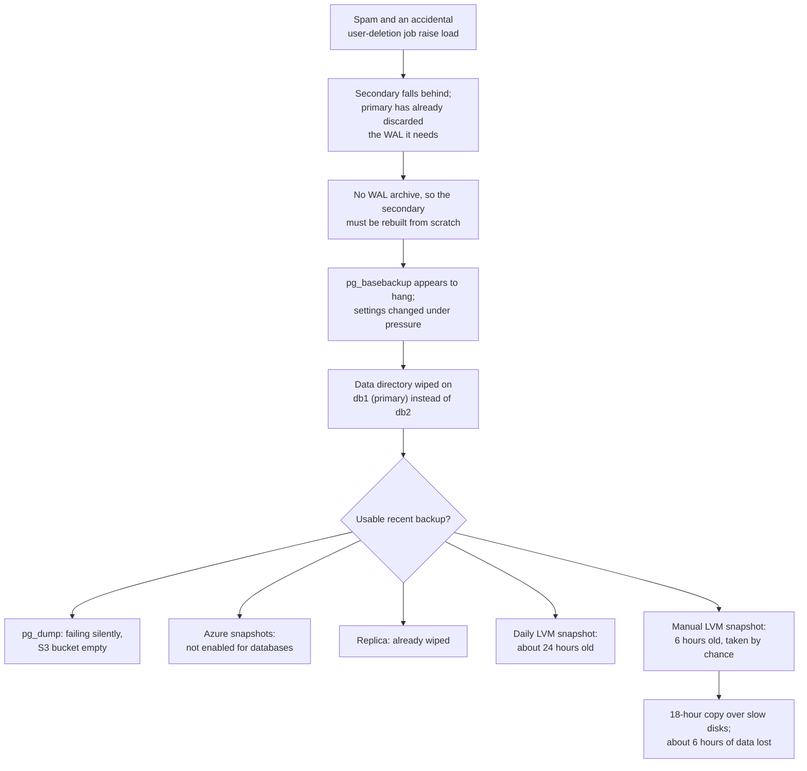

# Postmortem study guide - GitLab.com database deletion and backup failure, 2017-01-31

> On 31 January 2017 an engineer trying to repair a broken PostgreSQL replica ran a command that deleted the data directory on the **primary** database of GitLab.com instead of the secondary. When the team reached for backups, they found that none of their five backup and replication mechanisms could give them a recent, usable copy. They restored from a snapshot an engineer had taken by hand six hours earlier for unrelated testing, lost about six hours of database changes, and were down for roughly 18 hours. It is the best-documented public example of the rule every DBA learns eventually: **a backup you have not restored is not a backup.**

GitLab published an unusually candid postmortem, live-streamed the recovery and kept a public working document during the incident. Everything below comes from that postmortem unless stated otherwise.

---

## Why data engineers and DBAs study this one

Most outage write-ups are about availability. This one is about **durability**: data that was gone and could not be fully brought back. It is also a near-perfect catalogue of failure modes that still exist in data platforms today:

- replication mistaken for backup,
- a backup job that had been failing silently,
- a failure alert that was sent but never arrived,
- a disaster recovery mechanism that was never turned on for the one system that mattered,
- a restore path nobody had timed, which turned out to be limited by cheap disks,
- and a destructive command run on the wrong host by a tired engineer late at night.

None of these is exotic. Every one of them can exist in your warehouse, your operational databases or your lakehouse right now.

---

## The setup

GitLab.com ran on a single PostgreSQL primary (`db1.cluster.gitlab.com`) with a single hot-standby secondary (`db2.cluster.gitlab.com`). The secondary existed for failover only; all load hit the primary. GitLab's write-up notes that this single primary had already caused several earlier incidents.

The data protection measures in place, as GitLab listed them:

| Mechanism | What it was for | State on the night |
|---|---|---|
| `pg_dump` logical backup every 24 hours, uploaded to Amazon S3 | Disaster recovery | Had been failing; the bucket was empty |
| LVM snapshot of the database disk every 24 hours | Refreshing the staging environment | Working, but not designed for recovery; about 24 hours old |
| Azure disk snapshots every 24 hours | Disk-level recovery | Enabled for file servers, **not enabled for database servers** |
| Streaming replication to the secondary | Failover | Broken that night, and the secondary had been wiped during the repair |
| A manual LVM snapshot | Load testing in staging | Taken by chance about six hours before the outage |

That table is the incident in miniature. Five layers of protection looked like defence in depth on paper. In practice the only usable copy was an accident.

---

## Timeline (UTC, 31 January to 1 February 2017)

- **About 17:20.** An engineer, preparing to test the pgpool-II connection pooler in staging, took a manual LVM snapshot of the production database and loaded it into staging so the test data would be current. Normally this ran automatically once a day.
- **About 19:00.** Database load rose sharply, which GitLab suspected was spam. Part of the load turned out to be a background job deleting a GitLab employee and their data: the employee had been reported for abuse by a troll and accidentally scheduled for removal. Users had trouble posting comments; getting load under control took hours.
- **About 23:00.** Under the load, the secondary fell behind. Replication then failed because the primary had already removed write-ahead log (WAL) segments the secondary still needed. GitLab was not archiving WAL, so the only fix was to rebuild the secondary from scratch: empty its data directory, then run `pg_basebackup` to copy the primary.
- **23:00 to 23:30.** `pg_basebackup` hung silently. The team found the primary had too few replication connections (`max_wal_senders` was 3), raised it to 32, and hit a second problem when PostgreSQL refused to restart because `max_connections` was set to 8,000 (a value applied a year earlier); they lowered it to 2,000. `pg_basebackup` still appeared to hang. In fact it was behaving normally, waiting silently for the primary to start sending data, but this was not documented in their runbooks or in the PostgreSQL documentation.
- **About 23:30.** Believing earlier attempts had left files behind on the secondary, an engineer ran a command to wipe the PostgreSQL data directory, on what they believed was `db2`. It was `db1`, the primary. They stopped it a second or two later; about 300 GB of data had already been removed. GitLab.com went down.
- **Overnight.** The team went looking for backups. The `pg_dump` bucket in S3 was empty. Azure snapshots did not exist for the database. The secondary had been wiped as part of the repair. The 24-hour LVM snapshot would lose almost a day of data. The manual 17:20 snapshot was the best option.
- **Through 1 February.** Data was copied from the staging host back to production. The staging disks were cheap, network-attached and throttled to around 60 Mbps; the copy took about 18 hours. The team live-streamed the recovery on YouTube, peaking at around 5,000 viewers.
- **About 17:00, 1 February.** The database was restored to its 17:20 state from the previous day, without webhooks (the staging copy had them stripped).
- **About 18:00, 1 February.** Webhooks restored from a separate copy of the snapshot, and GitLab.com fully back.

*The diagram traces the chain of events. Load from spam and an accidental user-deletion job broke replication; because WAL was not archived, the secondary had to be rebuilt, and during that repair the primary's data directory was deleted by mistake. At the decision point, four of the five recovery options were unusable or too old, and the only good option was a snapshot an engineer had taken by hand for testing. Restoring it took about 18 hours and cost about six hours of data.*

---

## What was lost

Database changes between about 17:20 and the deletion around 23:30 UTC on 31 January could not be recovered. GitLab estimated roughly **5,000 projects, 5,000 comments and 700 new user accounts**, plus issues and snippets created in that window. Git repositories and wikis were stored separately (on file servers with their own snapshots) and were not lost, so for projects created in the window GitLab could rebuild a basic project record from the repository on disk, but without its issues and merge requests. Self-managed GitLab installations were unaffected; this was only the hosted service.

---

## Root cause analysis

GitLab used the "5 Whys" and split the incident into two problems: why the site went down, and why it took so long to restore. The second is the more important lesson.

### Problem 1: why the data was deleted

1. **A human ran a destructive command on the wrong host.** Both hosts looked the same in a terminal. The engineer was tired, late at night, working under pressure after hours of firefighting. GitLab's first action item was to change the shell prompt on every host so production and the environment are unmistakable.
2. **The procedure required deleting a data directory by hand.** Rebuilding a replica meant emptying its data directory and re-running a base backup. This was manual and, in GitLab's words, "not automated, nor was it documented properly". Any manual step that deletes data will eventually be run in the wrong place.
3. **Replication broke because WAL was not retained.** Under heavy write load the primary recycled WAL segments before the secondary had received them. With WAL archiving (or, in modern PostgreSQL, a replication slot or a `wal_keep_size` setting large enough), the secondary could have caught up instead of being rebuilt.
4. **Load spiked because of a hard delete.** A spam report led to a background job hard-deleting an employee's account and all its data, which hammered the database. GitLab opened an issue titled "Removal of users by spam should not hard delete": a soft delete would have been cheap and reversible.

### Problem 2: why recovery took 18 hours and lost 6 hours of data

1. **The main backup had been failing for an unknown time.** The `pg_dump` job ran on an application server, not a database server. GitLab's packaging picked the PostgreSQL client version from the local data directory; there was none on an app server, so it defaulted to the 9.2 tools. The database ran 9.6. `pg_dump` refuses to dump a server of a newer major version, so every run failed.
2. **The failure alert never arrived.** The cron job emailed errors, but those emails were not DMARC-signed and the receiving mail server rejected them. The sender had no other way to report failure. Nobody knew backups were failing.
3. **Disk snapshots were not enabled for the database.** The team assumed the other backups were enough, and restoring Azure snapshots across storage accounts could take days.
4. **Replication is not a backup.** The secondary was a live copy of the primary. It was wiped as part of the very repair that went wrong, and it would have replicated any logical corruption anyway.
5. **Nobody owned backup testing.** GitLab's own answer to "why was the backup procedure not tested on a regular basis?" was: "Because there was no ownership, as a result nobody was responsible for testing this procedure."
6. **The restore path ran on the slowest storage available.** The only good copy lived on cost-optimised staging disks throttled to around 60 Mbps. Nobody had measured how long a full restore would take, so nobody knew the real recovery time objective was close to a day.

---

## How they recovered, and the details worth copying

The recovery itself had some careful touches that are good practice in any restore:

- **They chose the freshest copy, not the official one.** The manual snapshot was six hours old; the scheduled one nearly 24. When every mechanism has failed, inventory every copy that exists, including staging, analytics extracts and developer snapshots.
- **They handled what staging had stripped out.** The staging refresh removed webhooks so test systems would not call customers' endpoints. Production needed them back, so the team restored a second copy of the snapshot separately and imported only the webhooks table.
- **They advanced every sequence by 100,000.** After restoring to an earlier point, IDs issued during the lost window could be reissued, colliding with references held elsewhere (emails, caches, URLs users had bookmarked). Bumping sequences guarantees new rows get IDs that were never used before.
- **They re-enabled the service gradually**, rather than opening the floodgates onto a freshly restored database.
- **They were radically transparent.** A public working document, a live stream and frequent updates. GitLab later noted it would redact engineers' names in future public documents.

---

## What GitLab changed

GitLab's published action items included:

- Change the shell prompt on all hosts to show the host and environment clearly.
- Monitor backups with Prometheus, not email.
- Set `max_connections` to a sane value.
- Investigate point-in-time recovery and continuous WAL archiving; evaluate WAL-E and pgBarman.
- Take LVM snapshots of production databases hourly instead of daily, and enable Azure disk snapshots for databases.
- Automate testing of database backup restores.
- Improve replication documentation and runbooks.
- Build a streaming database restore.
- **Assign an owner for data durability.**

GitLab also made a point worth quoting in spirit: they chose to focus on making recovery fast and routine rather than on blocking engineers from running commands. Aliasing `rm` to something safer protects against one typo, not against disk corruption, bad migrations or any of the other ways data is lost.

---

## What this teaches

### Replication is for availability; backups are for durability

A replica protects against losing a server. It does not protect against deleting data, a bad migration, a buggy job that updates every row, or ransomware, because the replica faithfully copies all of those. You need at least one copy that is **independent in time** (point-in-time recovery from base backups plus archived WAL, or managed equivalents) and ideally **independent in location and credentials** (a different account or region that the production admin cannot delete).

See [Replication and sharding](../learn/concepts/replication-and-sharding.md) and [Transactions and ACID](../learn/concepts/transactions-and-acid.md) for the underlying mechanics.

### Monitor backups by their output, not their exit email

The `pg_dump` job did send failure notices; they were just undeliverable. Robust backup monitoring checks the **result**: the age and size of the newest backup in storage, compared with expectations, alerting when the newest backup is older than, say, 26 hours or smaller than yesterday's by a wide margin. That check runs somewhere independent of the backup job and alerts through the same paging system as production outages. "No news" must never mean "good news".

### A backup is only proven by a restore

Schedule automated restore tests: restore last night's backup to a scratch instance, run sanity queries (row counts for key tables, the latest timestamp, a checksum of a reference table), record how long it took, then tear it down. This catches version mismatches, missing permissions, corrupt files and slow storage while there is still time to fix them. It also gives you a measured recovery time, rather than a guessed one.

### Know your real RPO and RTO

- **Recovery point objective (RPO)**: how much data you can afford to lose. GitLab's effective RPO turned out to be "whenever someone last happened to take a manual snapshot".
- **Recovery time objective (RTO)**: how long you can be down. GitLab's was set, in practice, by the throughput of the slowest disks in the company.

Write both down for each critical data store, design backups to meet them, and test that restores actually do.

### Make the wrong host obvious, and destructive steps rare

- Colour-coded prompts and hostnames that include the environment and role.
- Runbooks that start with "confirm you are on the replica" and a command that proves it (for PostgreSQL, `SELECT pg_is_in_recovery();` returns true only on a standby).
- Automate replica rebuilds so no human types a delete command at all.
- During an incident, use a second person to read back destructive commands before they are run.

### Prefer soft deletes for user-triggered removal

Hard-deleting a user and everything they own, triggered by an abuse report, is both an operational risk (a heavy, unbounded delete on the primary) and a data-loss risk. Mark rows as deleted, purge later in controlled batches, and give operators a window to undo mistakes.

### Watch configuration drift

`max_connections = 8000` had sat there for a year until a restart exposed it. Settings that only take effect on restart can hide for months. Review database parameters periodically and test restarts as part of maintenance, not only during incidents.

---

## How managed databases change the picture (and how they don't)

Managed services such as Amazon RDS and Aurora, Azure SQL Database and Cloud SQL take automated backups and keep transaction logs for point-in-time recovery within a retention window, so the "pg_dump silently failing" class of problem is much rarer. They do not remove the need to:

- set a retention window that meets your RPO, and copy backups to a separate account or region if a compromised admin could otherwise delete them,
- test restores and time them,
- understand that a restore usually creates a **new** instance that you must point applications at,
- protect against logical mistakes inside the database, which the provider faithfully backs up along with everything else.

**[📖 PostgreSQL: Continuous archiving and point-in-time recovery](https://www.postgresql.org/docs/current/continuous-archiving.html)** - base backups plus archived WAL, the mechanism GitLab lacked
**[📖 PostgreSQL: pg_basebackup](https://www.postgresql.org/docs/current/app-pgbasebackup.html)** - the tool used to rebuild the replica, and its options and progress reporting
**[📖 PostgreSQL: Replication settings](https://www.postgresql.org/docs/current/runtime-config-replication.html)** - `max_wal_senders`, `wal_keep_size` and replication slots
**[📖 Amazon RDS: Restoring a DB instance to a specified time](https://docs.aws.amazon.com/AmazonRDS/latest/UserGuide/USER_PIT.html)** - managed point-in-time recovery and its limits

---

## Cert mapping

| Cert | What this incident tests |
|---|---|
| [Azure DP-300](../exams/azure/dp-300/) | Backup and restore strategy, point-in-time restore, HA versus DR, monitoring |
| [GCP Professional Cloud Database Engineer](../exams/gcp/cloud-database-engineer/) | Backup, replication and recovery design for Cloud SQL and AlloyDB |
| [MongoDB Associate DBA](../exams/mongodb/associate-dba/) | Replica sets versus backups, restore procedures |
| [AWS Database Specialty (retired, reference)](../exams/aws/specialty/database-dbs-c01/) | RDS automated backups, snapshots, PITR, cross-region copies |
| [SnowPro Advanced: Administrator](../exams/snowflake/snowpro-advanced-administrator/) | Time Travel and Fail-safe as recovery tools, and their retention limits |

---

## Discussion questions (use as study prompts)

1. For your most important database, which of your protection mechanisms are replicas and which are independent backups? Which would survive an accidental `DROP TABLE`?
2. When did someone last restore your production backup, end to end, and how long did it take? Where is that number written down?
3. How would you find out if last night's backup job failed? What if the alerting channel itself were broken?
4. Your restore completes to a point six hours ago. What else must happen before you reopen to traffic (sequences, caches, webhooks, downstream consumers, data that arrived in the gap)?
5. Write the runbook step that would have stopped an engineer wiping the primary. What does it check, and how?

---

## Sources

- **[📖 GitLab: Postmortem of database outage of January 31 (10 February 2017)](https://about.gitlab.com/blog/2017/02/10/postmortem-of-database-outage-of-january-31/)** - the official postmortem: setup, timeline, settings changed, data loss estimates, backup failures, 5 Whys and action items. All figures on this page come from it.
- **[📖 PostgreSQL: pg_dump](https://www.postgresql.org/docs/current/app-pgdump.html)** - why a dump tool must be at least as new as the server it dumps.
- **[📖 Google SRE book: Postmortem culture](https://sre.google/sre-book/postmortem-culture/)** - the blameless postmortem practice GitLab's write-up follows.

---

## Related

- [Postmortem: Atlassian site deletion, 2022](./postmortem-atlassian-site-deletion-2022.md) - the other side of the same lesson: good backups, but a restore process that did not scale
- [Replication and sharding](../learn/concepts/replication-and-sharding.md)
- [Transactions and ACID](../learn/concepts/transactions-and-acid.md)
- [Database migration guide](./migration-guides/database-migration.md)
- [DBA interview guide](./interview-prep/dba-interview.md) - backup, recovery and replication questions with worked answers
- [Database certification roadmap](./certification-roadmap-database-specialist.md)
- Cloud postmortems on the sibling site: [AWS S3 2017](https://cloud.noblerworks.com/resources/postmortem-aws-s3-2017/), [Cloudflare regex 2019](https://cloud.noblerworks.com/resources/postmortem-cloudflare-regex-2019/), [GCP networking 2019](https://cloud.noblerworks.com/resources/postmortem-gcp-networking-2019/)
