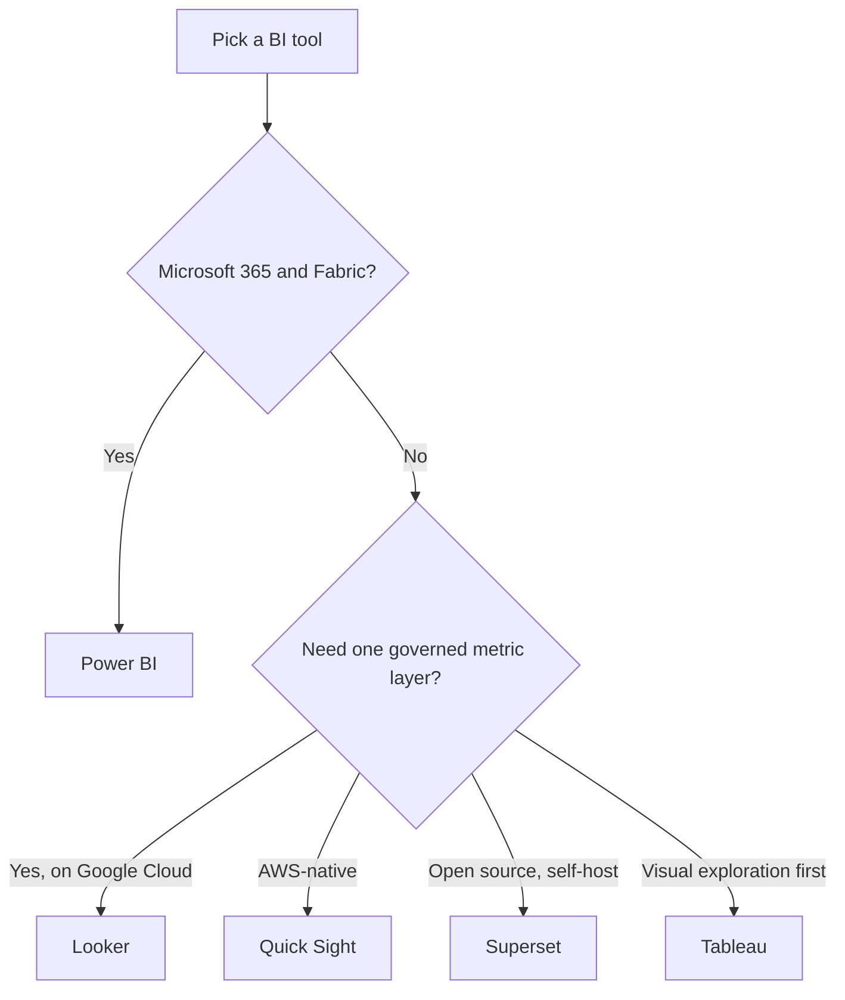

# Service Comparison: BI Tools

A BI tool sits on top of the warehouse and turns tables into charts, dashboards and self-service exploration. This page compares Power BI, Looker, Tableau, Amazon Quick Sight (formerly QuickSight) and Apache Superset. No prices; licensing for these products is detailed and changes. Check the vendor.

Where the data comes from: [Warehouse comparison](./service-comparison-warehouses.md). The modelling layer many of these tools lean on: [Semantic layer](./architecture-patterns/semantic-layer.md).

## The short version

| Tool | Where it comes from | What the docs stress |
|---|---|---|
| **Power BI** | Microsoft; a workload of Fabric | Desktop authoring, cloud service, DAX models |
| **Looker** | Google Cloud | Governed data model, embedded analytics |
| **Tableau** | Tableau | Desktop and web authoring, Cloud and Server |
| **Amazon Quick Sight** | AWS | Dashboards and embedding |
| **Superset** | Apache, open source | Chart builder and SQL editor |

The table holds only facts from the vendor pages linked below.

## Power BI

- Microsoft's business analytics platform, and a core workload of Microsoft Fabric.
- **Power BI Desktop** (Windows app) is for modelling and building reports. The **Power BI service** is the cloud side for publishing, sharing and collaboration. A mobile app is for viewing.
- Desktop connects to more than 100 data sources, uses Power Query for shaping data and DAX for calculations.
- The service adds workspaces, apps, scheduled refresh, row-level security, sensitivity labels and embedding.
- **Direct Lake** mode queries data in OneLake without import or caching. Paginated reports cover printable, pixel-exact output.

**[📖 What is Power BI?](https://learn.microsoft.com/en-us/power-bi/fundamentals/power-bi-overview)** - Desktop vs service, Fabric relationship

## Looker

- Google Cloud's platform for business intelligence, data applications and embedded analytics.
- Built around a governed, unified data model for key metrics. LookML is the language that defines it (the page I read links to LookML but does not explain it; read the LookML reference).
- BigQuery's docs list Looker as a supported BI tool. Looker Studio is a separate, lighter product.

**[📖 Looker documentation](https://docs.cloud.google.com/looker/docs)** - platform overview, LookML links

## Tableau

- A visual analytics tool with Tableau Desktop and web authoring. The help covers Tableau Cloud, Tableau Desktop and Tableau Server.
- Its help covers connecting to data, building views, creating calculations and making dashboards.
- I could only read the help index, so product packaging, ownership and licensing are **unverified**. Check Tableau's own pages.

**[📖 Tableau Desktop and Web Authoring Help](https://help.tableau.com/current/pro/desktop/en-us/default.htm)** - help index for Cloud, Desktop and Server

## Amazon Quick Sight

- Amazon QuickSight evolved into **Amazon Quick**, an AI-powered service. QuickSight continues as **Amazon Quick Sight**, the feature for data visualization and BI: connect to data sources, build dashboards and embed analytics in applications.
- AWS says existing QuickSight APIs, SDKs and integrations keep working without changes. Older exam material (for example the retired [DAS-C01](../exams/aws/specialty/data-analytics-das-c01/README.md)) uses the old name.

**[📖 What is Amazon Quick?](https://docs.aws.amazon.com/quicksight/latest/user/welcome.html)** - rename, Quick Sight feature

## Apache Superset

- An open-source platform for exploring and visualizing data.
- A no-code chart builder, a SQL editor, support for many SQL-based databases and dozens of built-in chart types.
- You host it yourself (or use a third-party host). That brings freedom and an operations bill in time.

**[📖 Apache Superset](https://superset.apache.org/)** - project home

## How to choose

The diagram is a first cut by ecosystem. Rules of thumb:

- Pick the tool your stakeholders already open every morning. Adoption beats features.
- Put metric definitions in one governed place, not in each dashboard. See [Semantic layer](./architecture-patterns/semantic-layer.md).
- Check how the tool queries: live against the warehouse, or from a cached extract. It changes cost and freshness.

## Related

- Certs: [PL-300](../exams/azure/pl-300/README.md) for Power BI, [DP-600](../exams/azure/dp-600/README.md) for Fabric analytics
- [Data analyst roadmap](./certification-roadmap-data-analyst.md) and [Analytics engineer roadmap](./certification-roadmap-analytics-engineer.md)
