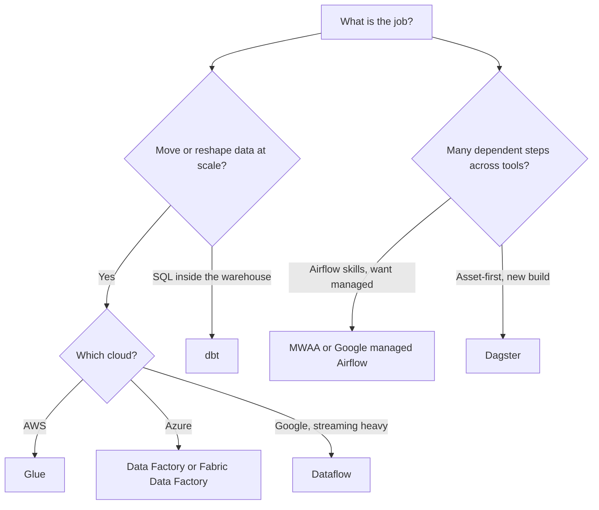

# Service Comparison: ETL and Orchestration

Two jobs get blurred together here. **Moving and transforming data** (ETL or ELT) and **running steps in order, on a schedule, with retries** (orchestration). Some products do both, some do one.

This page compares AWS Glue, Azure Data Factory, Google Dataflow, managed Airflow (Amazon MWAA and Google's managed Airflow), and two open-source tools, dbt and Dagster. No prices; check each vendor's pricing page. Background: [ETL vs ELT](../learn/concepts/etl-vs-elt.md) and [Data pipelines and orchestration](../learn/concepts/data-pipelines-and-orchestration.md).

## The short version

| Product | Mainly does | Style | You manage |
|---|---|---|---|
| **AWS Glue** | Data integration: catalog, crawlers, ETL jobs | Serverless, Spark-based jobs, visual or code | Job code and triggers |
| **Azure Data Factory** | Pipelines that copy and orchestrate, plus mapping data flows | Managed, visual authoring | Pipelines, integration runtimes |
| **Dataflow** | Batch and streaming processing with Apache Beam | Fully managed, code or prebuilt templates | Beam pipeline code |
| **Amazon MWAA** | Run Apache Airflow DAGs | Managed Airflow, DAGs in S3 | DAGs, environment settings |
| **Google managed Airflow (Composer)** | Run Apache Airflow DAGs | Managed Airflow, DAGs in Cloud Storage | DAGs, environment settings |
| **dbt** | SQL transformations inside a warehouse | Open-source engine (dbt OSS) plus the hosted dbt platform | Models, tests |
| **Dagster** | Orchestrate data assets | Orchestrator (the docs link a public GitHub repo; the docs page does not use the words open source) | Asset code |

## AWS Glue

- A serverless data integration service to discover, prepare, move and integrate data.
- Parts: the **Data Catalog** (central metadata), **crawlers** that infer schemas, ETL jobs on a Spark-based engine, **Glue Studio** for visual job building, notebooks and interactive sessions.
- Triggers start jobs and crawlers on a schedule, on demand or on an event. Workflows chain crawlers, jobs and triggers.
- Handles ETL, ELT and streaming. Cataloged data can be queried from Athena, EMR and Redshift Spectrum.
- Note from the docs: Glue for Ray has an end-of-support notice. Check it if you saw Ray in older material.

**[📖 What is AWS Glue?](https://docs.aws.amazon.com/glue/latest/dg/what-is-glue.html)** - features, Studio, related services

## Azure Data Factory (and Fabric Data Factory)

- A managed cloud service for hybrid ETL, ELT and data integration projects.
- Building blocks: **pipelines** (groups of activities), **activities** (copy, transform, control), **datasets**, **linked services** (connection definitions), **mapping data flows** (Spark-backed visual transforms), **integration runtimes** and **triggers**.
- Can hand transformation to Databricks, HDInsight or SQL. CI/CD through Azure DevOps and GitHub.
- The docs tip says Data Factory in Microsoft Fabric is the next generation, and that new data-integration work should start there. Existing ADF workloads can be upgraded.

**[📖 Introduction to Azure Data Factory](https://learn.microsoft.com/en-us/azure/data-factory/introduction)** - concepts, Fabric note

## Google Dataflow

- Runs **Apache Beam** pipelines (Java, Python or Go SDKs). One programming model covers batch and streaming.
- Fully managed: Dataflow allocates worker VMs per job and removes them when the job ends.
- Prebuilt **templates** let you run common pipelines without writing Beam.
- Streaming pipelines process data exactly-once by default; at-least-once mode can cut cost and latency if duplicates are acceptable.
- Because Beam is portable, the same pipeline can run on another runner such as Flink or Spark.

**[📖 Dataflow overview](https://docs.cloud.google.com/dataflow/docs/overview)** - Beam, batch and streaming, templates

## Managed Airflow: MWAA and Google's managed Airflow

Apache Airflow is an open-source tool to create, schedule and monitor workflows written in Python. Both clouds run it for you.

- **Amazon MWAA** sets up Airflow when you pick a version, scales workers between limits you set, integrates with IAM for access and sends logs and metrics to CloudWatch. DAGs and supporting files live in an S3 bucket.
- **Google's managed Airflow** (the Composer 3 docs now say "Managed Airflow (Gen 3)") is a fully managed Airflow service. Google runs a GKE cluster per environment for the scheduler, triggerers and workers, runs the Airflow web server UI and manages the metadata database. DAGs live in the environment's Cloud Storage bucket. Gen 3 supports Airflow 2 and 3.
- This guide did not read a managed Airflow page for Azure. Data Factory pipelines cover much of the same ground; check Microsoft's docs for any Airflow offering.

**[📖 What is Amazon MWAA?](https://docs.aws.amazon.com/mwaa/latest/userguide/what-is-mwaa.html)** - features, architecture, versions
**[📖 Managed Airflow (Gen 3) overview](https://docs.cloud.google.com/composer/docs/composer-3/composer-overview)** - what Google manages, DAG storage

## dbt and Dagster

- **dbt** turns SQL `select` statements into tables and views in your warehouse, handles run order, and adds tests and generated docs. It transforms data already in the warehouse; it does not extract or load. See [Analytics engineering and dbt](../learn/concepts/analytics-engineering-and-dbt.md) and the [dbt project build](./hands-on-projects/build-dbt-project.md).
- **Dagster** is a data orchestrator. Its core unit is the **asset**; assets declare dependencies on each other, which gives lineage and ordering. It stresses built-in observability and testability.

**[📖 What is dbt?](https://docs.getdbt.com/docs/introduction)** - models, tests, docs
**[📖 Dagster docs](https://dagster.io/docs)** - assets, orchestration

## How to choose

The diagram splits "do the work" tools from "run the steps in order" tools. Most real stacks use one of each: for example Glue or Data Factory to land data, dbt to model it, and Airflow or Dagster to schedule both.

Rules of thumb:

- A cloud-native service wins when you want few moving parts and your data is already in that cloud.
- Airflow wins on talent and plugins; asset-based tools win on lineage. Both are fine.
- Orchestrate things that already work. Do not rewrite a working job to fit the scheduler.

## Related

- [Data pipeline / ETL pattern](./architecture-patterns/data-pipeline-etl.md), [Medallion](./architecture-patterns/medallion-architecture.md)
- [Warehouse comparison](./service-comparison-warehouses.md) - where the data lands
- [Messaging and queues](./service-comparison-messaging-queues.md) - streaming transport
- Certs: [AWS DEA-C01](../exams/aws/associate/data-engineer-dea-c01/README.md), [DP-700](../exams/azure/dp-700/README.md), [GCP Professional Data Engineer](../exams/gcp/data-engineer/README.md)
