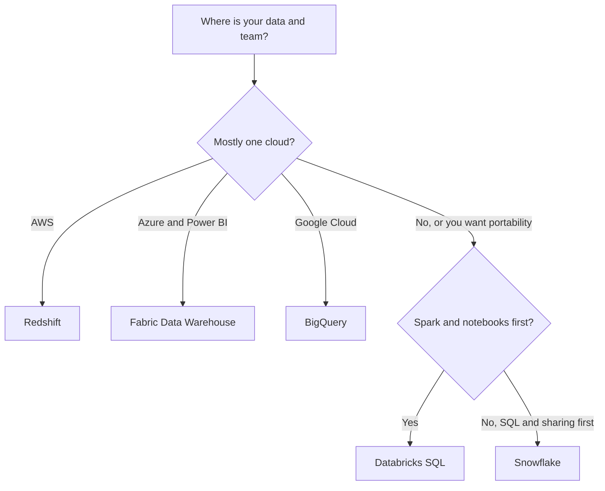

# Service Comparison: Data Warehouses

Five warehouse products show up on almost every data job ad: Amazon Redshift, Microsoft Fabric Data Warehouse (with Azure Synapse behind it), Google BigQuery, Snowflake and Databricks SQL. They all answer SQL over large tables. They differ in who runs the compute, where the data lives and how you are billed.

This page compares the shape of each product. It has no prices and no limits tables, because both change often. Check the vendor's pricing page before you size anything. For the operational databases these warehouses are fed from, see [Database services](./service-comparison-databases.md). For the idea behind them, see [Warehouses, lakes and lakehouses](../learn/concepts/warehouses-lakes-lakehouses.md).

## The short version

| | Redshift | Fabric Data Warehouse | BigQuery | Snowflake | Databricks SQL |
|---|---|---|---|---|---|
| **Cloud** | AWS | Azure (Microsoft Fabric) | Google Cloud | AWS, Azure and Google Cloud | Databricks (this guide read the AWS docs) |
| **Compute model** | Serverless or provisioned clusters | Fabric-managed, no knobs to tune | Serverless | Virtual warehouses you size | SQL warehouses, serverless recommended |
| **Storage** | Managed by the service | Delta tables in OneLake | Columnar, plus open table formats | Snowflake, Iceberg and hybrid tables | Governed by Unity Catalog |
| **Language** | SQL | T-SQL | SQL or Python | SQL | SQL |
| **Pricing models named in docs** | Serverless pays only while in use | Not covered here | On-demand or capacity reservations | Not covered here | Not covered here |

The table only holds facts from the vendor pages linked below. "Not covered here" means the page I read did not say; check the vendor's pricing page.

## Redshift

- A fully managed, petabyte-scale data warehouse service on AWS.
- Two modes: **Redshift Serverless**, where resources are provisioned and scaled automatically and nothing is charged while idle, and **provisioned clusters** that you manage yourself.
- You can load data and query it from the query editor v2 or from a BI tool.
- Heads-up from the AWS docs: Redshift no longer supports Python UDFs after June 30, 2026 (that date has passed), with enforcement in phases. Check the AWS blog post linked from the docs before relying on them.

**[📖 What is Amazon Redshift?](https://docs.aws.amazon.com/redshift/latest/mgmt/welcome.html)** - serverless and provisioned modes, query editor, UDF notice

## Fabric Data Warehouse (and Synapse)

- An enterprise-scale relational warehouse on a data lake foundation, inside Microsoft Fabric.
- Data is stored as Delta tables (Parquet files plus a transaction log) and is automatically replicated to OneLake Files for external access.
- Developed mainly with T-SQL, with multi-table ACID transactions, materialized views, functions and stored procedures.
- Storage and compute are separate. Microsoft describes autonomous workload management with no knobs to turn.
- Two item types: the **Warehouse** (full read and write SQL) and the **SQL analytics endpoint** of a Lakehouse (T-SQL queries and views over Delta tables, without changing the data).
- The docs name the Fabric Migration Assistant as the tool for moving from Azure Synapse Analytics, SQL Server, Teradata and other SQL Database Engine platforms. For new Microsoft-stack builds, Fabric is where the docs point. Existing Synapse estates still exist; check Microsoft's migration overview for current timelines.

**[📖 What is Fabric Data Warehouse?](https://learn.microsoft.com/en-us/fabric/data-warehouse/data-warehousing)** - warehouse vs SQL analytics endpoint, Delta storage, migration assistant

## BigQuery

- A fully managed, serverless data platform for storing and querying data with SQL or Python.
- Storage and compute scale independently. You do not provision or manually scale infrastructure.
- Two pricing models: **on-demand** and **capacity-based** (managed through reservations).
- Columnar storage with ACID transactions, BigQuery ML, queries over external sources (Cloud Storage, Bigtable, Spanner, Google Sheets) and loading of open table formats such as Iceberg, Delta and Hudi.
- Works with BI tools including Looker, Looker Studio, Tableau and Power BI.

**[📖 What is BigQuery?](https://docs.cloud.google.com/bigquery/docs/introduction)** - serverless model, pricing model names, external sources

## Snowflake

- Three layers: **database storage** (Snowflake tables, Iceberg tables and hybrid tables), **compute** (virtual warehouses) and **cloud services** (security, metadata, query optimization).
- Each virtual warehouse is an independent cluster of compute, so one team's heavy query does not slow another team's warehouse.
- Multi-cluster warehouses need Enterprise Edition or higher. In **Auto-scale** mode they add clusters when queries queue and remove them as load drops; in **Maximized** mode they run all configured clusters whenever the warehouse runs.
- Runs on AWS, Azure and Google Cloud.

**[📖 Key concepts and architecture](https://docs.snowflake.com/en/user-guide/intro-key-concepts)** - three layers, virtual warehouses, clouds
**[📖 Multi-cluster warehouses](https://docs.snowflake.com/en/user-guide/warehouses-multicluster)** - scaling modes, edition requirement

## Databricks SQL

- A **SQL warehouse** is a compute resource for querying and exploring data on Databricks.
- Types are serverless, pro and classic. Databricks recommends serverless where it is available: instant, elastic compute that Databricks patches and upgrades.
- Access to data is governed by Unity Catalog for most assets.
- Notebooks can attach to pro or serverless SQL warehouses.

**[📖 SQL warehouses](https://docs.databricks.com/aws/en/compute/sql-warehouse/)** - types, serverless recommendation, Unity Catalog

## How to choose

The diagram shows the usual first cut: let the cloud and the team's main tool decide, then pick between Snowflake and Databricks SQL when you want one platform across clouds.

Rules of thumb:

- **Start where your data already is.** Moving data out of a cloud costs time, and often money.
- **Match the BI tool.** Power BI teams get a short path with Fabric. See [BI tools](./service-comparison-bi-tools.md).
- **Watch the billing unit.** Pay-per-query (BigQuery on-demand), pay-per-running-cluster (Snowflake, Redshift provisioned) and pay-per-capacity (Fabric) fail in different ways. A forgotten warehouse is the classic Snowflake bill; a full-table scan is the classic BigQuery bill.
- **Lakehouse or warehouse?** If most work is Spark and ML, see [Lakehouse architecture](./architecture-patterns/lakehouse-architecture.md).

## Related

- [Data pipeline / ETL pattern](./architecture-patterns/data-pipeline-etl.md) and [ETL and orchestration services](./service-comparison-etl-orchestration.md) - how data gets in
- [Moving a warehouse to the cloud](./migration-guides/warehouse-to-cloud-migration.md)
- Certs: [SnowPro Core](../exams/snowflake/snowpro-core/README.md), [Databricks Data Engineer Associate](../exams/databricks/data-engineer-associate/README.md), [DP-600](../exams/azure/dp-600/README.md), [AWS DEA-C01](../exams/aws/associate/data-engineer-dea-c01/README.md), [GCP Professional Data Engineer](../exams/gcp/data-engineer/README.md)
