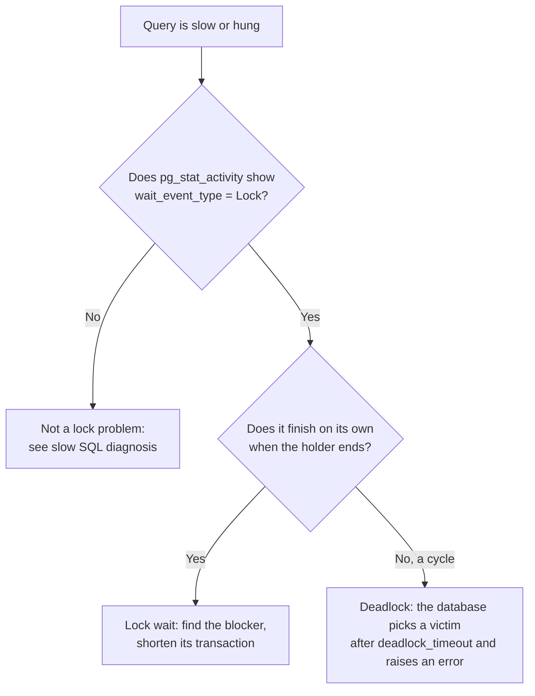

# Troubleshooting Deadlocks and Lock Waits

Two different problems share one symptom ("the query hangs"). A **lock wait** is one session waiting for another to finish. It ends by itself when the holder commits. A **deadlock** is a cycle: each session waits for the other, so neither can ever finish, and the database must kill one. This guide reproduces both for real on PostgreSQL 17 in Docker, shows how to read the evidence, and lists the fixes. MySQL and SQL Server equivalents are cited from vendor docs and were **not** run.

**Tested:** 2026-11-07 on PostgreSQL 17.11 (`postgres:17` image), two `psql` sessions. Background: [Transactions and ACID](../../learn/concepts/transactions-and-acid.md).

---

## Lock wait or deadlock?



Lock waits are a performance problem and resolve themselves. Deadlocks are an application-ordering bug and surface as an error that the app must retry.

---

## Set up the test table

```bash
docker run -d --name pgdl -e POSTGRES_PASSWORD=pw postgres:17
sleep 6
docker exec -i pgdl psql -U postgres <<'SQL'
create table accounts(id int primary key, balance int);
insert into accounts values (1,100),(2,100);
SQL
```

---

## Part 1: Reproduce a deadlock

Two transfers run at the same time, in opposite directions. Session 1 locks account 1 then wants account 2. Session 2 locks account 2 then wants account 1.

```bash
# Session 1: lock row 1, pause, then want row 2
docker exec -i pgdl psql -U postgres > s1.out 2>&1 <<'SQL' &
begin;
update accounts set balance = balance - 10 where id = 1;
select pg_sleep(3);
update accounts set balance = balance + 10 where id = 2;
commit;
SQL

# Session 2: start one second later, lock row 2, pause, then want row 1
docker exec -i pgdl psql -U postgres > s2.out 2>&1 <<'SQL' &
select pg_sleep(1);
begin;
update accounts set balance = balance - 10 where id = 2;
select pg_sleep(3);
update accounts set balance = balance + 10 where id = 1;
commit;
SQL
wait
```

The real output. Session 1 finished; session 2 was chosen as the victim:

```text
-- s1.out (tail)
UPDATE 1
COMMIT

-- s2.out (tail)
ROLLBACK
ERROR:  deadlock detected
DETAIL:  Process 91 waits for ShareLock on transaction 741; blocked by process 90.
Process 90 waits for ShareLock on transaction 742; blocked by process 91.
HINT:  See server log for query details.
CONTEXT:  while updating tuple (0,1) in relation "accounts"
```

(The sleep and header lines are trimmed.) The server log has more, including the statement each process was running:

```text
ERROR:  deadlock detected
DETAIL:  Process 91 waits for ShareLock on transaction 741; blocked by process 90.
	Process 90 waits for ShareLock on transaction 742; blocked by process 91.
	Process 91: update accounts set balance=balance+10 where id=1;
	Process 90: update accounts set balance=balance+10 where id=2;
```

Read it as a cycle: 91 waits for 90, and 90 waits for 91. The final balances were `90` and `110`: only the survivor's transfer happened, and the victim's whole transaction rolled back. **The application has to catch the error and retry the transaction**, because the database already undid it.

PostgreSQL does not detect a deadlock instantly. A session waits `deadlock_timeout` (default one second) before running the check, so a deadlock looks like a one-second-plus hang first.

### Fix 1: take locks in a consistent order

The cycle needs opposite orders. If both transfers lock the lower account id first, the second simply waits and then proceeds.

```sql
begin;
select id from accounts where id in (1, 2) order by id for update;  -- always ascending
update accounts set balance = balance - 10 where id = 1;
update accounts set balance = balance + 10 where id = 2;
commit;
```

This statement shape was **not** re-run as a separate experiment; the ordering rule comes from the PostgreSQL explicit-locking page, which names consistent lock order as the first defence.

### Fix 2: keep transactions short and retry

Do the thinking (API calls, user input, slow queries) outside the transaction. Open it late, close it early. Wrap the transaction in a retry for the deadlock error (SQLSTATE `40P01`) and the serialization error (`40001`).

### Fix 3: lock less

A foreign key, an unindexed column on an `UPDATE ... WHERE`, or `SELECT ... FOR UPDATE` over a wide range can all lock more rows than you meant. Index the columns you filter writes by, and lock the narrowest range you need.

---

## Part 2: Reproduce a lock wait and find the blocker

Session A updates a row and holds its transaction open. Session B tries to update the same row and waits.

```bash
# A: hold the lock for 8 seconds
docker exec -i pgdl psql -U postgres > a.out 2>&1 <<'SQL' &
begin;
update accounts set balance = 0 where id = 1;
select pg_sleep(8);
rollback;
SQL
sleep 1
# B: blocked
docker exec -i pgdl psql -U postgres > b.out 2>&1 <<'SQL' &
update accounts set balance = balance + 1 where id = 1;
SQL
sleep 3
```

While B is waiting, from a third session ask who is blocked and by whom:

```sql
SELECT pid, pg_blocking_pids(pid) AS blocked_by, wait_event_type, wait_event, state, left(query, 60) AS query
FROM pg_stat_activity
WHERE cardinality(pg_blocking_pids(pid)) > 0;
```

```text
-[ RECORD 1 ]---+--------------------------------------------------
pid             | 111
blocked_by      | {105}
wait_event_type | Lock
wait_event      | transactionid
state           | active
query           | update accounts set balance=balance+1 where id=1;
```

`blocked_by = {105}` is the answer: process 105 holds what 111 needs. `wait_event = transactionid` means "waiting for the other transaction to finish", which is how a row-lock wait shows up. Now look at the blocker itself:

```sql
SELECT pid, state, xact_start, left(query, 60) AS query
FROM pg_stat_activity WHERE pid = 105;
```

In this test, process 105 was `active` running `select pg_sleep(8)` inside an open transaction. In production the common blocker is a session that is **`idle in transaction`**: the app opened a transaction, took a lock, and then went off to do something else without committing. Look for it:

```sql
SELECT pid, state, now() - xact_start AS open_for, left(query, 60) AS last_query
FROM pg_stat_activity WHERE state LIKE 'idle in transaction%' ORDER BY xact_start;
```

That query returned no rows in our test (the blocker was active, not idle), so the output format above is from the PostgreSQL docs, not a pasted result.

The lock table shows the same story from the other side. The blocker holds `transactionid ExclusiveLock` with `granted = t`; the waiter wants `transactionid ShareLock` with `granted = f`:

```text
 pid |   locktype    |       mode       | granted
-----+---------------+------------------+---------
 105 | transactionid | ExclusiveLock    | t
 111 | transactionid | ShareLock        | f
```

(Rows for relation locks trimmed.) Session B finished as soon as A rolled back, with `UPDATE 1`. That is the difference from a deadlock: nobody was killed.

### Make waits fail fast instead of piling up

```sql
SET lock_timeout = '1s';
UPDATE accounts SET balance = balance + 1 WHERE id = 1;
```

Run while another session held the row, the real result was:

```text
ERROR:  canceling statement due to lock timeout
CONTEXT:  while updating tuple (0,7) in relation "accounts"
```

Set `lock_timeout` on web request paths so a stuck lock becomes a fast, visible error instead of every connection queuing behind it. Two related settings, from the PostgreSQL docs and **not** run here: `idle_in_transaction_session_timeout` ends sessions that sit idle inside a transaction, and `log_lock_waits = on` writes a log line whenever a wait exceeds `deadlock_timeout`.

### Last resort: end the blocker

```sql
SELECT pg_cancel_backend(105);     -- cancels its current query
SELECT pg_terminate_backend(105);  -- ends the session; its transaction rolls back
```

Find out what the blocker was doing first. Killing a migration halfway or a long batch can cost more than the wait.

---

## The same question on other engines

Vendor-documented starting points, **not run** for this guide.

| Engine | Deadlock evidence | Lock waits |
|---|---|---|
| MySQL 8.4 (InnoDB) | `SHOW ENGINE INNODB STATUS` prints the latest deadlock; `innodb_print_all_deadlocks` logs every one | `performance_schema.data_lock_waits` |
| SQL Server | The `system_health` Extended Events session records detected deadlocks with the deadlock graph | `sys.dm_tran_locks` and `sys.dm_os_waiting_tasks` |

In MySQL, InnoDB tries to pick the smaller transaction, measured by rows inserted, updated or deleted. In SQL Server the victim is the session with the lowest deadlock priority, otherwise the cheapest to roll back. Both are in the vendor pages below.

---

## Clean up

```bash
docker rm -f pgdl
```

---

## Vendor references

- **[📖 PostgreSQL: Explicit Locking (Deadlocks)](https://www.postgresql.org/docs/current/explicit-locking.html)** - row-level locks, what a deadlock is, and avoiding them by lock order
- **[📖 PostgreSQL: pg_locks](https://www.postgresql.org/docs/current/view-pg-locks.html)** - the lock table columns and `pg_blocking_pids`
- **[📖 PostgreSQL: Lock Management settings](https://www.postgresql.org/docs/current/runtime-config-locks.html)** - `deadlock_timeout`
- **[📖 PostgreSQL: Client Connection Defaults](https://www.postgresql.org/docs/current/runtime-config-client.html)** - `lock_timeout` and `idle_in_transaction_session_timeout`
- **[📖 MySQL 8.4: Deadlocks in InnoDB](https://dev.mysql.com/doc/refman/8.4/en/innodb-deadlocks.html)** - detection, minimizing and handling
- **[📖 SQL Server: Deadlocks guide](https://learn.microsoft.com/en-us/sql/relational-databases/sql-server-deadlocks-guide)** - how deadlocks form and the victim rules

## Related

- [Transactions and ACID](../../learn/concepts/transactions-and-acid.md) - isolation levels, MVCC and write skew
- [Indexes explained](../../learn/concepts/indexes-explained.md) - an unindexed write predicate locks more than it needs to
- [Slow SQL query diagnosis](./slow-sql-query-diagnosis.md) - when the wait is not a lock
- [Replication lag](./replication-lag.md) - the other stall that shows up under write load
