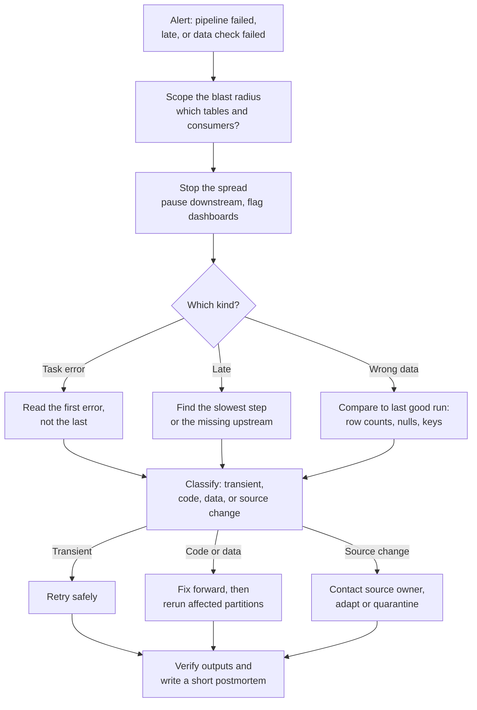

# Troubleshooting Failing and Late Pipelines

What to do when a data pipeline fails, runs late, or worse, succeeds and produces the wrong data. Covers triage, the common root causes (source changes, schema drift, late data, resource limits, dependencies), and the design habits that make the next incident smaller: idempotency, safe retries and planned backfills.

---

## The three kinds of pipeline incident

Pipeline problems come in three flavours, in rising order of danger:

1. **Loud failure.** A task errors, the orchestrator marks it red, someone is paged. Annoying, but at least you know.
2. **Late.** Everything is green, but the run started late, ran slowly, or is waiting on an upstream that never arrived. Dashboards show yesterday's numbers and nobody notices until a meeting.
3. **Silent wrong data.** Everything is green and on time, but a source sent half its usual rows, a join dropped records, or a column started arriving as null. This is the one that damages trust, because people make decisions on it.

Good monitoring turns the third kind into the first. Much of this page is about how.

---

## Triage: the first fifteen minutes

Pipeline incident triage. Scope who is affected and stop bad data spreading before debugging. Then work out which kind of incident it is, classify the root cause, apply the matching fix, and verify the outputs before closing.

**Scope first.** Which tables did this run write, and who reads them? Lineage from your catalog or dbt docs answers this in a minute (see [Data quality and lineage](../../learn/concepts/data-quality-and-lineage.md)). Knowing that the CFO's dashboard reads the broken table changes how fast you communicate.

**Stop the spread.** If wrong data has landed, pause the downstream jobs so they do not build more wrong tables on top of it, and tell consumers. A banner on the dashboard is better than a confident wrong number.

**Read the first error, not the last.** In a chain of 40 failed tasks, 39 failed because their upstream did. In logs, the last stack trace is often a secondary failure (a cleanup step, a retry wrapper). Scroll up.

**Compare with the last good run.** Row counts per partition, null rates per column, distinct key counts, min and max dates. Most "wrong data" incidents are obvious in that comparison.

---

## Classify the root cause

### Transient failures

Network timeouts, a rate-limited API, a database failover, a spot instance reclaimed, a warehouse briefly unavailable. Retrying usually works.

The rule: **retry automatically, with backoff, a limited number of times, and only if the task is idempotent.** Most orchestrators make this a setting (Airflow `retries` and `retry_exponential_backoff`, Dagster retry policies, Step Functions `Retry` blocks). Do not retry on errors that cannot succeed on retry (authentication failures, syntax errors, schema mismatches); that just delays the page.

### Code changes

A deploy changed a transformation. Check what was deployed since the last good run; version control and CI history answer this. Roll back or fix forward, then rerun the affected partitions. Prevention: run transformations on a sample or a staging copy in CI, and compare outputs between the old and new versions for important models (dbt's `--defer` and state-based runs make this practical).

### Source changes and schema drift

The most common cause of pipeline failures that are not your fault. Forms it takes:

- **A column added.** Usually harmless if your ingestion tolerates extra fields.
- **A column removed or renamed.** Ingestion fails, or worse, the column silently becomes null.
- **A type changed.** An ID that was always numeric starts containing letters; a timestamp switches from UTC to local time; a price switches from cents to dollars. Type changes that still parse are the most dangerous, because nothing errors.
- **Semantics changed.** Same column, same type, new meaning ("status 3 now means refunded, not shipped").
- **Volume changed.** A source that sends 2 million rows a day sends 40,000, because an upstream filter changed or an export broke halfway.

Defences, from cheapest to most thorough:

1. **Keep raw data loose.** Land the source as-is in bronze (see [Medallion architecture](../architecture-patterns/medallion-architecture.md)) so ingestion survives schema changes and you can reprocess once the transformation is fixed.
2. **Validate at the silver boundary.** Schema checks (expected columns and types), and data tests: not null, unique keys, accepted values, ranges. Fail or quarantine on violation.
3. **Volume and freshness checks.** Compare today's row count to a trailing average; alert on a big drop or jump. Freshness checks alert when the newest record is older than expected (dbt `source freshness`, warehouse monitoring tools).
4. **Data contracts** with source teams for critical feeds, so breaking changes are agreed in advance, not discovered in production. See [Data contracts](../../learn/concepts/data-contracts.md).
5. **Schema evolution settings** that match your intent. Delta and Iceberg can add new columns automatically on write; that is convenient for bronze and risky for gold. Decide per layer.

### Late and missing data

Late pipelines are usually one of:

- **An upstream dependency that did not arrive.** A partner file not delivered, an upstream team's job late. Use sensors with a timeout and a clear alert ("partner file for 2026-10-21 not received by 06:00"), not a sensor that waits forever.
- **Resource contention.** Many jobs scheduled at 00:00 compete for the same warehouse or cluster. Stagger schedules, or trigger downstream jobs on upstream completion (data-aware or asset-based scheduling) instead of fixed times.
- **Growth.** The job that took 20 minutes a year ago takes 3 hours now because it reprocesses all history every run. Make it incremental.
- **One slow step.** Find it in the orchestrator's task durations (Gantt view in Airflow, run timeline in Dagster) and treat it as a [slow query](./slow-sql-query-diagnosis.md) or [Spark performance](./spark-job-performance.md) problem.

**Late-arriving data** is different: the pipeline ran on time, but some records for that day arrived after it ran. Events from offline phones, corrections in source systems, payments settled days later. Fixes:

- **Lookback windows.** Each daily run reprocesses the last N days (say 3), not just yesterday. Cheap and effective for most cases.
- **Partition by arrival date in bronze, event date in silver,** and reprocess event dates touched by each new arrival batch.
- **Watermarks** in streaming jobs, which define how long to wait for late events before finalizing a window. See [Stream processing: windows and watermarks](../../learn/concepts/stream-processing-windows-and-watermarks.md).
- **Close periods explicitly** for finance: after month-end sign-off, corrections become adjustments in the next period.

### Resource failures

Out of memory, disk full, timeouts, quota exceeded. These often appear suddenly when data crosses a threshold. Look at input size trends before raising limits; a job that suddenly needs 4 times the memory may be suffering a join fan-out or skew, not growth. See [Spark job performance](./spark-job-performance.md) for executor memory and spill problems.

---

## Idempotency: the property that makes everything else safe

A pipeline step is **idempotent** if running it twice for the same input produces the same result as running it once. It is the most important design property for operability, because retries, reruns and backfills all run steps more than once.

Non-idempotent patterns and their fixes:

| Pattern | Problem on rerun | Idempotent alternative |
|---|---|---|
| `INSERT INTO target SELECT ... WHERE date = :d` | Duplicates every row | Overwrite the partition: `INSERT OVERWRITE` / `DELETE` then `INSERT` in one transaction / Delta `replaceWhere` |
| Appending files to a folder | Duplicate files | Write to a run-specific path, then swap atomically; or use a table format's transactional write |
| `MERGE` without a version guard | An older replay overwrites newer data | Merge only when the incoming version or log position is newer |
| `WHERE updated_at > (SELECT MAX(updated_at) FROM target)` | Depends on target state; skips rows after a partial failure | Drive by the logical date the orchestrator passes in |
| Using `CURRENT_DATE` or `NOW()` inside transformations | Rerunning yesterday's job computes today's answer | Use the run's logical date parameter everywhere |
| Calling an external API that creates records | Creates them twice | Use idempotency keys, or upsert on a natural key |

The last-but-one is subtle and very common. In Airflow, the `logical_date` (and the data interval) of a run identifies the data it is responsible for, regardless of when it actually runs. A backfill of 2026-03-01 run today must process March 1st, not today. Every query should be parameterized by that interval.

For incremental dbt models, the same discipline applies: use `is_incremental()` with a lookback, set a `unique_key` so reruns merge instead of duplicating, and run a full refresh periodically or when logic changes.

---

## Backfills without breaking things

A backfill reruns a pipeline for past dates: to fill history for a new table, to fix data after a bug, or to apply a logic change retroactively. Done carelessly, a backfill can overload the warehouse, starve production jobs, exhaust an API quota, or overwrite good data with bad.

A safe backfill:

1. **Confirm the step is idempotent** for a single partition. Test one date first and compare its output to the existing data.
2. **Write to a shadow table** for large or risky backfills, compare (row counts, key metrics per day, a sample of rows), then swap. Table formats with time travel (Delta, Iceberg, Snowflake) also let you roll back if a direct backfill goes wrong.
3. **Throttle.** Limit concurrency (Airflow's `max_active_runs`, Dagster backfill policies), run off-peak, or use a separate warehouse or cluster so production schedules are not delayed.
4. **Mind dependencies.** Backfilling a silver table means every downstream gold table for those dates is now stale. Plan the downstream reruns as part of the same backfill.
5. **Communicate.** Numbers for past periods will change. Tell the people who reported them.

---

## Observability: catching the silent ones

Monitoring "did the job succeed?" catches only loud failures. To catch late and wrong data, monitor the data itself:

- **Freshness**: newest record timestamp per critical table versus an SLA.
- **Volume**: row counts per run or partition versus a trailing baseline.
- **Schema**: column additions, removals and type changes.
- **Distribution**: null rate, distinct counts, min and max of key columns.
- **Reconciliation**: totals that should match an external system (billing, the general ledger) within a tolerance.

Route alerts to an owner per table, and keep the count low: an alert channel with 50 messages a day is ignored. Alert on things someone will act on, and make every alert say what table, what check, what the expected value was, and where the runbook is.

---

## After the incident

Write a short postmortem for anything that reached a consumer: what happened, when it was detected and by whom, impact, root cause, and the one or two changes that stop it recurring (a new check, an idempotency fix, a contract with the source team). Blameless and brief beats thorough and never written.

---

## Vendor references

- **[📖 Airflow best practices](https://airflow.apache.org/docs/apache-airflow/stable/best-practices.html)** - idempotent tasks, avoiding top-level code, and testing DAGs
- **[📖 Airflow backfill](https://airflow.apache.org/docs/apache-airflow/stable/core-concepts/backfill.html)** - running a DAG for past data intervals
- **[📖 Dagster partitions and backfills](https://dagster.io/docs/guides/build/partitions-and-backfills)** - partitioned assets and backfill policies
- **[📖 dbt incremental models](https://docs.getdbt.com/docs/build/incremental-models)** - `is_incremental()`, `unique_key` and incremental strategies
- **[📖 dbt source freshness](https://docs.getdbt.com/docs/deploy/source-freshness)** - alerting when sources stop updating
- **[📖 Delta Lake selective overwrite](https://docs.delta.io/delta-batch/)** - `replaceWhere` and dynamic partition overwrite for idempotent writes

---

## Related

- [Data pipelines and orchestration](../../learn/concepts/data-pipelines-and-orchestration.md)
- [Data quality and lineage](../../learn/concepts/data-quality-and-lineage.md)
- [Slow SQL query diagnosis](./slow-sql-query-diagnosis.md)
- [Spark job performance](./spark-job-performance.md)
- [CDC into a lakehouse](../architecture-patterns/cdc-to-lakehouse.md) - failure modes specific to replication
