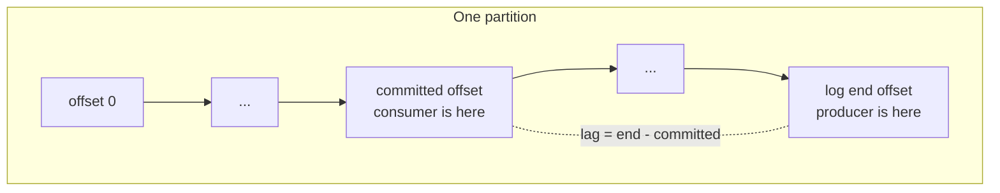
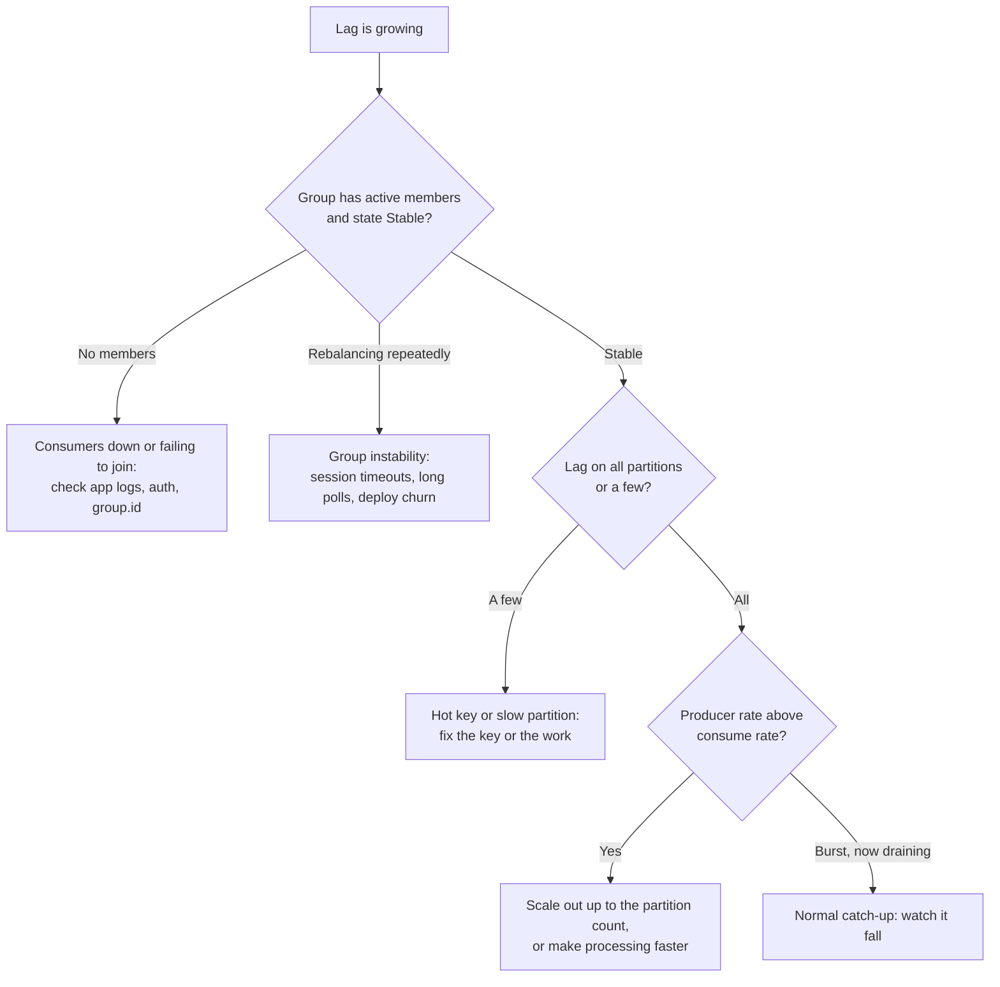

# Troubleshooting Kafka Consumer Lag

Consumer lag is how far a consumer group is behind the end of a topic, counted in messages. It is the first number to check when a streaming pipeline is late. This guide shows how to read it, what it looks like when a single hot key skews the load, and what to change. The commands were run for real against Apache Kafka 4.3.1 in Docker; the output is pasted from that run. Managed-service metrics are listed at the end and were **not** run.

**Tested:** 2026-11-07 with `apache/kafka:latest` (reported version 4.3.1), one broker in KRaft mode, the bundled command-line tools. Background: [Queues vs streams](../../learn/concepts/queues-vs-streams.md) and [Build a streaming pipeline](../hands-on-projects/build-streaming-pipeline.md).

---

## What lag is

For each partition, lag is `log-end-offset - committed offset`: the newest message in the partition minus the last offset the group said it had finished.



One partition as a line of messages. The producer appends at the log end; the consumer group records its progress as the committed offset. The distance between them is the lag.

Two things to remember before reading any number:

- **Lag is per group and per partition.** A topic has no lag, a consumer group does. A group with 3 partitions can be fine on two and badly behind on one.
- **A committed offset is "processed", not "received".** If the app commits before it finishes the work, lag looks fine while the data is not yet written. If it commits late, lag looks bad even though the work is done.

---

## Step 1: Read the lag

```bash
docker exec kafka /opt/kafka/bin/kafka-consumer-groups.sh \
  --bootstrap-server localhost:9092 --describe --group g1
```

On the test broker, topic `orders` had 3 partitions and a consumer group `g1` had read 600 messages and stopped:

```text
Consumer group 'g1' has no active members.

GROUP  TOPIC   PARTITION  CURRENT-OFFSET  LOG-END-OFFSET  LAG   CONSUMER-ID  HOST  CLIENT-ID
g1     orders  0          600             2402            1802  -            -     -
g1     orders  1          0               293             293   -            -     -
g1     orders  2          0               305             305   -            -     -
```

Read it column by column:

- `CURRENT-OFFSET` is the committed offset. `LOG-END-OFFSET` is the newest message.
- `LAG` per partition. The total is the sum: 1802 + 293 + 305 = 2400 messages.
- `CONSUMER-ID`, `HOST` and `CLIENT-ID` are `-` and the header says "no active members": **nobody is consuming at all.** That is a different problem from a slow consumer. Lag that grows with no members means the app is down, crashed in a loop, or failed to join the group.

Two other views of the same group:

```bash
# Group state (the test run showed Stable; the Kafka docs page does not list every state name)
kafka-consumer-groups.sh --bootstrap-server localhost:9092 --describe --group g2 --state
# Which client owns which partitions
kafka-consumer-groups.sh --bootstrap-server localhost:9092 --describe --group g2 --members
```

A running consumer's state, measured on the test broker:

```text
GROUP  COORDINATOR (ID)  ASSIGNMENT-STRATEGY  STATE   #MEMBERS
g2     localhost:9092 (1)  range              Stable  1
```

Seeing `PreparingRebalance` over and over means the group keeps re-forming, which stalls consumption each time. List every group with `--list`, or describe all at once with `--all-groups` (`--all-groups` and `--dry-run` worked on the 4.3.1 test broker but are not listed on the Kafka operations docs page).

A note on a surprise we hit: right after a new consumer joined from `--from-beginning`, the first `--describe` showed `-` for `CURRENT-OFFSET` and `LAG`. That is a group that has **not committed yet**. A few seconds later, once offsets were committed, the same command showed `LAG` 0 on all three partitions. A `-` is not an error; it is "no commit to compare against".

## Step 2: Spot a skewed partition

The test topic did not have even partitions. We keyed the 3,000 messages so that about 70% of them used one hot key. Kafka picks the partition from a hash of the key, so one key always lands on one partition:

```text
orders:0:2402
orders:1:293
orders:2:305
```

(Output of `kafka-get-offsets.sh`: `topic:partition:end-offset`.) Partition 0 holds 80% of the data. This is **key skew**, and it is the commonest reason lag stays high while "most consumers are idle": a group can run at most one consumer per partition, so adding consumers does nothing for the hot one.

If a few partitions carry nearly all the lag and the rest are at zero, the answer is not "more consumers". Options:

- Change the key so load spreads (add a salt, or use a finer key such as an order id instead of a customer id), if ordering per original key is not required.
- Add partitions to the topic, noting that existing keys may map to different partitions afterwards and per-key ordering across the change is not guaranteed.
- Make the work per message cheaper on the hot path.

---

## Step 3: Decide which kind of lag it is



A decision tree for a consumer group that is falling behind. Start with whether anyone is consuming, then whether lag is concentrated or everywhere.

### Group instability: rebalances

A rebalance pauses consumption while partitions are reassigned. A consumer that does not call `poll()` within `max.poll.interval.ms` is dropped from the group; one that misses heartbeats for `session.timeout.ms` is also dropped. Slow message handling inside the poll loop is the usual cause: the batch from one `poll()` takes longer than the interval, the consumer is evicted, the group rebalances, and the batch is reprocessed. Fixes: reduce `max.poll.records`, move slow work off the poll thread, or raise `max.poll.interval.ms` knowingly. These settings are described in the consumer configuration docs linked below; this guide did **not** reproduce an eviction.

### Scale-out has a ceiling

Consumers in a group each own whole partitions. With 3 partitions, a fourth consumer sits idle. To go faster you need more partitions (a topic change you plan for in advance) or faster processing. Pick the partition count from the throughput you expect, with headroom.

### The consumer is just slower than the producer

Compare the rates: how fast lag grows is `produce rate - consume rate`. Find the slow step with the usual tools: a downstream database write per message (batch it), a network call per message (batch or parallelise it), or deserialisation cost. If the sink is a table format, a commit per message is far too slow; commit per batch. See [Build a streaming pipeline](../hands-on-projects/build-streaming-pipeline.md).

---

## Step 4: Fix it safely: resetting offsets

Sometimes you want a group to skip a backlog (stale data is useless) or to reprocess a window. `--reset-offsets` does both, and **only works when the group has no active members**. Always dry-run first. On the test group:

```bash
kafka-consumer-groups.sh --bootstrap-server localhost:9092 \
  --group g1 --topic orders --reset-offsets --to-latest --dry-run
```

```text
GROUP  TOPIC   PARTITION  NEW-OFFSET
g1     orders  0          2402
g1     orders  1          293
g1     orders  2          305
```

Nothing changed yet; that is what it would do. Swapping `--dry-run` for `--execute` applied it, and the next `--describe` showed `CURRENT-OFFSET` equal to `LOG-END-OFFSET` and `LAG` 0 on every partition. **Everything between the old and new offsets was skipped and is never processed by this group**, so use `--to-latest` only when dropping the backlog is acceptable.

Other targets exist: `--to-earliest`, `--to-offset`, `--shift-by`, `--to-datetime`. A dry run of `--shift-by -100` on partition 0 printed a new offset of 2302 (100 below 2402), which is how to replay the last 100 messages. Replays mean duplicates downstream, so the target must be idempotent; see [Idempotency explained](https://cloud.noblerworks.com/learn/concepts/idempotency-explained/).

---

## Step 5: Alerting that works

- Alert on **lag growth and age**, not a fixed number. 10,000 messages is nothing on a busy topic and an outage on a quiet one. Time lag (how old is the oldest unprocessed message) is the user-facing number.
- Alert on **no active members** and on **repeated rebalances**.
- Watch the **skew**: the max partition lag against the average.
- Remember committed offsets mean "done". If your pipeline commits before writing, lag hides data loss.

---

## The same question on managed services

Vendor-documented starting points, **not run** for this guide.

| Service | Where to look |
|---|---|
| Amazon MSK | The consumer lag metrics MSK publishes to CloudWatch (`MaxOffsetLag` and `SumOffsetLag` are in the free DEFAULT level; per-partition `OffsetLag` needs `PER_TOPIC_PER_PARTITION`) |
| Confluent Cloud | Consumer lag in the Cloud console and the Metrics API |
| Amazon Kinesis | Not Kafka: the equivalent is `GetRecords.IteratorAgeMilliseconds`, how old the oldest read record is |
| Azure Event Hubs | Not Kafka lag as such; compare the consumer group's saved checkpoint (offset) with the partition's newest event; the Event Hubs features page defines offset and checkpointing but no lag metric |

---

## Reproduce it yourself

```bash
docker run -d --name kafka apache/kafka:latest
sleep 12
K="docker exec kafka /opt/kafka/bin"; B="--bootstrap-server localhost:9092"
$K/kafka-topics.sh $B --create --topic orders --partitions 3

# 3,000 keyed messages, about 70% on one hot key
python3 - > keyed.txt <<'PY'
import random
random.seed(1)
keys = ["hot"] * 70 + [f"cust{i}" for i in range(30)]
for i in range(3000): print(f"{random.choice(keys)}:{i}")
PY
docker exec -i kafka /opt/kafka/bin/kafka-console-producer.sh $B --topic orders \
  --reader-property parse.key=true --reader-property key.separator=: < keyed.txt

$K/kafka-get-offsets.sh $B --topic orders
$K/kafka-console-consumer.sh $B --topic orders --group g1 --from-beginning --max-messages 600 >/dev/null
$K/kafka-consumer-groups.sh $B --describe --group g1

docker rm -f kafka
```

We ran the producer with `--property`, which 4.3.1 accepted with a deprecation warning telling us to use `--reader-property`; the command above uses the newer flag, which we did **not** re-run.

---

## Vendor references

- **[📖 Apache Kafka: Managing consumer groups](https://kafka.apache.org/documentation/#basic_ops_consumer_group)** - `kafka-consumer-groups.sh` describe, list and reset offsets
- **[📖 Apache Kafka: Consumer configs](https://kafka.apache.org/documentation/#consumerconfigs)** - `max.poll.interval.ms`, `session.timeout.ms`, `max.poll.records`
- **[📖 Apache Kafka: Quickstart](https://kafka.apache.org/quickstart)** - running a broker and the console tools
- **[📖 Amazon MSK: Metrics for Standard brokers](https://docs.aws.amazon.com/msk/latest/developerguide/metrics-details.html)** - metrics, including consumer lag
- **[📖 Amazon Kinesis Data Streams: Monitoring with CloudWatch](https://docs.aws.amazon.com/streams/latest/dev/monitoring-with-cloudwatch.html)** - `GetRecords.IteratorAgeMilliseconds`

## Related

- [Queues vs streams](../../learn/concepts/queues-vs-streams.md) - partitions, ordering and replay
- [Stream processing: windows and watermarks](../../learn/concepts/stream-processing-windows-and-watermarks.md) - lag and late data
- [Failing and late pipelines](./failing-and-late-pipelines.md) - the batch version of "it is late"
- [Replication lag](./replication-lag.md) - the same idea for a database replica
- [Change data capture with Debezium](../hands-on-projects/debezium-cdc-to-lakehouse.md) - a pipeline whose sink you can watch lag
