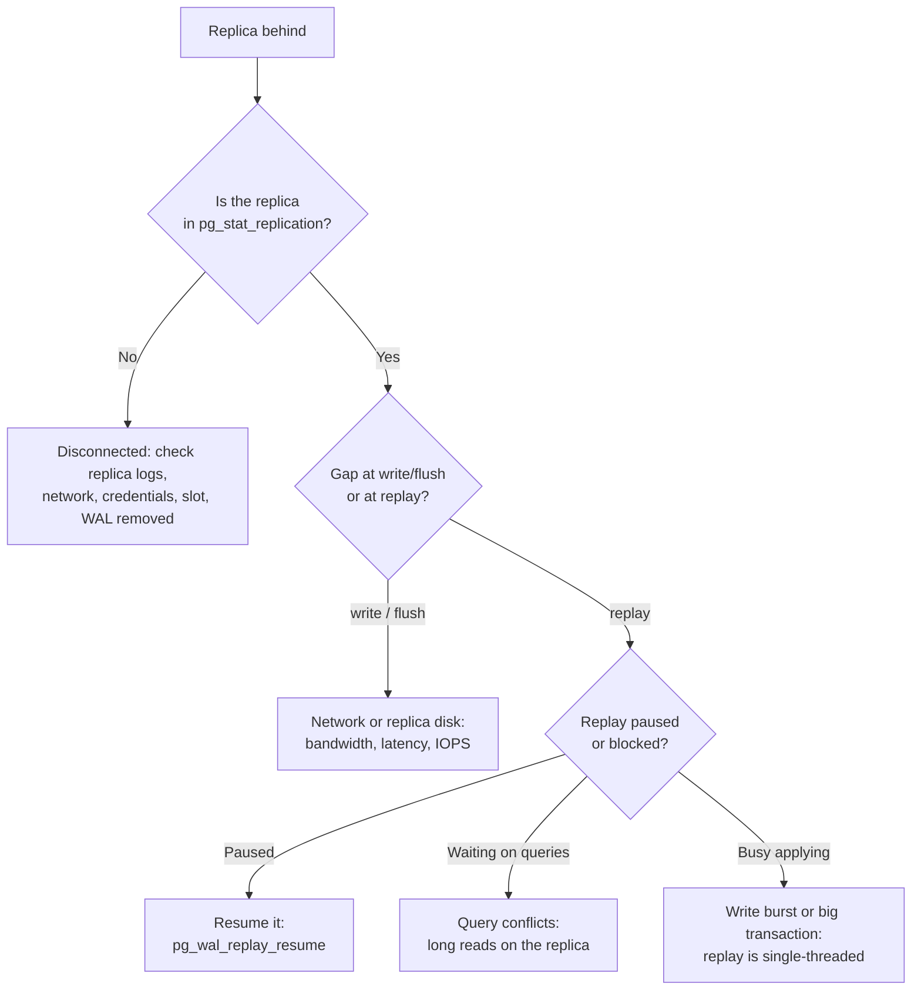

# Troubleshooting Replication Lag

A read replica that is seconds or minutes behind the primary makes an app show stale data, breaks "read your own write" and, if you fail over, loses commits. This guide shows how to measure lag, how to tell the four usual causes apart, and what to do about each. The commands were run for real against PostgreSQL 17 in Docker, and the output below is pasted from that run. MySQL, SQL Server and managed-service equivalents are listed at the end and were **not** run here.

**Tested:** 2026-11-07 on PostgreSQL 17.11 (`postgres:17` image), one primary and one streaming replica made with `pg_basebackup -R`. Background: [Replication and sharding](../../learn/concepts/replication-and-sharding.md) and [Eventual consistency](../../learn/concepts/eventual-consistency.md).

---

## What "lag" means

Replication ships the primary's write-ahead log (WAL) to the replica. A change travels through four stages, and lag can build up at any of them.


The four stages a change passes through. PostgreSQL reports a position (LSN) for each stage and, from version 10, a time-based lag for the last three. Queries on the replica only see a change after the replay stage.

The stage where the gap opens tells you the cause:

| Gap is between | Usual cause |
|---|---|
| Primary WAL and `sent` | Replica not connected, or the primary is slow to ship |
| `sent` and `write`/`flush` | Network bandwidth or latency, or slow replica disk |
| `flush` and `replay` | Replica is busy applying: long-running queries, single-threaded replay, replay paused |

---

## Step 1: Measure it on the primary

```sql
SELECT application_name,
       pg_size_pretty(pg_wal_lsn_diff(sent_lsn, replay_lsn)) AS replay_lag_bytes,
       write_lag, flush_lag, replay_lag
FROM pg_stat_replication;
```

Healthy output, measured on the test pair with `SELECT application_name, state, sent_lsn, write_lsn, flush_lsn, replay_lsn, write_lag, flush_lag, replay_lag, sync_state FROM pg_stat_replication;` (expanded display):

```text
application_name | walreceiver
state            | streaming
sent_lsn         | 0/3000000
write_lsn        | 0/3000000
flush_lsn        | 0/3000000
replay_lsn       | 0/3000000
write_lag        | 00:00:00.000197
flush_lag        | 00:00:00.000197
replay_lag       | 00:00:00.000197
sync_state       | async
```

All four positions match and the lags are fractions of a millisecond. After we paused replay on the replica and wrote about 500,000 rows on the primary, the Step 1 query (the one with `pg_wal_lsn_diff`) showed a gap that opened **only at the replay stage**:

```text
 application_name | replay_lag_bytes |    write_lag    |   flush_lag   |   replay_lag
------------------+------------------+-----------------+---------------+----------------
 walreceiver      | 46 MB            | 00:00:00.010145 | 00:00:00.0373 | 00:00:00.88273
```

`write_lag` and `flush_lag` are tens of milliseconds: the WAL arrived. The 46 MB gap is between what was sent and what has been applied. That points at the replica, not the network.

Two cautions about the time columns:

- They measure how long recent WAL took to reach each stage, so they are only meaningful while writes are flowing. On an idle primary the last measured value shows for a short time and then becomes NULL (per the PostgreSQL docs; not tested here).
- A view on the primary cannot see a replica that has disconnected: the row simply disappears. **An alert on lag must also alert on "fewer rows than replicas expected".** After we stopped the replica, `pg_stat_replication` returned `(0 rows)`.

## Step 2: Measure it on the replica

```sql
SELECT pg_last_wal_receive_lsn()  AS received,
       pg_last_wal_replay_lsn()   AS replayed,
       pg_is_wal_replay_paused()  AS paused,
       now() - pg_last_xact_replay_timestamp() AS since_last_replayed_commit;
```

```text
  received  | replayed  | paused | since_last_replayed_commit
-----------+-----------+--------+----------------------------
 0/5E103A0 | 0/3027420 | t      | 00:00:04.549384
```

`received` is far ahead of `replayed`, and `paused` is true. Queries on the replica showed the staleness directly: `count(*)` returned 10 on the replica and 500,000 on the primary. After `SELECT pg_wal_replay_resume();` the replica caught up in under two seconds and returned 500,000.

`since_last_replayed_commit` is the number most apps care about, but it **grows on an idle primary even when nothing is wrong**, because no new commit arrives. Use it only together with the byte gap from Step 1.

---

## Step 3: Find the cause



Decision tree for a lagging PostgreSQL replica. First check the replica is connected at all, then look at where in the pipeline the gap opened.

### Cause 1: replica disconnected, primary keeps WAL for it

If the replica uses a **replication slot**, the primary keeps every WAL file the slot has not confirmed. A replica that is down for hours makes the primary's disk fill. We reproduced it: with a slot named `lagdemo`, we stopped the replica and wrote one million more rows on the primary.

```sql
SELECT slot_name, active, restart_lsn,
       pg_size_pretty(pg_wal_lsn_diff(pg_current_wal_lsn(), restart_lsn)) AS retained_wal,
       wal_status
FROM pg_replication_slots;
```

```text
 slot_name | active | restart_lsn | retained_wal | wal_status
-----------+--------+-------------+--------------+------------
 lagdemo   | f      | 0/8C3B6D8   | 92 MB        | reserved
```

`active = f` and a growing `retained_wal` is the signature. Two options: bring the replica back, or drop the slot (`SELECT pg_drop_replication_slot('lagdemo');`) and rebuild the replica. Set `max_slot_wal_keep_size` so a dead replica cannot fill the primary's disk; the default is `-1`, meaning unlimited, which is what the test server showed. A slot whose WAL is removed becomes `lost` and its replica must be rebuilt.

Alert on **inactive slots and retained WAL size**, not just on lag.

### Cause 2: network or replica disk

Gap at `write` or `flush`. Check bandwidth between the two hosts, cross-region links, and the replica's disk latency. A replica on slower storage than the primary will never keep up with a write-heavy primary. This cause was **not** reproduced in the test; the diagnosis rule (write and flush lag high) comes from the `pg_stat_replication` documentation.

### Cause 3: queries on the replica conflict with replay

A long read query on a hot standby can hold back replay (or be cancelled) when the primary removed rows the query still needs. `max_standby_streaming_delay` sets how long replay waits before cancelling the query; `hot_standby_feedback = on` makes the replica tell the primary to keep the rows, which avoids cancellations but can bloat the primary. Both trade-offs are described in the hot standby page linked below. This cause was **not** reproduced here. The test replica had `hot_standby_feedback = off`.

### Cause 4: one big transaction or a write burst

Replay applies WAL in order, in one process. A bulk load, a large `UPDATE` or an index build on the primary can generate WAL faster than the replica applies it. Lag then rises during the job and drains afterwards. Spread large writes into batches, and run them outside peak read hours.

### Cause 5: replay paused

Someone ran `pg_wal_replay_pause()`, or recovery paused for a recovery target. This is the cause we staged. `pg_is_wal_replay_paused()` answers it in one query.

---

## Step 4: Decide what to do about the app

Lag is a fact you design for, not only a bug you fix.

- **Read your own writes.** After a user writes, send that user's next read to the primary, or wait for the replica to reach the write's LSN. Do not send every read to a replica and hope.
- **Set a lag budget** per feature. A dashboard can tolerate a minute; a checkout page cannot.
- **Before failover**, check lag. Promoting a replica that is 46 MB behind loses those commits. Synchronous replication (`synchronous_standby_names`) trades write latency for zero loss.
- **Alert on three things**: replay lag over budget, a missing replica, and an inactive slot with growing retained WAL.

---

## The same question on other engines

These are the vendor-documented starting points. They were **not** run for this guide.

| Engine | Where to look |
|---|---|
| MySQL 8.4 | `SHOW REPLICA STATUS` - `Seconds_Behind_Source`, and the `Replica_IO_Running` / `Replica_SQL_Running` flags |
| Amazon RDS read replicas | CloudWatch `ReplicaLag` metric; RDS also reports replication state in the console |
| SQL Server Always On | Availability group dashboard and the `sys.dm_hadr_database_replica_states` view |
| Warehouses and lakehouses | Not WAL-based; the equivalent is freshness of a CDC or ingestion job, see [Data observability](../../learn/concepts/data-observability.md) |

---

## Reproduce it yourself

```bash
docker network create repnet
docker run -d --name prim --network repnet -e POSTGRES_PASSWORD=pw postgres:17
sleep 6
docker exec prim bash -c "echo 'host replication all all scram-sha-256' >> /var/lib/postgresql/data/pg_hba.conf"
docker exec prim psql -U postgres -c "select pg_reload_conf()"

# Build the replica's data directory from a base backup (-R writes standby.signal and primary_conninfo)
docker volume create repvol
docker run --rm --network repnet -e PGPASSWORD=pw -v repvol:/var/lib/postgresql/data postgres:17 \
  bash -c "pg_basebackup -h prim -U postgres -D /var/lib/postgresql/data -R -X stream -P \
           && chown -R postgres:postgres /var/lib/postgresql/data && chmod 700 /var/lib/postgresql/data"
docker run -d --name repl --network repnet -v repvol:/var/lib/postgresql/data postgres:17

# Stage the lag
docker exec repl psql -U postgres -c "select pg_wal_replay_pause()"
docker exec prim psql -U postgres -c "create table t as select g id from generate_series(1,500000) g"
# now run the Step 1 and Step 2 queries

# Clean up
docker rm -f repl prim && docker volume rm repvol && docker network rm repnet
```

---

## Vendor references

- **[📖 PostgreSQL: Log-Shipping Standby Servers](https://www.postgresql.org/docs/current/warm-standby.html)** - streaming replication, replication slots and synchronous replication
- **[📖 PostgreSQL: Hot Standby](https://www.postgresql.org/docs/current/hot-standby.html)** - query conflicts, `max_standby_streaming_delay` and `hot_standby_feedback`
- **[📖 PostgreSQL: The Cumulative Statistics System](https://www.postgresql.org/docs/current/monitoring-stats.html)** - the `pg_stat_replication` columns and lag definitions
- **[📖 PostgreSQL: pg_basebackup](https://www.postgresql.org/docs/current/app-pgbasebackup.html)** - building a replica; the `-R` option
- **[📖 MySQL 8.4: SHOW REPLICA STATUS](https://dev.mysql.com/doc/refman/8.4/en/show-replica-status.html)** - MySQL lag fields
- **[📖 Amazon RDS: Working with DB instance read replicas](https://docs.aws.amazon.com/AmazonRDS/latest/UserGuide/USER_ReadRepl.html)** - replica lag on managed databases

## Related

- [Replication and sharding](../../learn/concepts/replication-and-sharding.md) - replicas, failover and shard keys
- [Eventual consistency](../../learn/concepts/eventual-consistency.md) - why a replica read can disagree with the source
- [Backup and point-in-time restore](../../learn/concepts/backup-and-point-in-time-restore.md) - the same WAL, used for recovery
- [Back up and restore drill](../hands-on-projects/backup-and-restore-drill.md) - base backup and WAL replay, run for real
- [Deadlocks and lock waits](./deadlocks-and-lock-waits.md) - the other way a database stalls under load
- [Kafka consumer lag](./kafka-consumer-lag.md) - the same idea for a log of events
