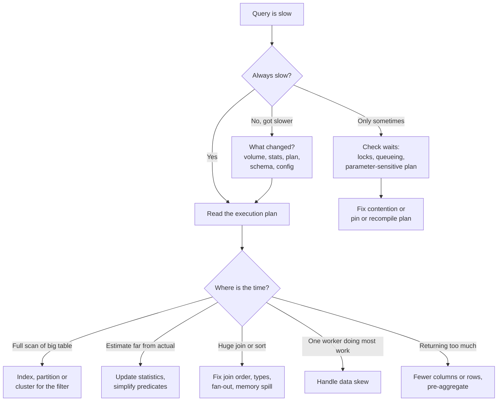

# Troubleshooting Slow SQL Queries

A methodical way to find out why a query is slow and fix it, on row-store databases (PostgreSQL, MySQL, SQL Server, Oracle) and on cloud warehouses (Snowflake, BigQuery, Redshift, Databricks SQL). The tools differ; the reasoning is the same.

---

## Start with the right question

"The query is slow" is a symptom. Before touching the query, find out which of these it is:

- **It was always slow.** The query, the data model or the indexes need work.
- **It used to be fast and got slow.** Something changed: data volume, data distribution, statistics, a plan change, a new index (or a dropped one), a configuration change, or another workload competing for resources.
- **It is slow sometimes.** Usually contention (locks, a busy warehouse, queueing) or a cached plan that suits some parameter values and not others.

These lead to different fixes, and guessing wastes hours. A few minutes of history (query logs, monitoring dashboards, "what deployed this week?") usually tells you which case you are in.



A decision path for slow queries. First establish whether the query was always slow, got slower, or is only slow sometimes. Intermittent slowness usually points to contention or plan instability. Otherwise read the plan and find where the time goes, which points to one of five common fixes.

---

## Step 1: Get the actual plan, not just the estimate

Every engine can show you how it intends to run a query (the estimated plan) and, after running it, what actually happened (the actual plan, with real row counts and timings). The actual plan is far more useful, because the most common cause of a bad plan is that the estimates were wrong.

| Engine | How to see what happened |
|---|---|
| PostgreSQL | `EXPLAIN (ANALYZE, BUFFERS) <query>` |
| MySQL 8 | `EXPLAIN ANALYZE <query>` |
| SQL Server | Include Actual Execution Plan, or Query Store for history |
| Oracle | `DBMS_XPLAN.DISPLAY_CURSOR` with runtime statistics |
| Snowflake | Query Profile in Snowsight, or `GET_QUERY_OPERATOR_STATS` |
| BigQuery | Execution details tab: stages, slot time, bytes shuffled |
| Redshift | `EXPLAIN`, plus `SVL_QUERY_SUMMARY` / `SYS_QUERY_DETAIL` for actuals |
| Databricks SQL | Query profile in the query history |

Be careful running `EXPLAIN ANALYZE` on a statement that modifies data; it really executes it. Wrap it in a transaction you roll back.

---

## Step 2: Read the plan

A plan is a tree of operators. Data flows from the leaves (table and index reads) up to the root (the result). Read it bottom-up, and look for the operator where most of the time or most of the rows are.

A trimmed PostgreSQL example:

```text
Hash Join  (cost=1250.00..98210.55 rows=120 width=48)
           (actual time=35.1..4210.7 rows=812440 loops=1)
  Hash Cond: (o.customer_id = c.customer_id)
  ->  Seq Scan on orders o  (rows=95 ...) (actual rows=812440 ...)
        Filter: (status = 'refunded' AND order_date >= '2026-01-01')
        Rows Removed by Filter: 41203311
  ->  Hash  (actual rows=500000 ...)
        ->  Seq Scan on customers c
```

What this tells you:

1. **The estimate was 95 rows; the actual was 812,440.** The planner thought the filter was very selective and chose a plan suited to a handful of rows. An estimate off by a factor of 1,000 or more is the headline finding. Causes: stale statistics, correlated columns (the planner assumes `status` and `order_date` are independent), or a function wrapped around the column.
2. **A sequential scan removed 41 million rows to keep 812,000.** That is a lot of reading to throw away; an index or partition pruning on `order_date` might avoid it.
3. **The join itself was fine**; the time is in reading `orders`.

The operators to recognize:

- **Seq Scan / Table Scan / Full Scan**: reads every row. Fine for small tables or when you need most rows; bad when you need a few.
- **Index Scan / Index Seek**: uses an index to find rows. **Index Only Scan** (or a covering index) avoids touching the table at all.
- **Bitmap Heap Scan** (PostgreSQL): collects matching row locations from an index, then reads the table pages in order. A middle ground.
- **Nested Loop**: for each row on one side, look up matches on the other. Great when the outer side is small and the inner side is indexed; terrible when both are large.
- **Hash Join**: build a hash table from one side, probe with the other. Good for large unsorted inputs; needs memory.
- **Merge Join**: both inputs sorted on the join key. Good when they already are.
- **Sort, Hash Aggregate, Window**: watch for "external merge", "spill" or "Disk" in the details, meaning the operation did not fit in memory.

In cloud warehouses the vocabulary differs but the questions are the same: which stage or operator took the most time, how many bytes or partitions were scanned versus the table total, how much data was shuffled between workers, and whether anything spilled to local or remote disk.

---

## Step 3: Match the symptom to a cause

### Reading far more than you need

**Symptoms:** full scans of large tables for selective queries; in warehouses, "partitions scanned" close to "partitions total"; BigQuery bytes processed close to table size.

**In a row store**, the usual fix is an index on the filter or join columns. Column order matters in a composite index: put equality columns first, then the range column. `(status, order_date)` serves `WHERE status = 'refunded' AND order_date >= ...` well; `(order_date, status)` less so. Include the selected columns (`INCLUDE` in PostgreSQL and SQL Server) to make it covering. See [Indexes explained](../../learn/concepts/indexes-explained.md).

**In a columnar warehouse**, there are no B-tree indexes to add (apart from search-optimization features). The levers are:

- **Partitioning** (BigQuery, Redshift sort and distribution keys, Delta and Iceberg partitions) on a column you almost always filter by, usually a date.
- **Clustering** (Snowflake clustering keys, BigQuery clustering, Databricks liquid clustering, Z-ordering) so related values sit in the same files, and per-file min/max statistics let the engine skip the rest.
- **Selecting fewer columns.** Columnar engines read only named columns; `SELECT *` on a 300-column table reads all 300.

**The predicate itself can defeat pruning.** A function on the column hides it from the index or the file statistics:

```sql
-- Cannot use an index or partition pruning on order_date
WHERE DATE(order_ts) = '2026-03-01'
WHERE EXTRACT(YEAR FROM order_date) = 2026
WHERE CAST(customer_id AS VARCHAR) = '42'

-- Can
WHERE order_ts >= '2026-03-01' AND order_ts < '2026-03-02'
WHERE order_date >= '2026-01-01' AND order_date < '2027-01-01'
WHERE customer_id = 42
```

The same applies to implicit type conversions (comparing a string column to a number), leading wildcards (`LIKE '%smith'`), and `OR` across different columns, which often forces a scan. These are "non-sargable" predicates, and rewriting them is often the cheapest fix there is.

### Bad estimates and stale statistics

**Symptoms:** estimated and actual row counts differ by orders of magnitude; nested loops over large inputs; a plan that changed after a big data load.

Planners choose plans from statistics: row counts, distinct values, value histograms. After a large load or delete, those can be badly out of date.

- PostgreSQL: `ANALYZE table_name;` and check `pg_stat_user_tables.last_autoanalyze`. For correlated columns, extended statistics (`CREATE STATISTICS ... (dependencies)`) help.
- SQL Server: `UPDATE STATISTICS`, and check auto-update thresholds on very large tables.
- MySQL: `ANALYZE TABLE`, and histograms for skewed columns.
- Cloud warehouses manage statistics automatically, but bad estimates still arise from complex expressions and correlated filters; simplifying the predicate or materializing an intermediate result often helps.

### Joins that explode

**Symptoms:** a join produces far more rows than either input; a final `DISTINCT` or `GROUP BY` that collapses a huge intermediate result.

Usually a **fan-out**: joining on a key that is not unique on one side. Joining orders to order lines to shipments multiplies rows, and someone adds `DISTINCT` to hide it. Check the grain of every table in the join, aggregate the many-side before joining, and remove the `DISTINCT` once the join is correct. See [SQL joins explained](../../learn/concepts/sql-joins-explained.md).

Other join problems: **mismatched types** on join keys (an integer joined to a string forces a conversion on every row and blocks index use), and **joining on expressions** (`ON LOWER(a.email) = LOWER(b.email)`), which blocks indexes unless you build an expression index.

### Memory spills

**Symptoms:** "external merge Disk", "spilled to local storage", "bytes spilled to remote storage" in the plan; sorts and hash joins taking much longer than their row counts suggest.

The operation needed more memory than it was given and wrote intermediate data to disk.

- Reduce the input: filter earlier, select fewer columns, pre-aggregate.
- PostgreSQL: `work_mem` is per operation per connection; raise it for the session running the heavy report, not globally.
- Snowflake: a larger warehouse size gives more memory per query; remote spill is a strong signal to size up or split the query.
- BigQuery: slot contention and shuffle limits; break very large queries into stages with intermediate tables.

### Data skew

**Symptoms (distributed engines):** one worker or slot runs far longer than the rest; in a stage summary, max time is many times the median. One key (a test account, a null, a default value like `'unknown'`) holds a huge share of rows.

Find it by counting the join or group key:

```sql
SELECT customer_id, COUNT(*) AS n
FROM orders
GROUP BY customer_id
ORDER BY n DESC
LIMIT 20;
```

Fixes: filter out junk keys (nulls, test accounts) before the join, handle the hot key separately and union the result, or rely on engine skew handling (Spark adaptive query execution, covered in [Spark job performance](./spark-job-performance.md)). In Redshift, a poor distribution key concentrates a table on a few slices; choose a high-cardinality key or `DISTSTYLE AUTO`.

### Contention, not the query

**Symptoms:** the plan is fine and the query is fast when run alone, but slow in production.

- **Locks:** in PostgreSQL check `pg_stat_activity` and `pg_locks` for waiting sessions; in SQL Server, the blocking session in `sys.dm_exec_requests`. A long-running transaction holding locks blocks everyone behind it. See [Transactions and ACID](../../learn/concepts/transactions-and-acid.md).
- **Queueing:** Snowflake shows queued time per query; a multi-cluster warehouse or a separate warehouse for the heavy workload helps. Redshift workload management queues and BigQuery slot reservations play the same role.
- **Parameter-sensitive plans:** a cached plan compiled for a rare parameter value is reused for a common one (SQL Server "parameter sniffing"; PostgreSQL generic plans after five executions). Fixes include recompiling for that statement, plan guides or forcing in Query Store, or splitting the query by case.

---

## Step 4: Change one thing, measure again

Apply one fix at a time and rerun with the actual plan. Compare rows read, time and bytes scanned, not just wall-clock time, which varies with caching. In warehouses, disable or account for the result cache (`USE_CACHED_RESULT = FALSE` in Snowflake for testing) or you will measure a cache hit.

Write down what you changed and what it did. Six months later, someone will ask why that index exists.

---

## Step 5: Prevent the next one

- **Track slow queries continuously.** PostgreSQL `pg_stat_statements`, SQL Server Query Store, MySQL performance schema, and the query history views in every warehouse let you sort by total time (frequency times duration). The query that runs 50,000 times a day at 200 ms matters more than the monthly report at 3 minutes.
- **Alert on regressions**, not just absolute slowness: the same query fingerprint taking 5 times longer than last week.
- **Review plans for new heavy queries** before they ship, especially those behind dashboards that refresh often.
- **Model for the queries you run.** A gold table pre-aggregated for a dashboard beats any amount of tuning of a query over raw events. See [OLTP vs OLAP](../../learn/concepts/oltp-vs-olap.md) and [Medallion architecture](../architecture-patterns/medallion-architecture.md).

---

## Vendor references

- **[📖 PostgreSQL: Using EXPLAIN](https://www.postgresql.org/docs/current/using-explain.html)** - reading plans, estimates versus actuals, and `ANALYZE`
- **[📖 PostgreSQL: pg_stat_statements](https://www.postgresql.org/docs/current/pgstatstatements.html)** - tracking execution statistics for every query
- **[📖 MySQL 8.4: EXPLAIN statement](https://dev.mysql.com/doc/refman/8.4/en/explain.html)** - plan output and `EXPLAIN ANALYZE`
- **[📖 SQL Server: Monitor performance by using the Query Store](https://learn.microsoft.com/en-us/sql/relational-databases/performance/monitoring-performance-by-using-the-query-store)** - plan history, regressions and plan forcing
- **[📖 Snowflake: Monitor query activity and Query Profile](https://docs.snowflake.com/en/user-guide/ui-snowsight-activity)** - operator statistics, pruning and spilling
- **[📖 BigQuery: Query plan and timeline](https://docs.cloud.google.com/bigquery/docs/query-plan-explanation)** - stages, slot time and shuffle
- **[📖 Amazon Redshift: Query plan](https://docs.aws.amazon.com/redshift/latest/dg/c-the-query-plan.html)** - reading Redshift plans and distribution steps

---

## Related

- [Spark job performance](./spark-job-performance.md) - the same problems in Spark: shuffle, skew and spills
- [Failing and late pipelines](./failing-and-late-pipelines.md) - when the slow query is inside a pipeline
- [Indexes explained](../../learn/concepts/indexes-explained.md)
- [File formats and partitioning](../../learn/concepts/file-formats-and-partitioning.md)
