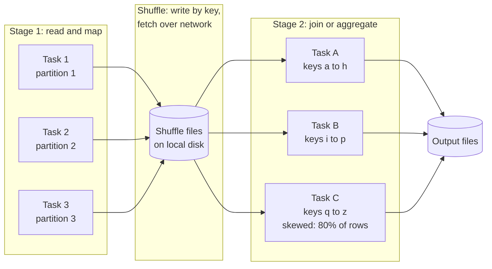

# Troubleshooting Spark Job Performance

Why Spark jobs get slow or fail with out-of-memory errors, how to find the cause in the Spark UI, and the fixes for the usual suspects: shuffles, data skew, small files, memory spills and bad partitioning. Applies to open-source Spark and the managed versions (Databricks, Amazon EMR and Glue, Google Dataproc, Azure Synapse and Fabric).

---

## A mental model in one paragraph

Spark splits your job into **stages** separated by **shuffles**. Inside a stage, each **task** processes one partition of data on one executor core, independently. A shuffle happens when rows must be regrouped by key (joins, `groupBy`, `distinct`, window functions with `partitionBy`, `repartition`): every task writes its output split by key to local disk, and the next stage's tasks fetch their piece over the network. So the cost of a Spark job is driven by: how much data each stage reads, how much it shuffles, how evenly the work is spread across tasks, and whether each task's working set fits in memory. Almost every performance problem is one of those four.



How a Spark job runs. Tasks in the first stage each read one partition and write shuffle files split by key. Tasks in the next stage fetch the keys they own and join or aggregate them. If one key range holds most of the rows (Task C here), that one task runs far longer than the others and the whole stage waits for it.

---

## Step 1: Find where the time goes

Do not tune configuration by guesswork. Open the **Spark UI** (on Databricks, the cluster's Spark UI and the query profile; on EMR, the persistent Spark history server; on Dataproc, the component gateway) and work through it in this order.

**Jobs and Stages tabs.** Sort stages by duration. Usually one or two stages account for most of the run. For the slow stage, look at:

- **Input** and **Shuffle Read / Shuffle Write** sizes. Large shuffle volume is the first suspect.
- **Spill (Memory) and Spill (Disk).** Any spill means tasks ran out of execution memory.
- **Task summary metrics**: min, 25th percentile, median, 75th percentile and max for duration and shuffle read size. If max is ten times the median, you have **skew**.
- **Number of tasks.** Tens of thousands of tiny tasks means too many partitions or small files; a handful of huge tasks means too few.

**SQL / DataFrame tab.** Shows the physical plan as a graph with per-operator metrics: rows output, files read, partitions pruned, time in each join. This is where you check whether a filter was pushed down, whether a broadcast join happened, and how many files were scanned.

**Executors tab.** GC time as a large fraction of task time means memory pressure. Failed tasks and lost executors point to out-of-memory kills (on YARN or Kubernetes the container is killed when it exceeds its memory limit, often reported as exit code 137 or "Container killed by YARN for exceeding memory limits").

Calling `df.explain("formatted")` before running shows the plan too, and is a quick way to spot a missing broadcast or an unexpected `Exchange` (shuffle).

---

## Problem 1: Too much shuffle

**Symptoms:** stages with shuffle read or write in the tens or hundreds of gigabytes; network and disk time dominating; long stages after joins and aggregations.

**Fixes, roughly in order of payoff:**

**Read less in the first place.** Filter and select columns as early as possible so less data reaches the shuffle. With Parquet, Delta and Iceberg, filters on partition columns prune whole directories, and filters on other columns use file-level min and max statistics to skip files. Check the scan node in the SQL tab: "files read" versus "files total". Avoid UDFs in filters; Spark cannot push a Python UDF down into the scan.

**Broadcast small tables.** Joining a 500 GB fact table to a 50 MB dimension should not shuffle the fact table. A **broadcast hash join** sends the small table to every executor and joins locally. Spark does this automatically below `spark.sql.autoBroadcastJoinThreshold` (10 MB by default), and adaptive query execution (AQE) can switch to a broadcast at runtime when a side turns out small after filtering. For tables a little larger, raise the threshold or use a hint:

```python
from pyspark.sql.functions import broadcast
result = facts.join(broadcast(dim_customer), "customer_id")
```

Do not broadcast large tables: the driver collects the table first, and a 2 GB broadcast can crash it.

**Aggregate before you join.** If you need daily totals per customer joined to customer attributes, aggregate the facts to customer and day first, then join the much smaller result.

**Avoid unnecessary shuffles.** `repartition()` always shuffles; `coalesce()` reduces partitions without a full shuffle. Repeated `distinct()` or `orderBy()` in the middle of a pipeline each cost a shuffle; only sort at the end, if at all.

**Bucketing or clustered layouts** for tables that are joined on the same key over and over. Bucketed Hive tables let Spark skip the shuffle on join; on Delta and Iceberg, liquid clustering or sort orders help file skipping more than they eliminate shuffles.

---

## Problem 2: Data skew

**Symptoms:** a stage where most tasks finish in seconds and a few run for many minutes; max shuffle read per task far above the median; the job sits at "199 of 200 tasks complete" for a long time.

Skew happens when one key holds a disproportionate share of rows: nulls, a default value like `'unknown'` or `-1`, a test account, a giant customer, or a popular product. All rows for a key go to the same task in a shuffle, so one task does most of the work.

**Find the hot keys:**

```python
(df.groupBy("customer_id").count()
   .orderBy("count", ascending=False)
   .show(20))
```

**Fixes:**

1. **Remove junk keys.** If the hot key is null or a placeholder, filter it out before the join (nulls never match in an inner join anyway) and handle those rows separately if they are needed.
2. **Let AQE split skewed partitions.** With `spark.sql.adaptive.enabled` (on by default since Spark 3.2) and `spark.sql.adaptive.skewJoin.enabled`, Spark detects shuffle partitions much larger than the median and splits them into smaller tasks for sort-merge joins. It handles moderate skew well. Check the SQL tab for a "skew" annotation on the join to confirm it kicked in.
3. **Broadcast** if the other side is small; a broadcast join has no shuffle, so no skew.
4. **Salt the key** for extreme cases. Add a random number from 0 to N-1 to the hot key on the big side, replicate the matching rows on the small side N times, and join on key plus salt. This spreads the hot key over N tasks. It costs complexity and replication, so use it only where AQE does not cope.
5. **Split the hot keys out.** Process the top few keys in a separate job or with a broadcast, process everything else normally, and union the results.

Skew also affects aggregations and window functions partitioned by a hot key. For aggregations, two-phase aggregation (aggregate by key plus salt, then by key) helps; Spark already does partial aggregation before the shuffle for most built-in aggregate functions.

---

## Problem 3: Small files (and huge files)

**Symptoms:** a scan stage with tens of thousands of tasks each reading a few kilobytes; jobs where listing files or planning takes minutes before any task starts; streaming tables that get slower to query every day.

Every file costs a metadata lookup, an open, and a task or part of one. Ten million 100 KB files are dramatically slower to read than a thousand 1 GB files with the same data. Small files come from streaming writes (each micro-batch writes files), high-cardinality partitioning (partitioning by `customer_id` instead of `date`), and many parallel tasks each writing a little to every partition.

**Fixes:**

- **Compact regularly.** Delta Lake `OPTIMIZE`, Iceberg's `rewrite_data_files` procedure, Hudi clustering. On Databricks, auto compaction and optimized writes do much of this automatically; predictive optimization can schedule it.
- **Partition coarsely.** Partition by date (or by date and one low-cardinality column), not by anything with thousands of values. A good rule of thumb is that each partition should hold at least a gigabyte or so of data; otherwise do not partition by that column at all and rely on clustering. Databricks recommends liquid clustering over partitioning for most new tables. See [File formats and partitioning](../../learn/concepts/file-formats-and-partitioning.md).
- **Control output file count.** Before writing, `repartition()` by the partition column so each task writes to one partition, or rely on AQE's coalescing of shuffle partitions plus `spark.sql.files.maxRecordsPerFile`. For streaming, use longer trigger intervals if latency allows.
- **Expire old snapshots** on table formats, or the metadata (and storage bill) grows with every write.

The opposite problem, a few huge unsplittable files (a 50 GB gzip CSV), forces one task per file. Gzip is not splittable; convert such inputs to Parquet once, early, and work from that.

---

## Problem 4: Memory spills and out-of-memory errors

**Symptoms:** "Spill (Disk)" in the stage metrics; high GC time; executors lost with OOM or container-killed errors; driver crashes with `java.lang.OutOfMemoryError` or "Total size of serialized results is bigger than spark.driver.maxResultSize".

First decide whether the problem is the **driver** or the **executors**.

**Driver OOM** almost always comes from pulling data to the driver: `collect()`, `toPandas()` on a large DataFrame, a broadcast of a table that is too big, or a very large query plan (thousands of columns or deeply chained transformations in a loop). Fix the code: write results to a table instead of collecting, aggregate before `toPandas()`, and break very long plans with a checkpoint or an intermediate write.

**Executor spill and OOM** happen when a task's working set (a hash table for a join or aggregation, a sort buffer, a window) exceeds its memory share. Fixes:

- **More, smaller partitions.** Each task handles less data. With AQE, `spark.sql.adaptive.coalescePartitions.enabled` merges small shuffle partitions automatically, and you can set a higher initial `spark.sql.shuffle.partitions` (default 200) for big jobs so AQE has room to work. A target of roughly 100 to 200 MB of shuffle data per task is a reasonable starting point.
- **Fix skew** (above). One skewed task spilling is a skew problem, not a memory problem.
- **Right-size executors.** Very large executors with many cores share memory between many concurrent tasks and suffer long GC pauses; very small ones cannot hold a single task's data. Four to five cores per executor is a common starting point on self-managed clusters. On YARN and Kubernetes, `spark.executor.memoryOverhead` covers off-heap usage; Python UDFs and pandas UDFs use memory outside the JVM, so PySpark jobs often need more overhead.
- **Use built-in functions over Python UDFs.** Built-in functions run in the JVM (or the native engine, on platforms like Databricks Photon or with Spark's newer vectorized paths), with no serialization to Python. When you need Python, pandas UDFs (Arrow-based, vectorized) are much cheaper than row-by-row UDFs.
- **Cache deliberately.** `cache()` on a DataFrame used once wastes memory that execution needs. Cache only what is reused, and `unpersist()` when done.

---

## Problem 5: The plan is not what you think

Sometimes the slow job is doing work you did not intend.

- **Recomputing lineage.** A DataFrame used in three actions is computed three times unless cached or written out.
- **Cartesian products.** A join with a missing or always-true condition produces rows-times-rows output. Spark blocks explicit cross joins by default unless allowed, but a join on a column that is null on both sides or a typo can still blow up. Check rows output per operator in the SQL tab.
- **Exploding arrays** multiply row counts; check them early.
- **Type mismatches** in join keys (string versus integer) can block broadcast and pushdown and produce wrong results. Cast once, early.
- **Window functions without `partitionBy`** move all data to a single partition. Spark logs a warning ("No Partition Defined for Window operation"); take it seriously.

---

## A tuning checklist

Work through these in order and stop when the job is fast enough:

1. Is AQE on? (It is by default on Spark 3.2 and later and on managed platforms.)
2. Does the scan read only the needed columns and prune partitions or files?
3. Are small dimension tables broadcast?
4. Is there skew in any stage (max task time far above median)?
5. Is anything spilling? Is GC time high?
6. Are input files reasonably sized (hundreds of megabytes to about a gigabyte), and are output files?
7. Are there Python UDFs that could be built-in functions?
8. Is the cluster right-sized, and does autoscaling help or just add startup delay?

Change one thing at a time, rerun on the same input, and compare stage metrics, not just total duration.

---

## Vendor references

- **[📖 Spark SQL performance tuning](https://spark.apache.org/docs/latest/sql-performance-tuning.html)** - AQE, skew join handling, broadcast thresholds, partition coalescing
- **[📖 Spark web UI](https://spark.apache.org/docs/latest/web-ui.html)** - what each tab and metric means
- **[📖 Spark configuration](https://spark.apache.org/docs/latest/configuration.html)** - memory, shuffle and executor settings
- **[📖 Spark tuning guide](https://spark.apache.org/docs/latest/tuning.html)** - memory management, serialization and garbage collection
- **[📖 Delta Lake optimizations](https://docs.delta.io/optimizations-oss/)** - `OPTIMIZE`, Z-ordering and file compaction
- **[📖 Databricks liquid clustering](https://docs.databricks.com/aws/en/tables/clustering)** - clustering as an alternative to partitioning
- **[📖 Iceberg table maintenance](https://iceberg.apache.org/docs/latest/maintenance/)** - compaction, snapshot expiry and orphan file cleanup

---

## Related

- [Slow SQL query diagnosis](./slow-sql-query-diagnosis.md) - the same reasoning for SQL engines
- [Failing and late pipelines](./failing-and-late-pipelines.md) - when a Spark job is the late step
- [File formats and partitioning](../../learn/concepts/file-formats-and-partitioning.md)
- [Lakehouse architecture](../architecture-patterns/lakehouse-architecture.md)
