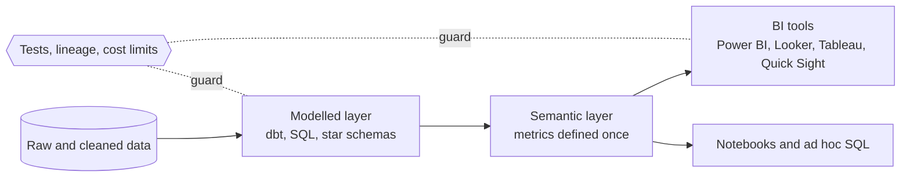

# Analytics and BI

The part of the data platform people actually look at: modelled tables, metrics with one agreed definition, and dashboards that do not take a minute to load. The work sits between the pipeline and the decision, and it is mostly about shape (a star schema), trust (tests and lineage) and cost (what each dashboard refresh scans).

From raw tables to a dashboard. The modelled layer and a shared set of metric definitions are where analytics engineering lives; tests and cost controls keep the numbers right and the bill bounded.

---

## Learn

- [Data modeling for analytics](../learn/concepts/data-modeling-for-analytics.md) - star schemas, grain, slowly changing dimensions
- [Slowly changing dimensions](../learn/concepts/slowly-changing-dimensions.md) - Type 1 vs Type 2, and keeping history honest
- [Analytics engineering and dbt](../learn/concepts/analytics-engineering-and-dbt.md) - transformation SQL with tests, code review and lineage
- [SQL joins explained](../learn/concepts/sql-joins-explained.md) - join types and fan-out, the usual cause of a wrong total
- [Window functions explained](../learn/concepts/window-functions-explained.md) - running totals, rankings, latest row per key
- [OLTP vs OLAP](../learn/concepts/oltp-vs-olap.md) - why analytics runs on a different store
- [Warehouses, lakes, and lakehouses](../learn/concepts/warehouses-lakes-lakehouses.md) - where the modelled tables live
- [Data quality and lineage](../learn/concepts/data-quality-and-lineage.md) - catching a wrong number before a dashboard shows it
- [Warehouse cost control](../learn/concepts/warehouse-cost-control.md) - scan and compute cost, with hard limits
- [Feature stores for data engineers](../learn/concepts/feature-stores-for-data-engineers.md) - the same metrics, served to models
- [Day one: your first SQL query](../learn/day-one/first-sql-query.md) - the on-ramp if you have not written SQL yet

---

## Compare

- [BI tools](../resources/service-comparison-bi-tools.md) - Power BI, Looker, Tableau, Quick Sight, Superset
- [Data warehouses](../resources/service-comparison-warehouses.md) - Redshift, Fabric, BigQuery, Snowflake, Databricks SQL
- [ETL and orchestration](../resources/service-comparison-etl-orchestration.md) - dbt, Dagster, Airflow and managed options

---

## Reference

- [Architecture pattern: semantic layer](../resources/architecture-patterns/semantic-layer.md) - metrics defined once for BI, notebooks and AI
- [Architecture pattern: medallion](../resources/architecture-patterns/medallion-architecture.md) - bronze, silver and gold, and what belongs in each
- [Architecture pattern: reverse ETL](../resources/architecture-patterns/reverse-etl-operational-analytics.md) - modelled data back into operational tools
- [Troubleshooting: slow SQL queries](../resources/troubleshooting/slow-sql-query-diagnosis.md) - plans, indexes, pruning
- [Interview: analytics engineer](../resources/interview-prep/analytics-engineer-interview.md) - dbt layering, incremental models, tests, SCDs and metrics
- [Interview: SQL](../resources/interview-prep/sql-interview-guide.md) - the query patterns analytics roles are tested on

---

## Build

- [Design a star schema](../resources/hands-on-projects/design-star-schema.md) - from business questions to grain, facts and dimensions
- [Build a dbt project](../resources/hands-on-projects/build-dbt-project.md) - a tested star schema with snapshots, contracts and CI
- [Orchestrate a pipeline with Dagster](../resources/hands-on-projects/airflow-or-dagster-pipeline.md) - partitions, a quality check and safe reruns

---

## Certify

- [Power BI Data Analyst (PL-300)](../exams/azure/pl-300/)
- [Azure Fabric Analytics Engineer (DP-600)](../exams/azure/dp-600/)
- [Snowflake SnowPro Core (COF-C03)](../exams/snowflake/snowpro-core/)
- [Snowflake SnowPro Advanced Architect](../exams/snowflake/snowpro-advanced-architect/)
- [Databricks Data Engineer Associate](../exams/databricks/data-engineer-associate/) - SQL warehouses and dashboards

## Roadmap

The ordered paths are the **[Data Analyst roadmap](../resources/certification-roadmap-data-analyst.md)** and the **[Analytics Engineer roadmap](../resources/certification-roadmap-analytics-engineer.md)**.

---

Related topics: **[Data engineering](./data-engineering.md)** for how data reaches the modelled layer, and **[Data governance](./data-governance.md)** for who may see which column.
