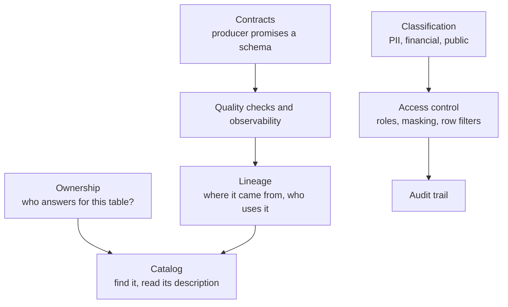

# Data governance

Who owns a dataset, what is in it, who may see it, how it got there, and how anyone knows it is right. Governance is not a tool you buy. It is a short list of habits (owners, classifications, contracts, checks) and a catalog that makes them findable.

The pieces of governance and how they depend on each other. Ownership and classification come first; the catalog, access control, quality checks and lineage are how they are enforced and discovered.

---

## Learn

- [Data governance and catalogs](../learn/concepts/data-governance-and-catalogs.md) - owners, classification, access and discovery
- [Data contracts](../learn/concepts/data-contracts.md) - producer-consumer agreements enforced in CI
- [Data quality and lineage](../learn/concepts/data-quality-and-lineage.md) - assertions, and tracing a number back to its source
- [Data observability](../learn/concepts/data-observability.md) - freshness, volume and schema monitoring
- [Backup and point-in-time restore](../learn/concepts/backup-and-point-in-time-restore.md) - the recovery half of data protection
- [Slowly changing dimensions](../learn/concepts/slowly-changing-dimensions.md) - keeping history so an audit can ask "what did we know then?"

---

## Compare

- [Data warehouses](../resources/service-comparison-warehouses.md) - the access-control and masking features differ per platform
- [Databases (cloud-native)](../resources/service-comparison-databases.md) - encryption, auditing and backup options per service

---

## Reference

- [Architecture pattern: data mesh](../resources/architecture-patterns/data-mesh.md) - federated ownership, data products and computational governance
- [Architecture pattern: medallion](../resources/architecture-patterns/medallion-architecture.md) - where raw, PII-bearing data stops being visible
- [Architecture pattern: semantic layer](../resources/architecture-patterns/semantic-layer.md) - one definition per metric
- [Postmortem: GitLab database incident, 2017](../resources/postmortem-gitlab-database-2017.md) - backups nobody had restored
- [Postmortem: Atlassian site deletion, 2022](../resources/postmortem-atlassian-site-deletion-2022.md) - a deletion script, and recovery at scale
- [Compliance guides](https://security.noblerworks.com/resources/compliance-guides/) - GDPR and the rest, where lineage stops being optional
- [Identity and IAM](https://security.noblerworks.com/topics/iam/) - the access-control foundations on the security site

---

## Build

- [Build a dbt project](../resources/hands-on-projects/build-dbt-project.md) - tests, contracts and lineage in code
- [Backup and restore drill](../resources/hands-on-projects/backup-and-restore-drill.md) - prove a backup restores before you need it
- [Design a star schema](../resources/hands-on-projects/design-star-schema.md) - declared grain and conformed dimensions are governance too

---

## Certify

- [Databricks Data Engineer Professional](../exams/databricks/data-engineer-professional/) - Unity Catalog permissions, lineage and masking
- [Databricks Data + AI Platform Administrator Accreditation](../exams/databricks/lakehouse-platform-administrator/)
- [Snowflake SnowPro Advanced Administrator](../exams/snowflake/snowpro-advanced-administrator/) - roles, masking and row access policies
- [Snowflake SnowPro Core (COF-C03)](../exams/snowflake/snowpro-core/)
- [GCP Professional Data Engineer](../exams/gcp/data-engineer/) - data security and governance sections
- [AWS Data Engineer Associate (DEA-C01)](../exams/aws/associate/data-engineer-dea-c01/) - security and governance domain

---

Related topics: **[Data engineering](./data-engineering.md)** for the pipelines these controls sit on, and **[Analytics and BI](./analytics-and-bi.md)** for where the governed data is consumed.
