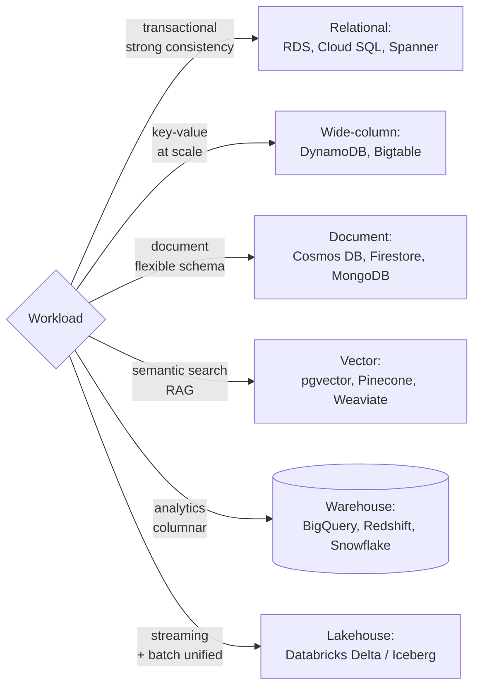

# Databases

SQL, NoSQL, vector databases, data warehouses, lakehouses. The choice is rarely "which database" - it's "which database for which workload."

---

## Learn

- [SQL joins explained](../learn/concepts/sql-joins-explained.md) - join types, fan-out, and how engines execute joins
- [Window functions explained](../learn/concepts/window-functions-explained.md) - latest row per key, running totals, rankings
- [Indexes explained](../learn/concepts/indexes-explained.md) - B-trees, composite and covering indexes, reading a plan
- [Transactions and ACID](../learn/concepts/transactions-and-acid.md) - isolation levels, write skew, MVCC
- [OLTP vs OLAP](../learn/concepts/oltp-vs-olap.md) - row stores vs column stores, and why both exist
- [Replication and sharding](../learn/concepts/replication-and-sharding.md) - replicas, failover, shard keys, distributed SQL
- [Eventual consistency](../learn/concepts/eventual-consistency.md) - CAP, when EC is fine, when it bites
- [Idempotency explained](https://cloud.noblerworks.com/learn/concepts/idempotency-explained/) - retries, idempotency keys, common patterns
- [Queues vs streams](../learn/concepts/queues-vs-streams.md) - SQS vs Kinesis (and equivalents), ordering, replay
- [Vector databases for data engineers](../learn/concepts/vector-databases-for-data-engineers.md) - where vectors can live and how to keep the index in sync
- [Embeddings and vector search](https://ai.noblerworks.com/learn/concepts/embeddings-and-vector-search/) - vector DB basics, the AI side
- [Warehouses, lakes, and lakehouses](../learn/concepts/warehouses-lakes-lakehouses.md) - the analytical stores
- [Data modeling for analytics](../learn/concepts/data-modeling-for-analytics.md) - star schemas, grain, SCD types
- [Change data capture](../learn/concepts/change-data-capture.md) - streaming every change out of an operational database

For how data gets into these stores - pipelines, ETL/ELT, batch vs streaming, partitioning, quality - see the [Data engineering topic](./data-engineering.md).

---

## Compare

- [Databases (cloud-native)](../resources/service-comparison-databases.md) - RDS vs Cloud SQL vs SQL Database, DynamoDB vs Cosmos DB vs Firestore, BigQuery vs Redshift vs Synapse
- [Vector databases](https://ai.noblerworks.com/tools/decisions/vector-database/) - Pinecone, Weaviate, Qdrant, Milvus, pgvector, OpenSearch, Vertex Vector Search

---

## Reference

- [Architecture pattern: Data Pipeline / ETL](../resources/architecture-patterns/data-pipeline-etl.md)
- [Architecture pattern: Lakehouse](../resources/architecture-patterns/lakehouse-architecture.md)
- [Architecture pattern: Data Mesh](../resources/architecture-patterns/data-mesh.md)
- [Architecture pattern: CQRS / Event Sourcing](https://cloud.noblerworks.com/resources/architecture-patterns/cqrs-event-sourcing/)
- [Architecture pattern: CDC into a lakehouse](../resources/architecture-patterns/cdc-to-lakehouse.md)
- [Migration: database](../resources/migration-guides/database-migration.md)
- [Migration: legacy warehouse to cloud](../resources/migration-guides/warehouse-to-cloud-migration.md)
- [Troubleshooting: slow SQL queries](../resources/troubleshooting/slow-sql-query-diagnosis.md) - reading plans, indexes, statistics and skew
- [Interview: SQL worked problems](../resources/interview-prep/sql-interview-guide.md)

---

## Build

- [Build a data pipeline](../resources/hands-on-projects/build-data-pipeline.md)
- [Design a star schema](../resources/hands-on-projects/design-star-schema.md) - dimensional design in DuckDB
- [Build a dbt project](../resources/hands-on-projects/build-dbt-project.md) - the same model as tested code
- [Build a RAG pipeline](https://ai.noblerworks.com/build/projects/build-rag-pipeline/) - exercises pgvector

---

## Certify

**Cloud-side data certs**
- [AWS Data Engineer Associate (DEA-C01)](../exams/aws/associate/data-engineer-dea-c01/)
- [AWS Database Specialty (DBS-C01)](../exams/aws/specialty/database-dbs-c01/) - retired, retained for credential holders
- [AWS Data Analytics Specialty (DAS-C01)](../exams/aws/specialty/data-analytics-das-c01/) - retired, retained
- [Azure Data Engineer (DP-203)](../exams/azure/dp-203/)
- [Azure Database Administrator (DP-300)](../exams/azure/dp-300/)
- [Azure Cosmos DB AI Developer Associate (DP-420)](../exams/azure/dp-420/)
- [Azure Fabric Analytics Engineer (DP-600)](../exams/azure/dp-600/)
- [Azure Fabric Data Engineer (DP-700)](../exams/azure/dp-700/)
- [GCP Data Engineer](../exams/gcp/data-engineer/)
- [GCP Cloud Database Engineer](../exams/gcp/cloud-database-engineer/)

**Vendor-specific**
- [Databricks Data Engineer Associate](../exams/databricks/data-engineer-associate/)
- [Databricks Data Engineer Professional](../exams/databricks/data-engineer-professional/)
- [Snowflake SnowPro Core](../exams/snowflake/snowpro-core/)
- [Snowflake SnowPro Advanced Architect](../exams/snowflake/snowpro-advanced-architect/)
- [Snowflake SnowPro Advanced Data Engineer](../exams/snowflake/snowpro-advanced-data-engineer/)
- [Snowflake SnowPro Advanced Administrator](../exams/snowflake/snowpro-advanced-administrator/)
- [MongoDB Associate Developer](../exams/mongodb/associate-developer/)
- [MongoDB Associate DBA](../exams/mongodb/associate-dba/)
- [MongoDB Associate Atlas Administrator](../exams/mongodb/associate-atlas-administrator/)
- [Confluent Certified Developer for Apache Kafka](../exams/confluent/certified-developer/)
- [Confluent Certified Administrator for Apache Kafka](../exams/confluent/certified-administrator/)

---

## Roadmap

Career paths live in the **[Data Engineer roadmap](../resources/certification-roadmap-data-engineer.md)** and **[Database Specialist roadmap](../resources/certification-roadmap-database-specialist.md)**.
