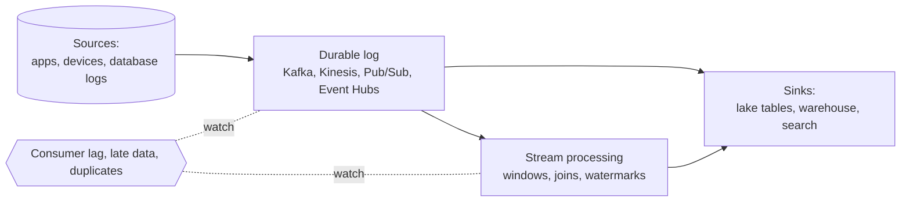

# Streaming

Data that is processed as it arrives instead of in nightly batches: events on a log, changes read from a database, windows that close when a watermark says they are done. The hard parts are not the speed. They are ordering, late data, duplicates, and knowing how far behind you are.

The shape of a streaming system. A durable log decouples producers from consumers, processing turns events into results, and three things (lag, lateness and duplicates) decide whether the output can be trusted.

---

## Learn

- [Batch vs streaming](../learn/concepts/batch-vs-streaming.md) - event time, watermarks, and when streaming is not worth it
- [Queues vs streams](../learn/concepts/queues-vs-streams.md) - ordering, partitions, replay, and why a stream is a log
- [Stream processing: windows and watermarks](../learn/concepts/stream-processing-windows-and-watermarks.md) - when a window is finished, and what to do with late data
- [Change data capture](../learn/concepts/change-data-capture.md) - turning a database's own log into a stream of changes
- [Eventual consistency](../learn/concepts/eventual-consistency.md) - why two readers can briefly disagree
- [Idempotency explained](https://cloud.noblerworks.com/learn/concepts/idempotency-explained/) - the property that makes at-least-once delivery safe

---

## Compare

- [Messaging and queues](../resources/service-comparison-messaging-queues.md) - Kafka, Kinesis, Pub/Sub, Event Hubs, SQS
- [ETL and orchestration](../resources/service-comparison-etl-orchestration.md) - where streaming jobs sit next to batch ones

---

## Reference

- [Architecture pattern: streaming analytics](../resources/architecture-patterns/streaming-analytics.md) - Lambda vs Kappa, and the lakehouse hybrid
- [Architecture pattern: CDC into a lakehouse](../resources/architecture-patterns/cdc-to-lakehouse.md) - Debezium, DMS or Datastream into Delta or Iceberg
- [Architecture pattern: event-driven architecture](https://cloud.noblerworks.com/resources/architecture-patterns/event-driven-architecture/)
- [Troubleshooting: Kafka consumer lag](../resources/troubleshooting/kafka-consumer-lag.md) - reading lag, skew, rebalances and offset resets, run on a real broker
- [Troubleshooting: failing and late pipelines](../resources/troubleshooting/failing-and-late-pipelines.md) - triage, retries and backfills
- [Troubleshooting: replication lag](../resources/troubleshooting/replication-lag.md) - the same "how far behind" question for a database replica

---

## Build

- [Build a streaming pipeline](../resources/hands-on-projects/build-streaming-pipeline.md) - Kafka into a Parquet lake, event-time windows, a watermark and a reconciliation
- [Change data capture with Debezium into a lakehouse](../resources/hands-on-projects/debezium-cdc-to-lakehouse.md) - PostgreSQL changes into Iceberg, with a replay test
- [Build an Iceberg lakehouse locally](../resources/hands-on-projects/iceberg-lakehouse-local.md) - the table format the streams land in

---

## Certify

- [Confluent Certified Developer for Apache Kafka](../exams/confluent/certified-developer/)
- [Confluent Certified Administrator for Apache Kafka](../exams/confluent/certified-administrator/)
- [AWS Data Engineer Associate (DEA-C01)](../exams/aws/associate/data-engineer-dea-c01/) - Kinesis and MSK streaming
- [GCP Professional Data Engineer](../exams/gcp/data-engineer/) - Pub/Sub and Dataflow
- [Azure Fabric Data Engineer (DP-700)](../exams/azure/dp-700/) - Real-Time Intelligence and Eventstreams

---

Related topics: **[Data engineering](./data-engineering.md)** for the batch side of the same platform, and **[Databases](./databases.md)** for the stores that streams are read from and written to.
